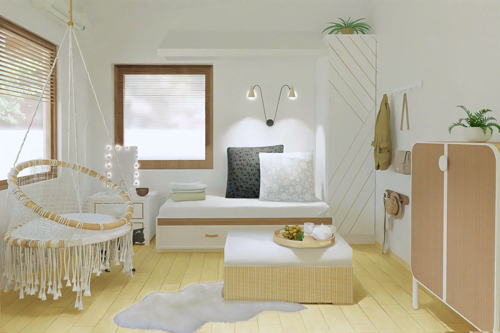
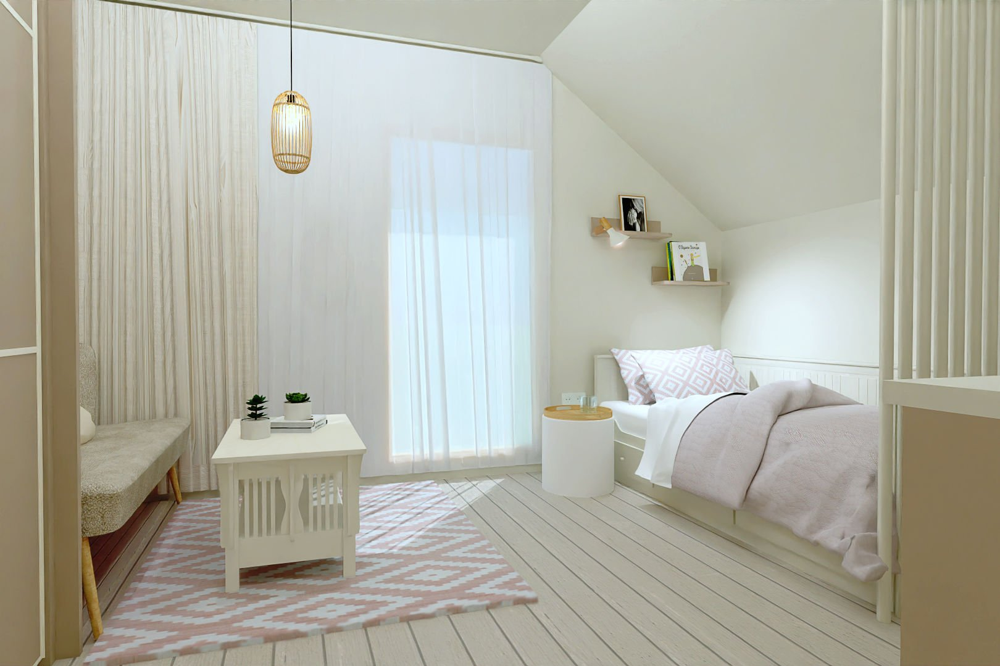
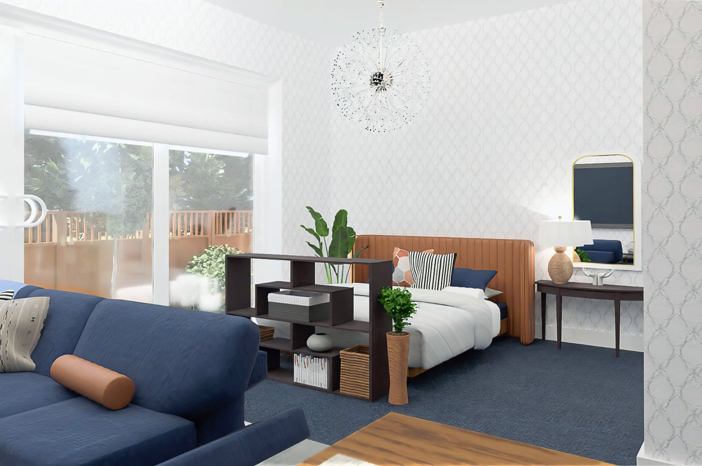
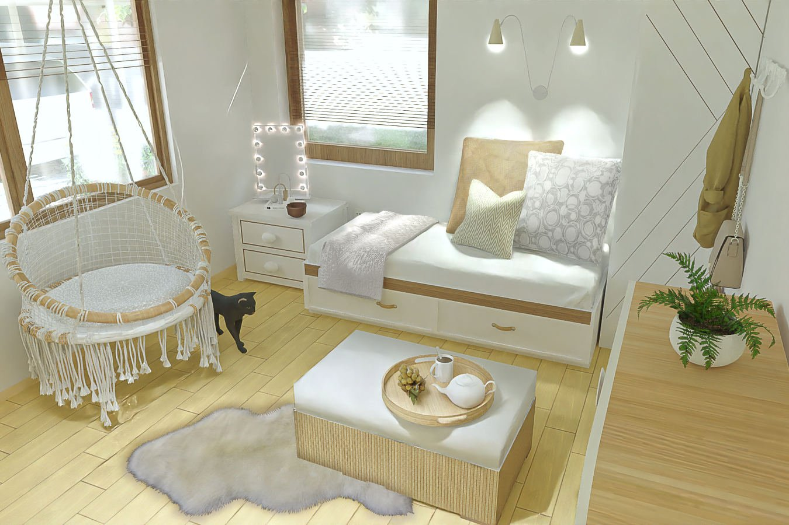
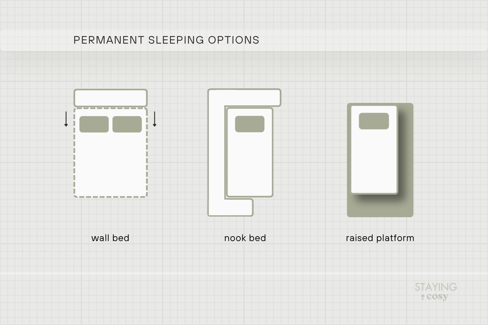
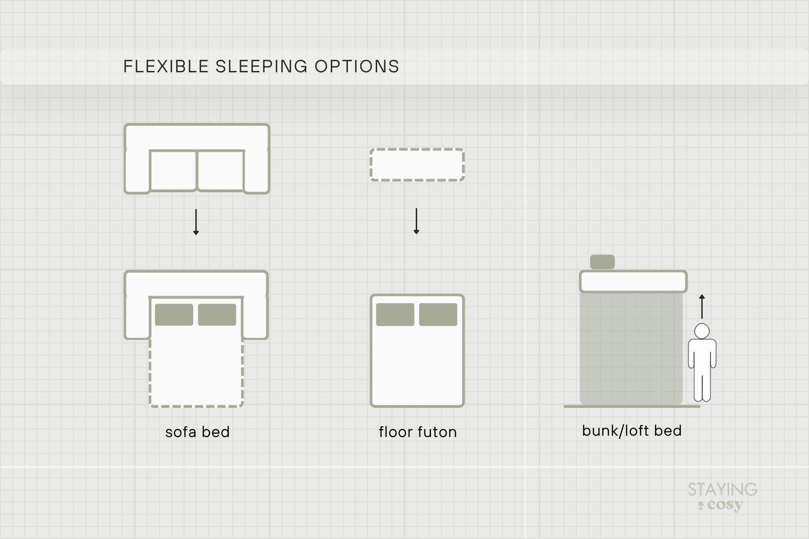

*In the limited space of a studio apartment, the kitchen usually fits quite naturally, the living area follows, but the bed… that’s where things tend to get tricky. Finding the best bed placement for flow and functionality often becomes the biggest design challenge. The usual approach to ‘loft it, or futon it’ does save floor space, but perhaps only works up to a certain age. I decided to look at this whole conundrum from a more practical angle.*

<Caption>
Image credit: Staying Cosy
</Caption>

I’ve always had a soft spot for small spaces. But in a one-room apartment, the bed is usually a problem. It either dominates the entire floor or gets awkwardly tucked away, as if we’re trying to pretend it doesn’t exist. Neither quite works in cramped layouts where one room has to function as bedroom and living space.

The goal isn’t to hide the bed; it’s to bring it into **harmony with the rest of the space.**

Think about it. The bed is where we land when we’re exhausted and where we linger on slow Sunday mornings. It should be easy to reach, simple to get around, and effortless to make. Even changing the sheets shouldn’t feel like a logistical challenge — *provided you’re someone who likes fresh covers regularly.*

To find that balance, we’re going to look at studio solutions from most holistic to least. None of them are superior, per se, it only comes down to the one that fits your layout and your life circumstances.

To help you decide, I run every option below through a simple filter:

☘︎ **Holistic Bed Comfort Check**

- **Flu Test:** Can you reach a glass of water and medicine easily?
- **Laundry Test:** Can you change the sheets without breaking a sweat?
- **Air Test:** Is there enough clearance for proper circulation?

## 3 Holistic Bed Placement Champions

In a small space, we shouldn’t just talk about saving square footage; we need to talk about life-readiness. These three studio apartment bed layouts come out as clear winners. They prioritise easy access for comfortable daily use over just fitting into the room, and pass all three points of my Holistic checklist.

Plus, as a bonus, all of them are rental-friendly.

### Anchored Corner Sleeping — Simple and Efficient

<Caption>
Image credit: Staying Cosy
</Caption>

Tucking your bed into a corner or along two walls is one of the most reliable ways to reclaim a sense of openness in a studio. It immediately frees up the central floor, creating a sleep zone that feels protected and enclosed without being boxed in.

This layout works because it **allows the rest of the room to breathe**. You still have space for a small bedside table or a narrow shelf, but the bed stays out of your main daily path — you won’t be weaving around it as you move from the kitchen to the sofa.

From a practical standpoint, this is where the Laundry test comes in. While the bed is tucked away, you’ll want to leave a small breathing gap between the frame and the wall. This makes tucking in the sheets effortless and keeps the air circulating. Holistically, corners offer a natural sense of shelter, signalling to your mind that it’s finally time to switch off.

Anchored corner layouts work best for single or small queen beds.

#### Subtle Upgrades to Consider

- **Elevate the bed slightly:** Use a higher base or a platform with deep drawers to create ample storage underneath while keeping access straightforward.
- **Add a sheer curtain:** Light draping or a simple divider at the foot of the bed can psychologically separate your sleep space without blocking ligh or airflow.

### Zoned Bed — Softly Divided

<Caption>
Image credit: Staying Cosy
</Caption>

If you want the psychological comfort of a bedroom without building actual walls, this is your best move. Zoned layouts are a key approach in small studio apartment design, where you create a subtle separation between sleep and living areas. By using low-profile furniture like a **bookcase, plant stand, or sleek sideboard**, you set up a clear boundary that divides restful retreat from the rest of the studio.

Ideally, place your headboard against a solid wall to give the bed a sense of anchor and security. Side placement is also effective. The divider then sits at the foot or along one of the sides. This works beautifully for both single and double beds because it defines the zone without blocking natural light or airflow.

A low cabinet or open shelf naturally acts as an oversized bedside table, with plenty of surface area for water or a snack right at arm's reach. A zoned layout usually allows you to walk around at least two sides of the mattress, making sheet-changing a breeze.

#### Subtle Upgrades to Consider

- **Use a rug for floor zoning:** Place a large rug under the bed that extends past the divider. It visually anchors the sleep area and feels much softer on your feet when you first wake up.
- **Choose open-backed shelving:** If you use a bookcase as a divider, leave some cubbies empty. This maintains a sightline through the room, making the studio feel larger while still providing that cosy, enclosed feeling.

### Hybrid Lounge Bed — Doubling as Daytime Sofa

<Caption>
Image credit: Staying Cosy
</Caption>

When space is at a premium and you can’t justify both a sofa and a bed, the Hybrid Lounge is your best ally. By placing the long side of the mattress against a wall and layering it with firm bolsters or large cushions, your bed becomes the primary seating area during the day. This layout is especially effective for singles or those with a small double bed, as it keeps the centre of the studio open for movement.

Holistically, **this is a high-functioning choice**. Since your bed doubles as your sofa, you’ll likely already have a side or coffee table nearby for essentials. The real work here is the daily reset. It takes about five minutes each morning and evening to transition from sleep mode to lounge mode, but this small ritual can actually help your brain define the start and end of the day.

And if you aren't into rituals? Honestly, just leave it as it is. It's your home — no one is there to judge you.

#### Subtle Upgrades to Consider

- **Use a large basket or under-bed drawer:** Having dedicated, integrated storage for your pillows or duvet makes the evening transition seamless.
- **Roll your bedding toward the wall:** If you don't want to hide your duvet, roll it up tightly against the wall to act as a ‘backrest’ for your cushions. It’s a trick I used as a kid that still works perfectly for creating a firm, comfortable sofa feel.
- **Pair with a single armchair:** For a more living room feel as well as secondary seating zone for reading or guests.

## 3 Best Permanent Sleeping Options

<Caption>
Graphic: Staying Cosy — made in Canva
</Caption>

If you own your studio or are planning a long-term stay, these integrated options are the gold standard. They usually pass the Holistic checklist with flying colours because they are designed specifically for your walls, your light, and your layout.

The primary trade-off isn't space, but **the upfront cost** and the fact that you can’t take these with you when you move. However, for a homeowner, these custom bed options are among the most effective ways to reclaim every square inch of a small studio, as they serve multiple functions.

### Wall Beds as the Vanishing Act

In tiny homes, space-saving furniture is essential. The [modern wall bed](https://www.clei.it/en/murphy-beds-hideaway-wall-beds), or Murphy bed, is a masterpiece of engineering, particularly suited to studio flats. Unlike the clunky versions of the past, today’s designs can include integrated sofas or desks that remain level when the bed is lowered.

They are perfect for those who need their bedroom to become a dance floor, a yoga studio, or a professional office during the day. It completely clears the floor, leaving you with an open, airy studio at daytime. When lowered, it’s a real bed with a proper mattress, and because the cabinetry is custom-made, you can integrate your bedside table directly into the frame.

If you’re worried about setting it up, you’d be surprised to learn it’s much easier than a traditional sofa bed — literally a matter of seconds. Thanks to hydraulic or piston-driven systems, most wall beds are specifically designed to open and close smoothly and with minimal effort. Plus, the bedding stays put. Pure magic.

**Don’t forget the power prep.** Once the bed is up, your wall outlets might be hidden. So, plan ahead and have an electrician move your power points or USB ports both in and out of the wall bed.

### Custom Nooks and Sleep Alcoves

If you prefer a fixed sanctuary, a built-in sleep nook creates an alcove that feels miles away from your kitchen. By building the bed into a dedicated architectural pocket, you gain recessed shelving right in the walls of your bed. It’s the ultimate way to feel enclosed and secure while keeping your floor plan clean. Since it's a permanent fixture, open-ended designs can help keep the nook fresh.

The Laundry test can be a bit tricky with nooks, but it’s still manageable.

**Be careful with full-height partitions.** Shoving a floor-to-ceiling wall into the centre of a studio usually kills the airflow and ruins the open feel you’ve worked so hard to create. There’s a reason this trend is fading — it simply isn't practical for daily life.

### Permanent Raised Platforms

Unlike a wobbly ladder loft, a permanent raised platform is not as tall, and uses wide shallow steps to reach the sleeping surface. These steps often double as deep drawers, creating a massive walk-in storage area underneath that keeps the rest of your studio clutter-free. Because the platform is wide, you have plenty of room to walk around the mattress, making sheet changing effortless and providing a natural bench to sit on while you get dressed.

## 3 Simplest Options that Come with Trade-offs

<Caption>
Graphic: Staying Cosy — made in Canva
</Caption>

Finally, we have the stereotypical heroes of space saving, options that require a specific kind of dedication to live with. These aren't bad choices by any means, but they come with daily physical demands that don't always pass the Holistic test as we get older or busier.

Imagine a forty-something professional climbing into a bunk bed every night.

### Sofa Bed as a Versatile Double-duty Classic

Having sold these amazing [sofa beds](https://www.milanobedding.store/en/) years ago, I know the appeal. They are the ultimate two-in-one solution for tiny rentals.

Practically, they pass the Flu test with ease since they sit at floor level, and the Air test is rarely an issue. However, the sofa bed hits a snag with the Laundry test. While changing the sheets is simple enough, it’s the daily mechanical chore of the *reset* that adds a layer of logistical struggle to your morning routine.

#### 💡 **Technical Note**

Don’t skimp on the **mechanism** or mattress — if this is your primary bed, choose a pocket-spring hybrid or a high-quality memory foam topper. Your back will thank you after the first month.

Also, check the **swing space** carefully: make sure you don’t need to move furniture every night just to open it comfortably.

### Foldable Futon for Minimalists

The futon is the classic nomad choice. It’s affordable, portable, and disappears during the day. It’s a wonderful solution for very tiny places, but it requires a daily workout. You have to fold, store, and remake the bed every single morning and night. In my holistic checklist, it clearly fails the Air test and the Flu test is also questionable.

Don't forget that even when the futon is folded, your duvet and pillows still need a home. Without a dedicated basket or cupboard, they end up cluttering your living area. I used to have a futon, and it worked, but only because I was in my early 20’s. The youth withstands many discomforts.

### The Loft or Bunk Bed

Lofting your bed is the ultimate floor-space saver, effectively doubling your square footage. Unfortunately, it is also the holistic loser by far, failing all three checklist points. Why? It’s the most challenging one for when you’re physically unwell. If you’ve ever had to climb a ladder with a fever or a twisted ankle just to reach your pillow, you know exactly why this is a trade-off.

Not to mention making the bed — *we can all imagine the struggle*.

To keep things workable, aim for at least **90 cm (35.4”) of clearance** above the mattress. If you can’t sit up straight to read or drink water, the space will feel claustrophobic very quickly.

While a bunk may offer lovely views over your studio, the [air quality](/blog/fresh-air-in-home) up there is often compromised. Especially in the summer, a lofted bed can be significantly warmer than the rest of the flat. A fan or a window nearby might be necessary to keep the air moving and pleasantly cool.

☘︎ **For Better Sleep**

Since many studio layouts involve using the bed for sitting during the day, your mattress works twice as hard. Make sure it lasts by choosing and maintaining it properly.

*Check out my guide on* [*choosing a healthy mattress*](/blog/eco-friendly-mattress-materials-guide) *to ensure yours lasts for years.*

Have you found your personal champion yet? I know everyone’s priorities differ. Sometimes floor space wins over comfort, or visual harmony takes the lead over practicality. It’s worth remembering that we spend nearly a third of our lives in bed.

Choose the option that supports your nighttime routine and overall well-being, as much as your space allows.

---

**☘︎ Compliment your small studio layout with:**

*•* [*Perfect Multi-purpose Furniture Pieces*](/blog/multipurpose-furniture-for-small-spaces)

*•* [*Easiest Low Maintenance Air Purifying Plants*](/blog/air-purifying-plants)

*•* [*Sculptural Lamps for the Artistic Feel*](/blog/sculptural-lamps-light-personality)

SEARCH THE BLOG

