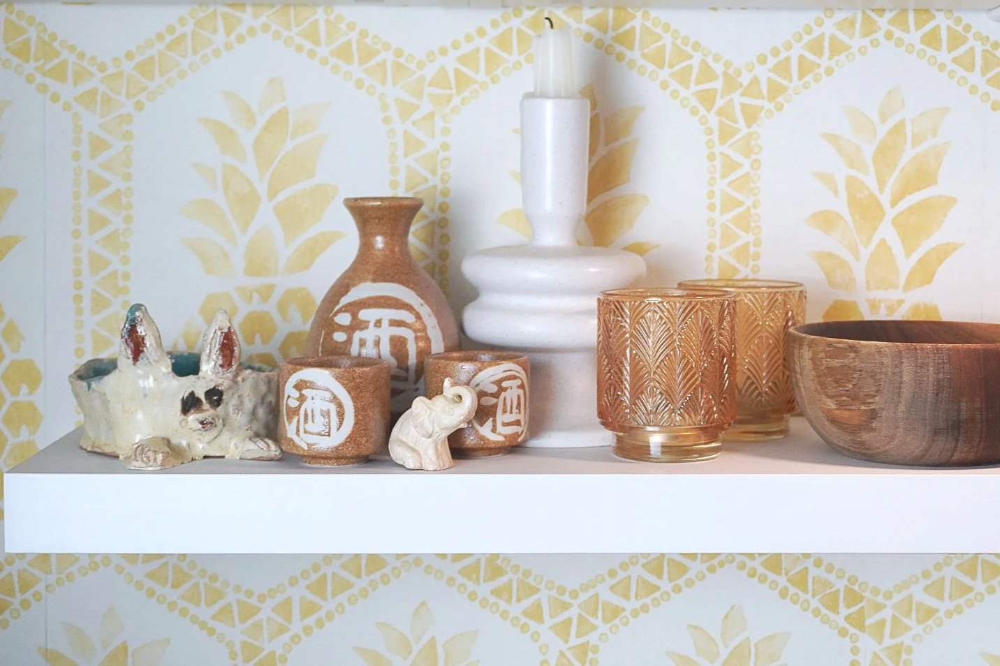
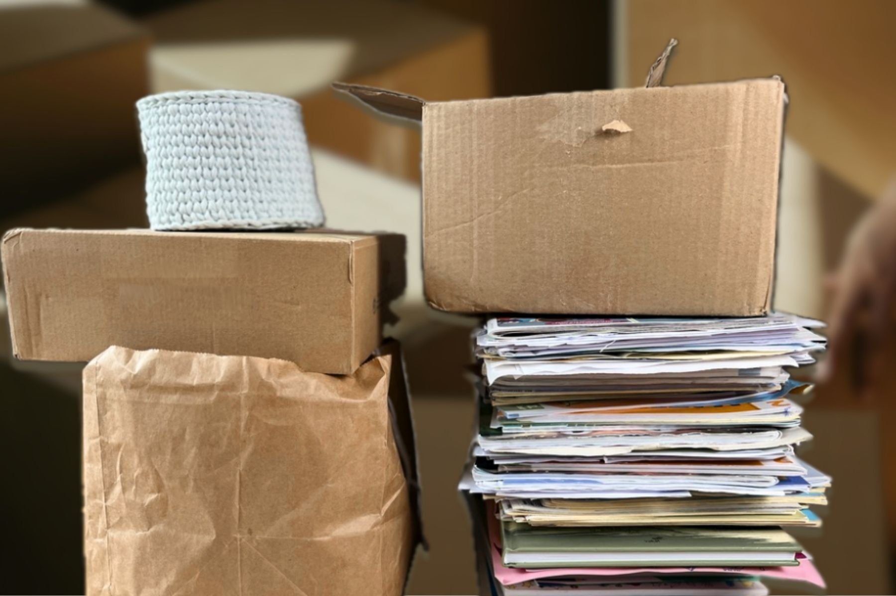
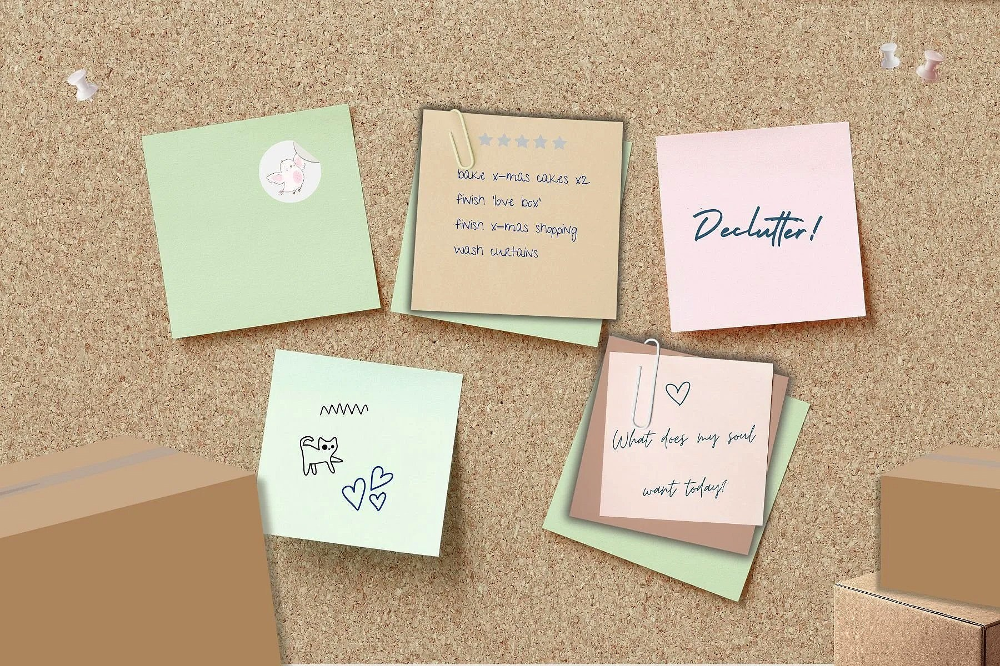
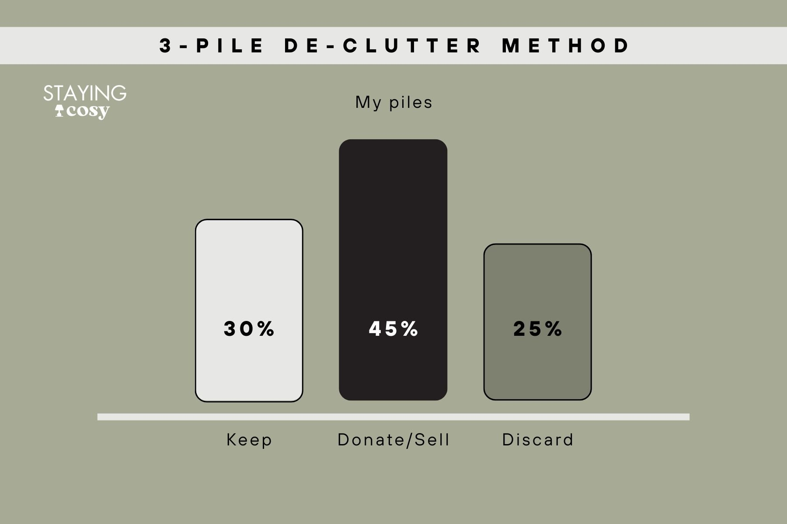
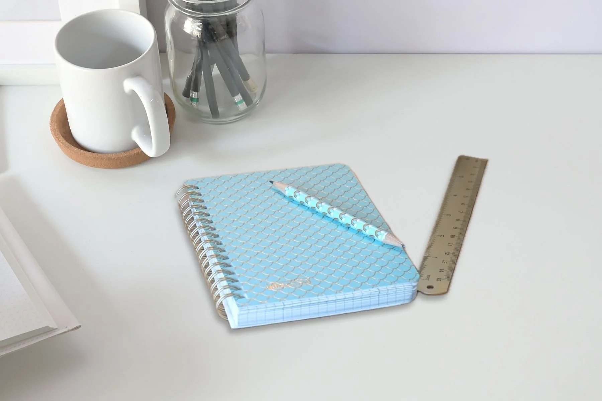
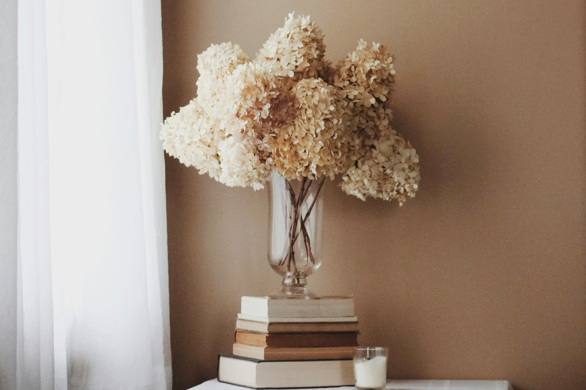
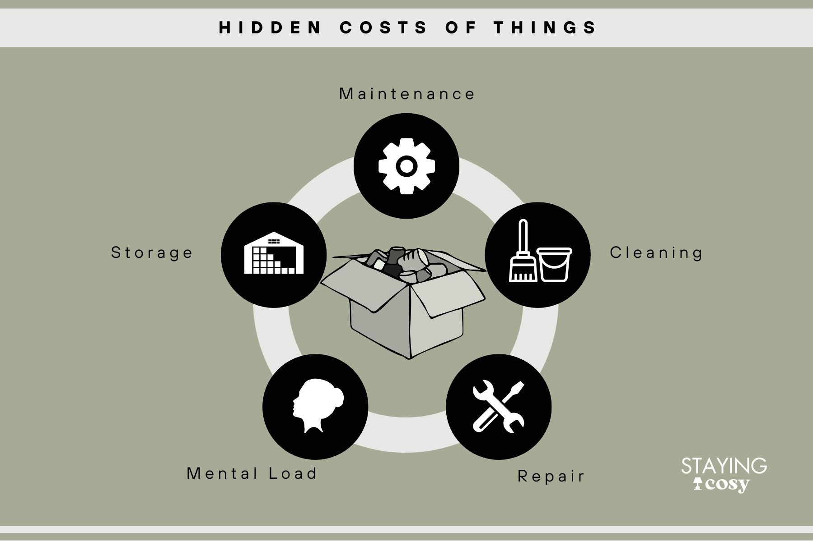
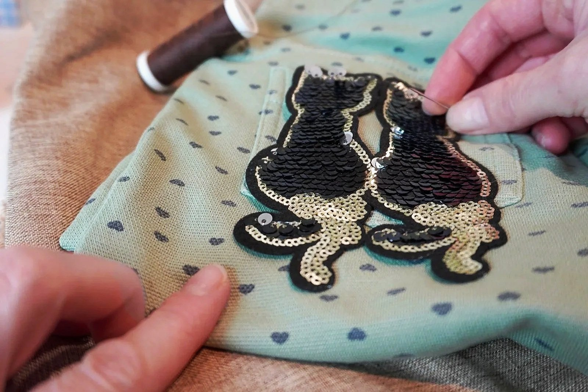

*I used to think the mess was contained. Just a few hidden pockets here-and-there, a couple of boxes under the bed waiting for one day that never seemed to arrive. But as the months blurred into years, I realised those boxes weren't just sitting there. They had become a persistent, nagging weight in the back of my mind.*



<Caption>
Image credit: Staying Cosy
</Caption>

Maybe for you, it’s a single drawer that causes a flicker of stress, or a cabinet you haven’t dared to open in years. The truth is, the things we haven’t touched in ages often take up the most of our mental space.

Clutter has a way of sneaking in quietly. Subtle, silent, and easy to overlook. It creates a low-level tension, a sort of static in our peripheral vision. And then, one day, the weight becomes too heavy to ignore, and those quiet piles start asking for the one thing we’ve been withholding: *our attention*.

## Why Clutter Builds Up — Even When You Don’t Overbuy

I have a confession to make. I recently discovered I’m a bit of a hoarder. Not the dramatic kind you see on TV,  but enough that clutter had taken over little corners of my home. And honestly? I wasn’t fully aware of it until a few months ago.



<Caption>
Image credit: Staying Cosy
</Caption>

I’ve never been an impulse buyer, I don’t over-shop and I don’t chase trends… so how did this even happen? How did our empty, unused, soon-to-be master bathroom become a dumping ground for boxes I felt too overwhelmed to deal with?

### Lack of System Fuels Accumulation

When I looked closer, the answer was surprisingly simple. I had no system. Especially for the kids’ things. What I thought was my semi-organised method of storing outgrown clothes was actually just chaos. Add in long-forgotten toys, empty boxes, a handful of unused gifts, and a collection of *what-if* items I couldn’t quite bring myself to part with. And suddenly I was staring at nearly a decade of accumulation. Ten years’ worth of *I’ll sort it later*.

### Emotional Challenges of Letting Go

It’s not just practical needs — letting go can be highly emotional. Gifts, memories, little things that once meant something. Add imagination spinning stories and possibilities about what you *might* need later, weighing up the *perceived loss,* and it becomes too much to carry.

## The Moment It Finally Clicked

It started rather innocently. A cluster of 25 sticky notes at my desk, the oldest probably from two years ago… and later, stacks of boxes had turned into mini avalanches I was sidestepping daily.

A sudden clarity hit me, overwhelming and almost alarming. My home, usually tidy on the surface, felt **mentally loud**. Those *secret pockets* of mess weren’t secret anymore. They revealed themselves everywhere, and I felt a nearly physical urge to deal with them right now.



<Caption>
Graphic: Staying Cosy - made in Canva
</Caption>

At the same time, while writing my stress-free [Christmas guide](/blog/holistic-christmas-guide), I realised I couldn’t encourage others to simplify while living with noisy corners myself. Just writing about it pushed me into action.

In the middle of this mental storm, my husband and I walked past a lottery ad for 100 million euros. Naturally, we played the game: *What would life look like if that amount landed in our account tomorrow?* And then it clicked.

Looking at the clutter we had accumulated over the years, I asked myself a question:

> “Would I keep this if I had 100 million?”

Most of the time, the answer was *no*. I knew instantly why my struggle of letting go had been so hard. I was clinging to perceived worth. Old baby shoes, half-broken bowls… I mean, *really?* The monetary value was long gone, but the mental weight stayed.

### How I used The Three-pile Declutter Method

Once I had that clarity, the next step was obvious: taking real action. I started with the worst corner of the house — the ‘waiting-to-be’ bathroom filled with boxes and half-forgotten items.

**This is how my piles turned out:**



<Caption>
Graphic - Staying Cosy - made in Canva
</Caption>

Most weren’t worth selling, so why let them take up space?

The three-pile method works because it keeps the decision simple. No circling back, no emotional spirals. Just one choice per item — and it’s done.

> “Objects are meant to serve your life, not drain your energy.”

## A Blank Slate for a Clearer Mind

I couldn’t be happier to start the new year with a properly cleared-out home. In fact, I’ve been longing for it for a while. I dare to say, there’s something almost sacred about an empty surface.

Fewer things allow more room for ideas to land.



<Caption>
Image credit: Staying Cosy & Canva
</Caption>

My creativity flourishes in ordered surroundings. When things are visually neat, thoughts stop competing for attention. They settle, they stretch out and finally have somewhere to go.

### Knowing What You Own

A huge part of this clarity comes from knowing what we have, and where it lives. Not to be minimalistic for the sake of minimalism, but for practicality reasons. How can we use something if we don’t even know we have it? Choosing wisely what stays turns every object into a tool rather than a distraction.

I’m learning I don’t need drawers full of *maybes* or shelves full of *almosts*. I just want the things that support my life, my work, and my creativity — nothing more, but also nothing less.

A blank slate isn’t emptiness. It’s mental space. And don’t we need more of that to balance our busy lives?

## How Much Do We Really Need for a Comfortable Life?



<Caption>
Image credit: [Jessica Mangano](https://unsplash.com/@jfdelp?utm_source=unsplash&utm_medium=referral&utm_content=creditCopyText) on [Unsplash](https://unsplash.com/photos/white-and-brown-floral-wreath-JhYbY9nv0rU?utm_source=unsplash&utm_medium=referral&utm_content=creditCopyText)
</Caption>

Comfort means different things to different people, but for most of our history, humans lived with far fewer things. Somewhere along the way, we began confusing convenience with accumulation. More options, more storage, more backups — yet somehow, less ease.

Isn’t comfort primarily about usefulness? Not having every possible item, but having the *right* ones? Not filling our homes, but *living* in them?

If this resonates, I’ve explored a similar idea about [how much space we need](/blog/how-big-should-your-home-be) for living. You might find it just as inspiring.

### Too Much Low-quality Stuff

These days, life bombards us with things almost non-stop. Fast fashion, fast interiors… you name it. Cheap items that break, replacements that pile up, cupboards filling with things that were never meant to stay. And beyond the clutter itself, such lifestyle creates a **deep emotional fatigue.**

It’s not just me, this overload is a widespread issue. Our relationship with possessions has changed. More choice often means more waste, but far less meaning attached to the objects we bring home. No wonder our minds feel crowded. So, what can we do about it?

### A Simple Way to Keep Clutter at Bay

Here are a few practical tips you can use to keep accumulation in check:

- **1 in, 1 out rule.** If something new comes in, something old leaves. Especially valid for categories that multiply easily, like kids’ clothes or beauty products.
- **Choose the best version of an item.** One excellent pan beats seven mediocre ones. Same for shoes, tools and décor.
- **Use the 20% rule.** We tend to use 20% of our items 80% of the time. Identify that 20% and invest well into it, it’s what supports your life the most.
- **Let usefulness guide you, not guilt.** If it no longer serves you, let it go. Guilt is not a good enough reason to keep anything.

My aim now is to live by these rules and, above all, teach them to my daughters.

## Hidden Weight of What We Own

We often forget that every little thing we own comes with a hidden tax. I’m not just talking about the space it takes up, the time spent cleaning it, or the effort to keep it in good shape. I’m talking about the mental *rent* it pays.

### When Less Becomes More

I was recently watching a video comparing lifestyles across different income levels, and one specific insight really hit home. It suggested that wealthier people tend to live longer not just because of premium healthcare or organic food, but because they have the ability to essentially *buy back* their time.

By outsourcing repetitive tasks and cutting down on decision fatigue, they free themselves from the grind of constant micro-management. They aren't just buying services; they are protecting their focus, their attention, and their precious energy. Recently, we’ve been seeing a huge shift toward this kind of lifestyle minimalism, where homes and routines are intentionally designed to support wellbeing rather than just store excessive belongings. It is a luxury that goes far beyond money.



<Caption>
Graphic: Staying Cosy - made in Canva
</Caption>

### Reclaiming Mental Clarity

This ties directly into decluttering. Simplifying our lives is really about reclaiming mental clarity. Just ask yourself: *Does this object or task serve my daily life, or does it quietly drain my energy?*

Intentional living is a form of self-investment. By being selective with what we own and what we commit to, we’re actually *buying back* time and focus. And really — wouldn’t it be a shame to let random things nibble away at chunks of our life without us even noticing? When we look at it this way, a home that supports us mentally is far more valuable than one that simply looks good on the outside.

### Is the Era of Fixing Things Coming Back?

Growing up in the 90s, life felt simpler in ways I only now fully appreciate. People fixed things instead of tossing them. Clothes were handed down, toys were treasured, and a single kitchen pot could last a lifetime. We didn’t have endless choice or instant convenience, and every object had to earn its place in our lives.



<Caption>
Image credit: Staying Cosy
</Caption>

Naturally, there was less visual clutter. Homes were filled with purpose, kitchens with home-made preserves; and outdoors was our playground, with imagination as entertainment. We learned patience, creativity, and care for what we owned. Lessons that get lost in today’s culture of fast everything.

Maybe, in small ways, we’re starting to rediscover that simplicity again. And I really hope it’s not just another fly-by trend. By valuing what we already have, repairing and reusing where we can, we create a life that feels richer — not with more things, but with more space for actual living.

---

```
SEARCH THE BLOG
```

---

---
