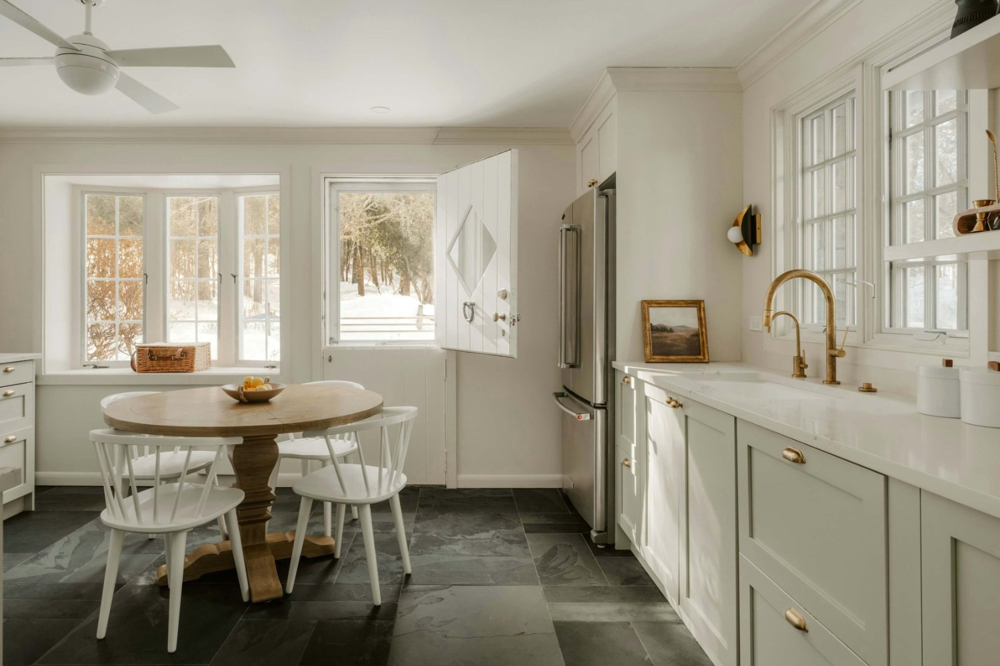
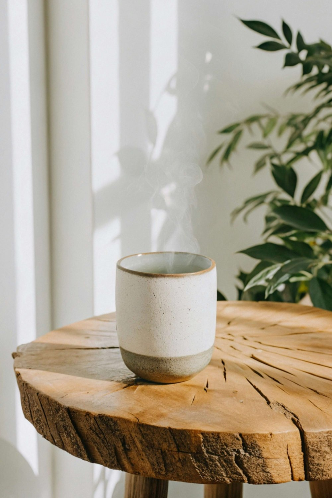
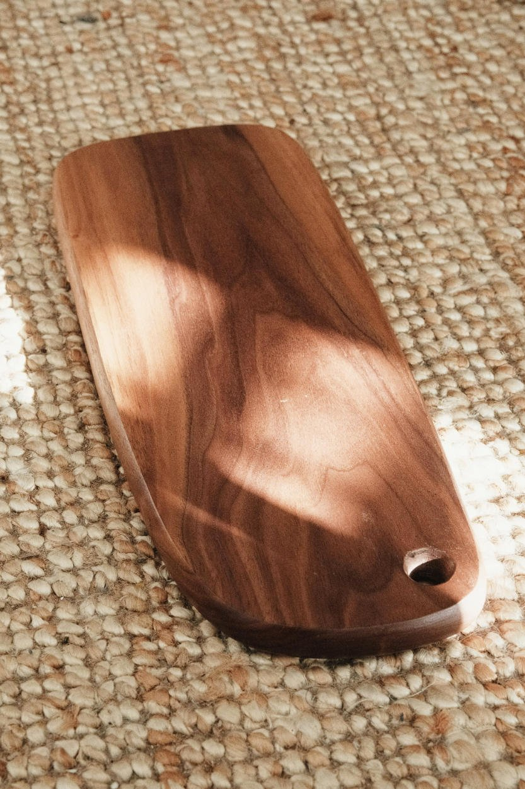
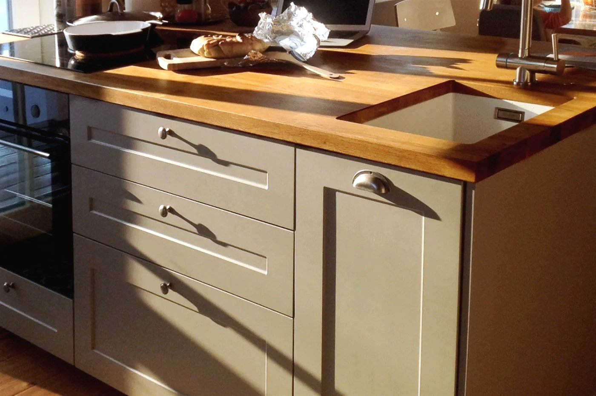
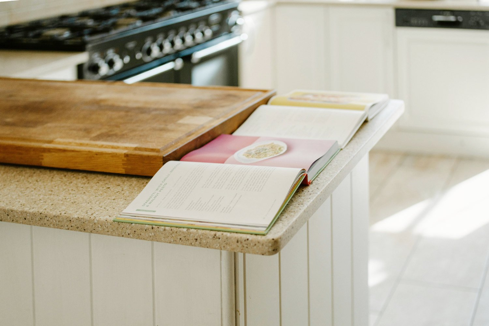

*We’ve all heard of kitchens that sizzle, but what about a kitchen that glows? If you’ve ever found yourself leaning into a patch of sunlight like a house cat while waiting for the kettle to boil, you know exactly what I mean. There is something magnetic about a sunny kitchen; it’s that instinctive pull to start your day exactly where the light hits the kitchen table.*

<Caption>
Image credit: [Clay Banks](https://unsplash.com/@claybanks?utm_source=unsplash&utm_medium=referral&utm_content=creditCopyText) on [Unsplash](https://unsplash.com/photos/bright-kitchen-with-dining-table-and-stainless-steel-refrigerator-alXdbCZoQZI?utm_source=unsplash&utm_medium=referral&utm_content=creditCopyText)
</Caption>

Whether it’s a breakfast nook bathed in the first morning glow or a counter illuminated by a gentle sunset while you prep dinner, natural light in the home turns a functional room into a scenic dance.

A sunny kitchen is the ultimate home-maker’s dream, and not just for the aesthetics. Sunlight acts as a silent conductor for your internal clock, triggering your brain to wake up with your first cup of tea and kissing you goodnight as the shadows lengthen.

For those of us who spend hours at the stove, the sun truly becomes our best friend. In a world where we’re all chasing vitamin D3 supplements, why not let your architecture help keep you topped up? Even on days when you can’t get outside, a well-positioned layout ensures you’re soaking up the benefits of the sky while you go about your everyday hustle.

## The Biological Wake-up Call

A subconscious switch flips the moment you walk into a room filled with natural light. You don’t always notice it right away, but your body does.

<Caption>
Image credit: [Simply Mersah](https://unsplash.com/@simplymersah?utm_source=unsplash&utm_medium=referral&utm_content=creditCopyText) on [Unsplash](https://unsplash.com/photos/a-white-cup-sitting-on-top-of-a-wooden-table-UjVDryDfo-w?utm_source=unsplash&utm_medium=referral&utm_content=creditCopyText)
</Caption>

Morning light is particularly magical; it’s nature’s version of a gentle alarm. It signals to our internal **circadian rhythm** that the day has begun, helping us feel alert without the caffeine-induced heart palpitations.

In our kitchen, the sun literally pulls me into the room through the East-facing window. I find myself stepping into that first patch of light to make my tea, and somewhere between the morning birds chirruping and the first sip, my mind begins to clear. It’s a passive way to get ready for the day — no extra work required.

But beyond the zen of it all, there’s a very practical side. Any busy cook can testify, *I certainly can vouch for this*, that prepping a meal on a well-lit counter feels like half the effort. There’s no squinting under a flickering bulb or working in your own shadow. Good kitchen lighting for well-being starts with the sun.

The brightness draws us in, but it’s the quality of the light that makes us stay. It moves across the surfaces throughout the morning — softening and warming. It’s the reason meals stretch out a little longer and conversations feel a bit less ordinary. Even on a chaotic Tuesday morning, there’s a sense of ease in a sunlit space that artificial lighting can’t replicate.

> “Think of a sun-drenched counter as a charging station for your mood. While you’re busy chopping kale, you’re soaking up the healing sun rays.”

Our bodies don’t just want sunlight to thrive, they are designed for it. From that essential vitamin D boost to the simple feeling of safety and openness, a sunny kitchen feels less like a luxury and more like a wellness necessity.

## The Sun as Your Silent Assistant

We usually talk about sunlight in terms of atmosphere, but in a busy kitchen, the sun is a high-performance tool you don't have to plug in. Since our own kitchen happens to benefit all three sunny directions, it acts like an invisible pair of hands working in the background.

<Caption>
Image credit: [Rumman Amin](https://unsplash.com/@rumanamin?utm_source=unsplash&utm_medium=referral&utm_content=creditCopyText) on [Unsplash](https://unsplash.com/photos/a-wooden-object-laying-on-top-of-a-rug-hJgYJaCGHXQ?utm_source=unsplash&utm_medium=referral&utm_content=creditCopyText)
</Caption>

Sunlight is the most effective **natural sanitiser** for the kitchen. Those UV rays are grubbing away the moisture out of surfaces to keep bacteria from winning.

In our home, the sun light is our powerhouse. If I toss a damp wooden cutting board onto the counter or hang a soggy kitchen towel on the hook in that direct afternoon sun-trap, it’s bone-dry and smelling like *outside* in twenty minutes.

I’ve actually become obsessed with drying my kitchen sponges and dishes in the direct sunlight. It’s my secret, unbeatable dish-drying weapon. I admit, it’s not visually the most appealing, but I would not change it for anything.

A functional kitchen layout uses the light to support your health. Once you start seeing windows as a purifier, you use them to your advantage.

☘︎ **The Sun-Sanitising Tip**

Next time you deep-clean your wooden boards or bread baskets, let them sit in a direct patch of **sunlight for 20 minutes**. It’s the oldest, and cheapest, antibacterial hack in the book — and it smells much better than bleach.

## Navigating the Light Through East-South-West Experience

Of course, not all sunlight behaves the same. It has a personality that changes depending on which window it’s pouring through. We are lucky enough that our kitchen is oriented to the east, south, and west, which means I get to watch the light play different roles as the day unfolds.

**East.** Rising sun greets us first. It’s that delicate, cool morning light that helps you find your footing before the rest of the world wakes up. It’s one of the biggest east-facing kitchen benefits — having just enough brightness to see the steam rising off your tea. It’s the *get to work* light.

**South.** By midday, the south takes over. This is the most consistent and reliable light we have. It’s a high, steady presence that keeps the energy in the room lifted while we cook or lunch. It’s the engine of the kitchen, making everything feel crisp and true colours.

**West.** The Golden Hour is the most dramatic of the three. As I’m starting dinner, the light turns heavy and amber, stretching across the counters. It signals the end of the day, turning the kitchen into a much calmer space right when you need it most. And the sunset glow is its ultimate peaceful reward.

Having the mix of these exposures means the room never feels static. I can actually track the day by where the shadows fall on the counter, making the kitchen an ever-changing lively place.

<Caption>
Image credit: Staying Cosy
</Caption>

**How is your kitchen positioned?**

Is it flooded with a bright midday glare, or is it more subtly illuminated through a single, lonely window? Take a moment today to notice how the changes in natural light influence the atmosphere of your kitchen, even if nothing else has changed.

Any sunny direction is good and if you happen to combine it with [flow-through room principles](/blog/walk-through-rooms-and-room-circulation), where the goal is to let energy and light move seamlessly from one space to the next, you’re essentially killing two birds with one stone.

> “If you’re redesigning your home layout, my best advice is simple — let your kitchen follow the sun.”

The same goes for buying or renting. You don't need a massive wall of windows to make a difference; allowing just a little more sunlight into your cooking hub might be the exact boost you need to make the daily chores feel a whole lot lighter.

## Managing the Heat — Is a Sunny Counter Overkill in Hot Climates?

<Caption>
Image credit: [Annie Spratt](https://unsplash.com/@anniespratt?utm_source=unsplash&utm_medium=referral&utm_content=creditCopyText) on [Unsplash](https://unsplash.com/photos/open-cookbooks-rest-on-a-kitchen-counter-yjYxtxLOiF4?utm_source=unsplash&utm_medium=referral&utm_content=creditCopyText)
</Caption>

This talk does raise an interesting question. Is a sunlit counter always ideal? If you live in a climate where the sun is aggressive all year round, a direct-hit window can feel like overkill.

In mild winters however, that low-angled winter sunlight is a hidden gem for natural warmth and mood boost. In hotter months, it can pose a significant challenge. Instead of blocking the world out, flexible shading invites the light in on your own terms.

Think linen curtains to catch the morning breeze, leafy plants to break up the glare, or shutters to lock out the midday peak completely, if necessarry. It ensures the kitchen stays pleasant rather than turning into a sweaty greenhouse. Moving your cooking zone out of the direct sunlight is also advisable.

## Small Fixes for Dark Kitchens — How to Mimic the Feel of a Sun-Drenched Space

But what if your kitchen is tucked away in a north-facing corner or shadowed by a neighbouring wall? You don't have to knock down walls to invite the light in. There are ways to how to brighten a dark kitchen without a full renovation.

- **Mirror the glow:** Place a mirror opposite your window. It’s an old-school trick for a reason; it effectively doubles whatever light you do have, bouncing it deeper into the room.
- **The power of paint:** If the sun won't provide the warmth, your colour palette can. Switching to a warm white or a soft, buttery cream can mimic that "golden hour" feeling even on a flat, cloudy day.
- **Declutter the glass:** Sometimes we block our own light with herbs or decor on the windowsill. Clear the glass to let every available ray reach the kitchen counter.
- **Artificial sunlight:** Invest in high-quality flicker-free [full-spectrum LED bulbs](https://www.amazon.com/gp/aw/d/B0FLQBFFXR/?_encoding=UTF8&pd_rd_plhdr=t&aaxitk=4c0ecdcecd8a09bd861b8f019d768baa&hsa_cr_id=0&qid=1777647238&sr=1-3-f02f01d6-adaf-4bef-9a7c-29308eff9043&ref_=sbx__sbtcd2_asin_2_title&pd_rd_w=gFItm&content-id=amzn1.sym.d3360101-5266-4e0e-8e4a-de7eb0be6ed9%3Aamzn1.sym.d3360101-5266-4e0e-8e4a-de7eb0be6ed9&pf_rd_p=d3360101-5266-4e0e-8e4a-de7eb0be6ed9&pf_rd_r=TNV4GGMP1PP4C5YGK1RX&pd_rd_wg=GN4ou&pd_rd_r=0286d06d-ab0a-463f-9385-54d7e20aa397&th=1). They mimic the colour temperature of natural daylight, helping your circadian rhythm stay on track even without a South-facing window. You can see exactly which bulbs to choose and how to position them in my practical [lighting guide](/blog/interior-lighting-guide).

I know, it’s not exactly the same. The sun can’t truly be replicated by a bulb, but making these small adjustments is certainly better than leaving your home, *and your mood*, to sit in the gloom. The most impactful home improvement doesn’t have to be a costly makeover. It can be as simple as moving your favourite chair into the sun.

**A healthier home starts here.**

Having a sun-drenched kitchen is a lifestyle hack that nourishes your body and invigorates your soul. Whether you are working with a wall of glass or a single small pane, following the light is the fastest way to turn this high-traffic heart of your home into a healing cooking hub.

---

**☘︎ More on mindful living and healthy interior:**

*•* [*Three Rituals to Clean & Renew Your Home*](/blog/eco-friendly-spring-cleaning-rituals)

*•* [*Why Mould Keeps Returning & How to Stop It for Good*](/blog/mould-keeps-coming-back-how-to-stop-it)

*•* [*Beauty of Desire Paths — Walking the Way We Feel*](/blog/beauty-of-desire-paths)

SEARCH THE BLOG

