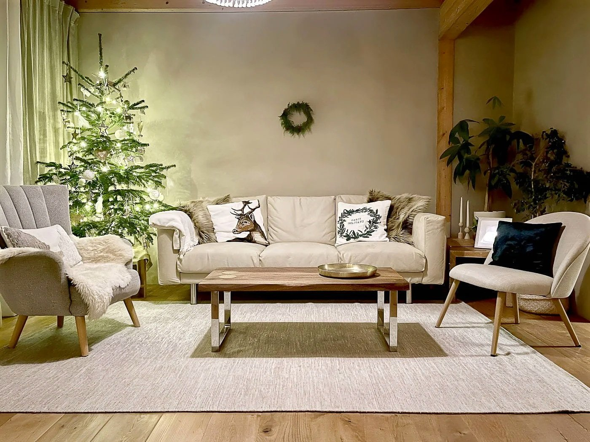
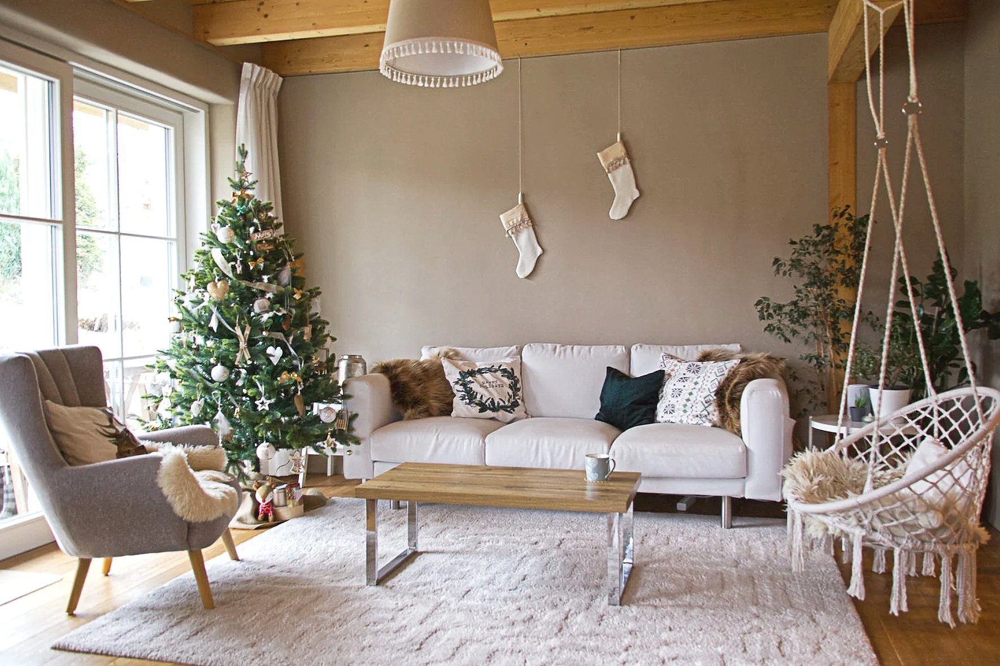
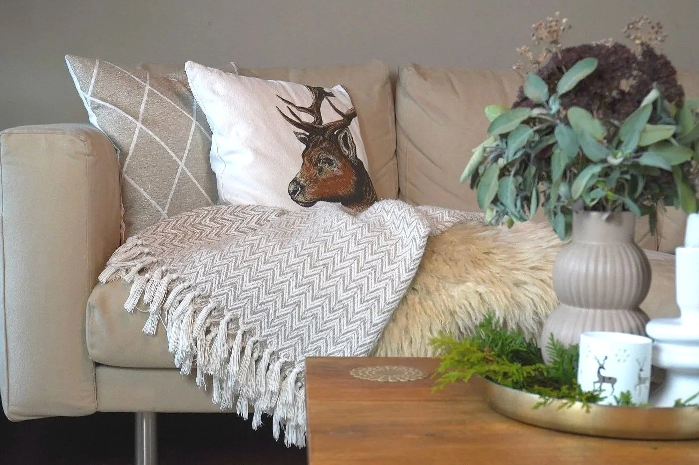
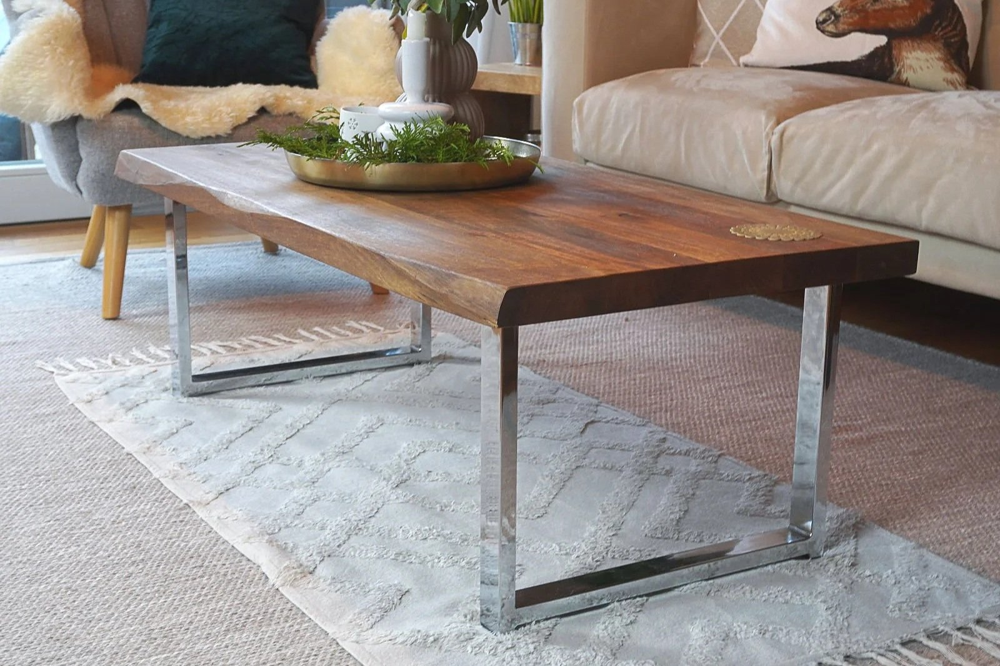
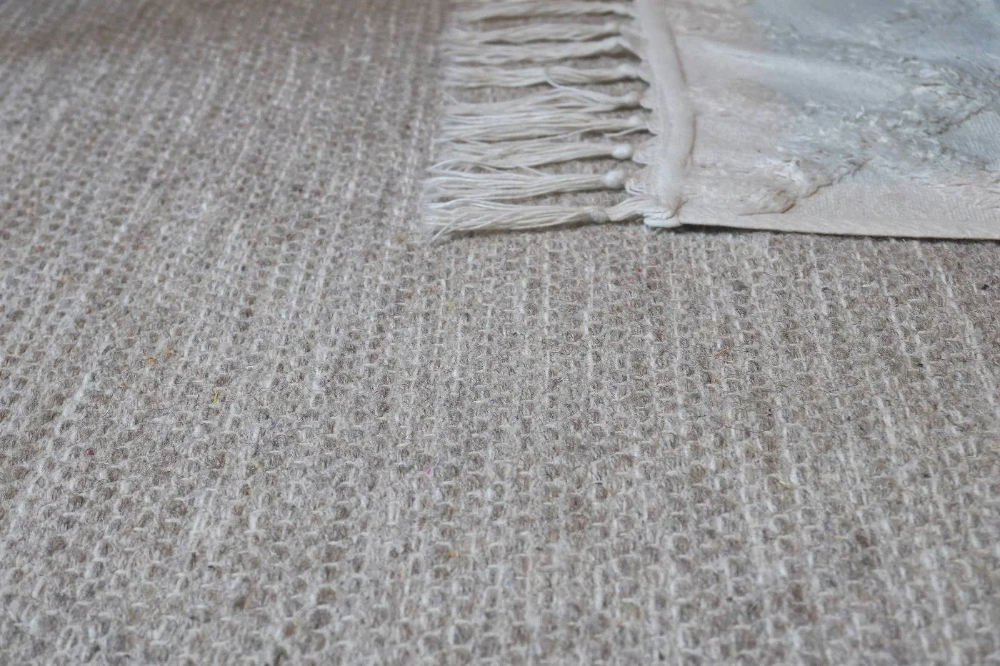
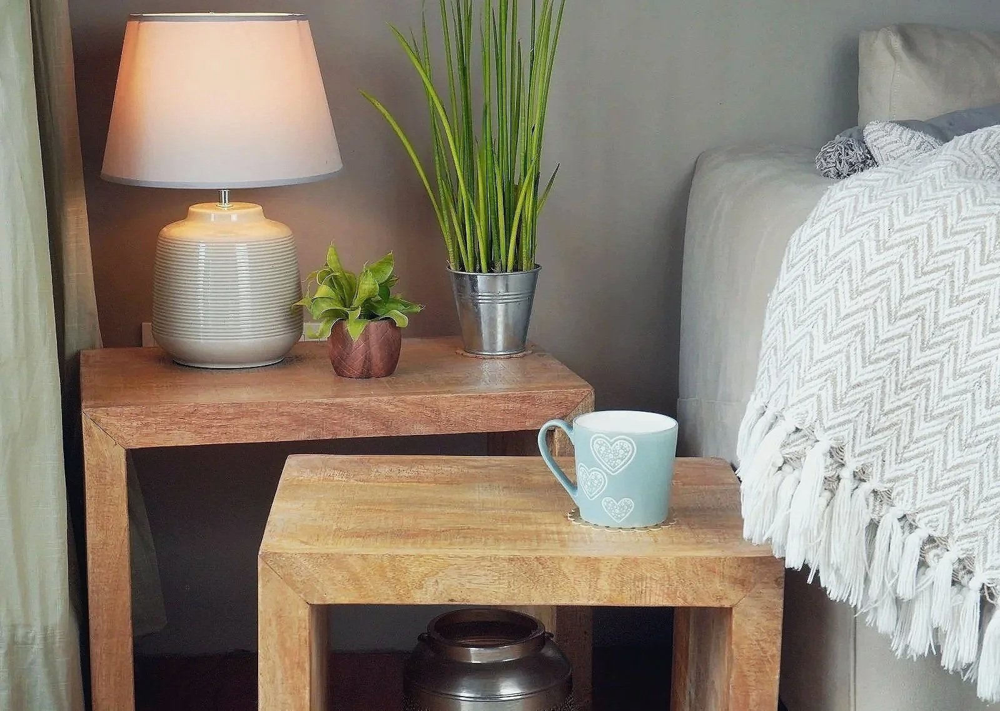
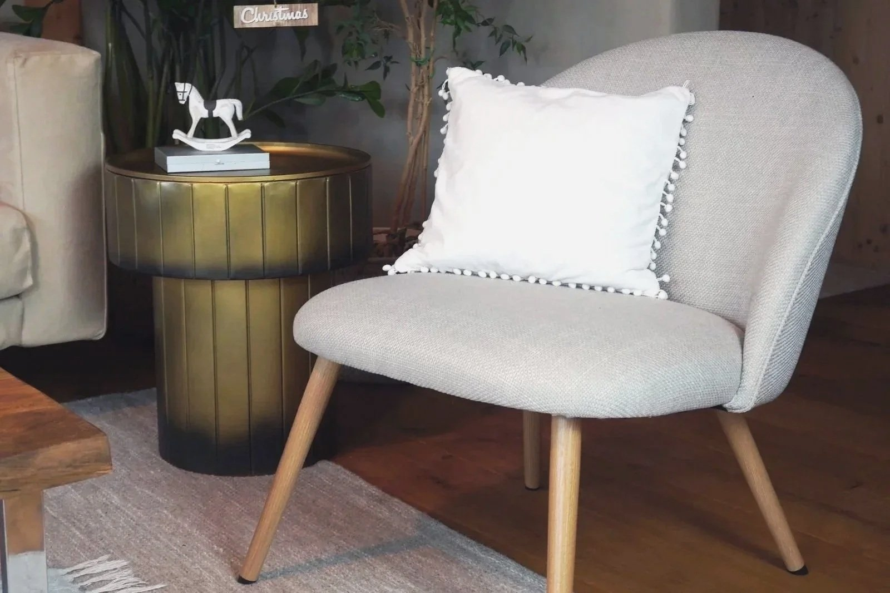
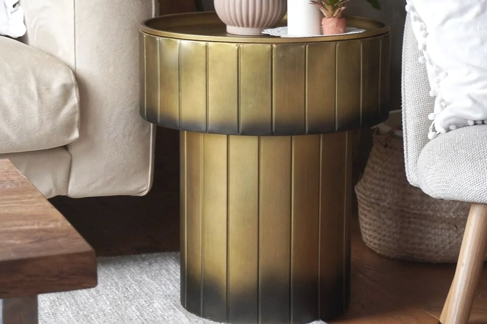
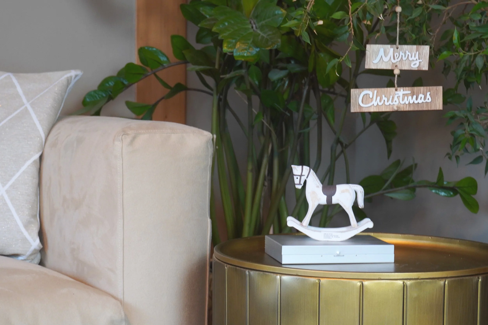

*It’s hard to believe it’s been a year since we gave our living room a very different kind of Christmas gift — an eco-friendly upgrade. We wanted to make our home feel better and take a simple, conscious step toward cutting down on plastics along the way.*



<Caption>
Image credit: Staying Cosy
</Caption>

A year later, I’d say we’ve done pretty well. What started as a small family promise to buy less plastic has slowly become second nature — something we barely have to think about anymore. But before I get ahead of myself, let’s rewind a bit.

## From Bare Beginnings to Better Choices

When we first moved into our newly built home with two small kids, things were… let’s just say, humble. Everything either went super-budget or didn’t happen at all. For a whole year, we lived without interior doors or a proper kitchen — *imagine indoor camping!*

#### *Our previous set-up:*



<Caption>
Image credit: Staying Cosy
</Caption>

Those early days made me appreciate the basic comforts we often take for granted. As the dust, *quite literally*, settled over time, it felt like the right moment to upgrade. Not to buy more for the sake of it, but to [swap smartly](/blog/10-ways-to-give-your-home-instant-refresh), improve quality, and lift the space a little — all while keeping our sustainable values front and centre.

And yes, I’ll share the full budget at the end — *because we all secretly love knowing the numbers.*

### The sofa—not exactly how we imagined



<Caption>
Image credit: Staying Cosy
</Caption>

We mistakenly thought we were ready for that grown-up milestone: buying a brand-new, high-quality sofa. Preferably leather, to avoid the microplastics and chemical coatings found in most synthetic fabrics.

*Well… things didn’t quite go that way.*

With the front yard, master bathroom, and a few other priorities still on the list, our budget just couldn’t stretch to a €3,000+ leather piece.

So instead, we gave our existing sofa a second life, by replacing only the [covers](https://www.dekoria.co.uk/norsborg-3-seat-sofa-cover,p35235,3433,36510.html?collection=0&fabric=). The options weren’t ideal and we ended up with a beige suede-like polyester fabric. It’s *washable*, which is a big win in a family home.

> “Polyester isn’t our eco dream, but it was the most available option. Reusing the old sofa still felt responsible — keeping what works, upgrading what doesn’t.”

The frame is sturdy, the comfort’s still there, and only the worn upholstery really needed replacing. *Doing the best we can with what we already have* became a bit of a theme as we moved on to the rest of the living room.

### Coffee table — solid and simple



<Caption>
Image credit: Staying Cosy
</Caption>

Our old coffee table had a melamine top, which was actually not too bad for a wood-lookalike. But after giving the sofa a mini makeover, it felt like the table deserved a little *facelift* too. We swapped in a rough-cut, solid [mango wood top](https://www.vidaxl.co.uk/e/vidaxl-table-top-110x60x2.5-cm-live-edge-solid-wood-mango/8721012094949.html) while keeping the original metal legs. They catch the light just enough without stealing the show.

The warm wood grain against the chrome frame makes the table feel balanced and welcoming. It’s not a massive change, but it’s original, it’s ours, and we love it that way. And the old table top didn’t go to waste either. It’s become our go-to surface for building puzzles.

With the coffee table in place, the living room finally felt grounded — though the floor still needed a little something.

### The rug situation



<Caption>
Image credit: Staying Cosy
</Caption>

Our old polyester high-pile rug had done its job well. Now, it was time for a refresh, something that felt natural underfoot and tied the room together.

My husband complained about that IKEA rug probably a hundred times. Fair enough — it was soft, hardwearing, and handled spills like a champion. Still, we wanted something a little more premium. Wool rugs? Expensive. Big wool rugs? Expensive times ten. So, *naturally*, we compromised.

Enter our new [cotton–wool blend rug](https://www.bonami.sk/p/bezovy-rucne-tkany-koberec-s-primesou-vlny-190x280-cm-pradesh-linen-white-elle-decoration). Handwoven, a little rougher, thinner, and less plush than the old one — but full of rustic, natural charm. Classic, neutral, grounding — exactly the vibe we wanted.

And the price? €120. A bargain for what it brings to the room.

### Nesting tables — small but mighty



<Caption>
Image credit: Staying Cosy
</Caption>

In one corner, we swapped out a random stool for two solid mango wood [nesting tables](https://www.moebelix.sk/p/sada-prirucnych-stolikov-everest-exklusiv-002178001315?view=mplp&utm_source=google-x&utm_medium=shopping&utm_campaign=s-ecomm_sl_pmax_ao_on_mbx-sk&utm_term=&gad_source=1&gad_campaignid=17182261654&gbraid=0AAAAADf6wTa1TPKWrZwvhW2CVrECXYXz0&gclid=EAIaIQobChMIyvW9icmykAMVBSNECB29yjq4EAQYASABEgKfVfD_BwE). They are incredibly sturdy, and strong enough to hold a large plant or a stack of books. They instantly feel like they belong. The slightly rough, uneven finish gives a subtle oriental vibe, while blending perfectly with the other mango pieces we already have.

I love how versatile they are — we can shuffle them around whenever we need an extra surface or want to freshen up the layout. Who knows, someday they might even migrate to a bedroom. A small investment, but one that’s built to last.

### The budget chair



<Caption>
Image credit: Staying Cosy
</Caption>

This was our replacement for a much-loved hanging swing chair. The kids adored it, but it kept bumping the wall — not ideal with clay plaster, so we agreed it was time for something more stable and less chaotic.

The new [chair](https://jysk.co.uk/living-room/armchairs/armchair-thorup-beige-fabric/oak-colour) has a simple metal frame and clean lines. I first tried a larger faux leather armchair, but it just didn’t feel right, so we returned it. Instead, we went with a soft upholstered and understated model.

Yes, it’s polyester again. But when it comes to upholstery, it’s tricky — unless you go for real leather, most easy-clean fabrics are synthetic. Having sold sofas in the past, I can confidently say practicality often wins the showroom battle.

Even so, this chair feels solid and surprisingly comfortable, despite its modest size. It fits the space perfectly and has quickly become our cat’s favourite spot. Could we ask for more?

### A touch of whimsy — the brass side table



<Caption>
Image credit: Staying Cosy
</Caption>

To balance all that wood and fabric, we added a small brass side table. It’s round, with hidden storage inside, and yes, *I’m pretty much obsessed with clever storage solutions.* We really love it! I couldn’t track down the exact one, but here’s a [similar option](https://www.westwing.de/beistelltisch-uno-in-messing-141352.html) you can check out.

> “The brass finish catches the light beautifully, and its subtle shine adds a touch of elegance without feeling flashy.”

The corner feels more complete every time we glance at it. And if you’re wondering what’s tucked inside, it’s where our favourite family games finally found a proper home.

The old white IKEA table, also with a removable tray top, *one of my favourite budget finds*, has now been repurposed as my daughter’s bedside table. She didn’t have one before, so nothing is wasted, everything has a second life.

Here’s how our living room refresh added up, piece by piece:

#### **BUDGET BREAKDOWN** — *for the curious*

---

- **Removable** [**sofa covers**](https://www.dekoria.co.uk/norsborg-3-seat-sofa-cover,p35235,3433,36510.html?collection=0&fabric=) **in suede-like polyester** – €220

  giving the old sofa a second life, plus washable!

- **Coffee table with** [**mango wood top**](https://www.vidaxl.co.uk/e/vidaxl-table-top-110x60x2.5-cm-live-edge-solid-wood-mango/8721012094949.html) **& old reused metal legs** – €90

  simple swap, big impact.

- [**Rug**](https://www.bonami.sk/p/bezovy-rucne-tkany-koberec-s-primesou-vlny-190x280-cm-pradesh-linen-white-elle-decoration) **is large cotton–wool blend** – €120

  natural fibres without the designer price tag.

- [**Nesting tables**](https://www.moebelix.sk/p/sada-prirucnych-stolikov-everest-exklusiv-002178001315?view=mplp&utm_source=google-x&utm_medium=shopping&utm_campaign=s-ecomm_sl_pmax_ao_on_mbx-sk&utm_term=&gad_source=1&gad_campaignid=17182261654&gbraid=0AAAAADf6wTa1TPKWrZwvhW2CVrECXYXz0&gclid=EAIaIQobChMIyvW9icmykAMVBSNECB29yjq4EAQYASABEgKfVfD_BwE) **in solid mango wood** – €160

  small but mighty, versatile and sturdy.

- **Budget** [**accent chair**](https://jysk.co.uk/living-room/armchairs/armchair-thorup-beige-fabric/oak-colour) **in soft upholstery with metal frame** – €35

  stable, understated, and a new cat favourite.

- [**Brass side table**](https://www.westwing.de/beistelltisch-uno-in-messing-141352.html) **with hidden storage** – €100

  a touch of whimsy and clever storage.

#### Total: €725 - ($850)

I’ve linked a few similar options available in the US for you: [sofa covers](https://soferia.com/product/85-ikea-norsborg-3-seat-sofa-cover/?fabric=145), [mango wood top](https://www.amazon.com/vidaXL-43-3X23-6-Furniture-Replacement-Rectangular/dp/B0D78B9KT2/ref=sr_1_2?crid=3321BR9QIRAR0&dib=eyJ2IjoiMSJ9.-aeeuBsPSofXKVSz-UHpzjA5sUGVc6RLhAB_E7BOPln1MnvXjUr9SgblaSQtTStmxkrez5LTKDw87x7ZOBijAShLOqYyJXkj5RX5ybljkwXZ9nENm1AfV0QWdTvdD_E-7YO4k_AFH2KsPExjBqdGFiSbdyZTt9zYQ3-KXHlNylygdGWYYDg3594hM2_8XD2nRHouI0OJ6GsLnek-bjMNiEfT51baXTfrXyiEYiQpnpyXhTle7-QhHk8njW-rmFF0HEAf0JJpfi7hj9rUl_NHEtoq0oZ29zVb9oj_ChWxHfk.gbGt7O1fwqhXIok1hhojrQXLrZxa2iuojplQ5o_Zavw&dib_tag=se&keywords=solid%2Bmango%2Bwood%2Btable%2Btop%2B110&qid=1760958563&sprefix=solid%2Bmango%2Bwood%2Btable%2Btop%2B110%2Caps%2C550&sr=8-2&th=1), [cotton-wool rug](https://www.rugsusa.com/products/palisades-marled-rug-beige?variant=48461633388600), [nesting tables](https://www.wayfair.com/furniture/pdp/birch-lane-blu-freddy-solid-wood-sled-nesting-table-set-dvet1562.html?piid=87786223), [accent chair](https://www.walmart.com/ip/Mainstays-Modern-Accent-Chair-Cream-White/870455916?classType=VARIANT), [brass side table](https://www.target.com/p/manila-cylinder-drum-accent-table-threshold/-/A-79836347#lnk=sametab).

---

Now, you may be thinking: not too shabby for a living room that’s practical and aligned with our sustainable goals. My secret to the prices? Pre-Christmas discounts and a handy cash-back scheme.

## Sustainable Living Room — Real Life Edition



<Caption>
Image credit: Staying Cosy
</Caption>

This refresh wasn’t about creating a picture-perfect or magazine-ready room. Those polyester sofa covers and the chair? Yep, they’re not ideal. And yes, we’re still keeping an eye on plastics around our house. We didn’t replace everything or chased the latest trends; we focused on pieces we actually needed and that would last.

It’s far from ideal, and that’s completely okay. Thoughtful decisions and a willingness to live with what we have — that’s what makes our home sustainable and functional.

What mindful moves will you take [this Christmas](/blog/holistic-christmas-guide) to make your home feel a little warmer, a little greener? Can a polyester sofa cover still be a sustainable choice if it saves an old sofa from the landfill? I’d love to hear what you think.

---

```
SEARCH THE BLOG
```

---

---

---
