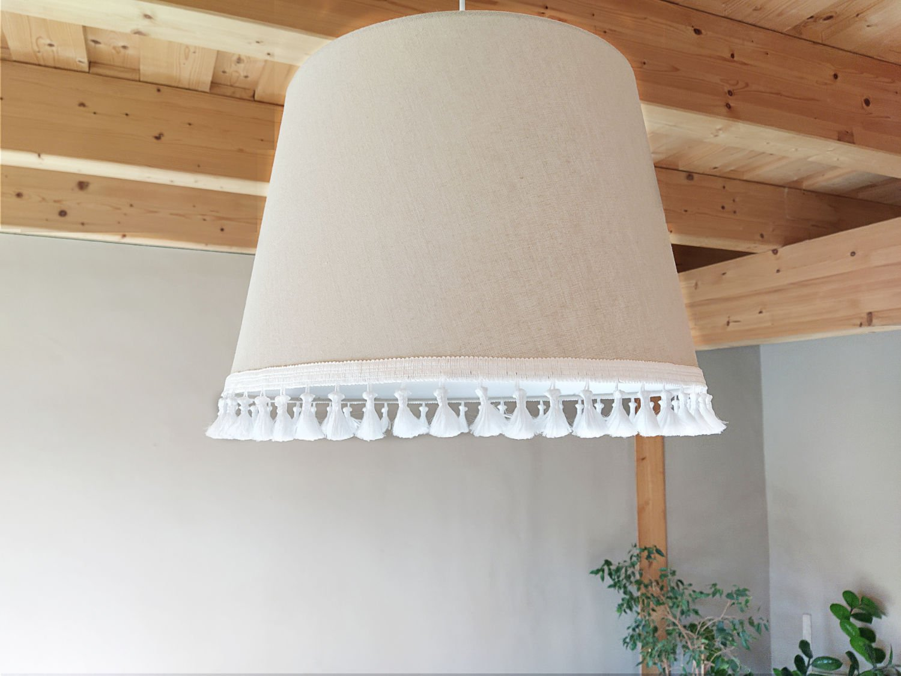
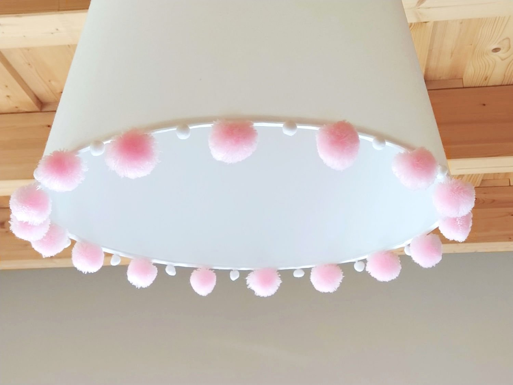
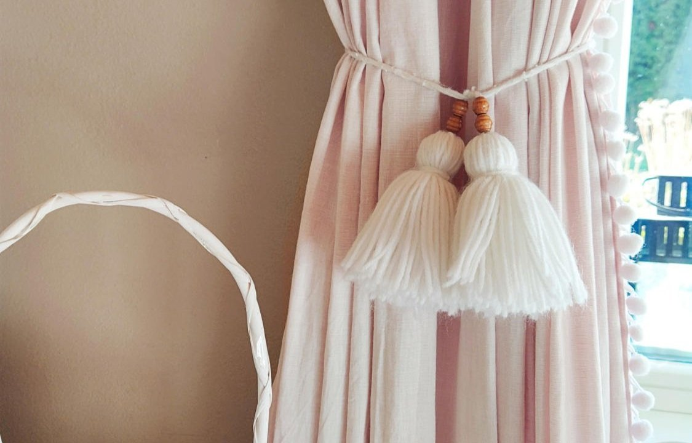
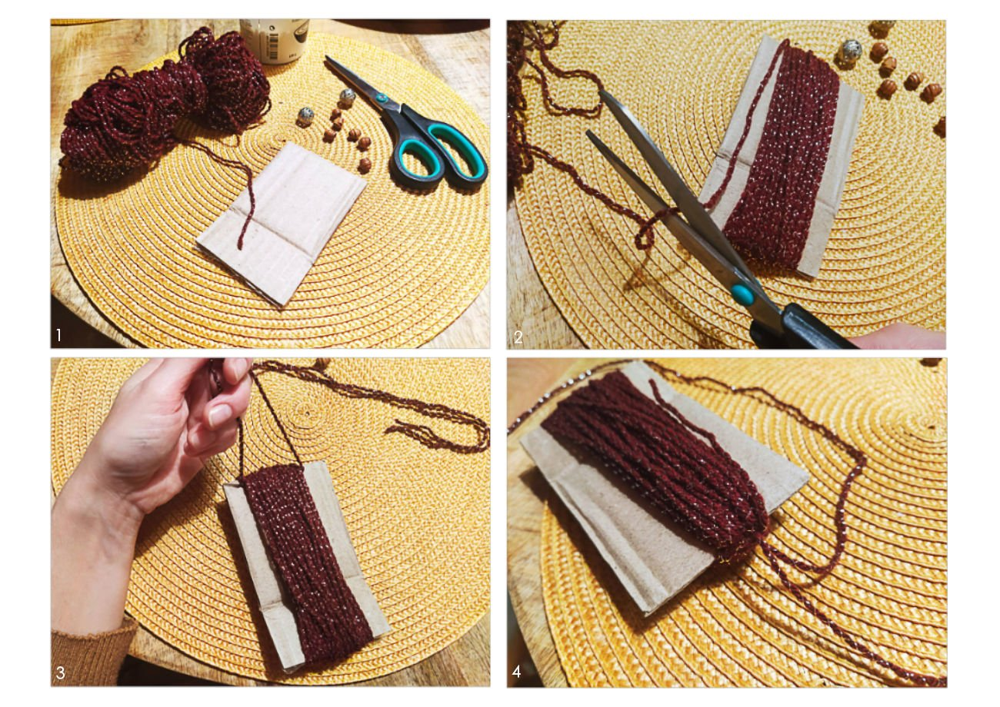
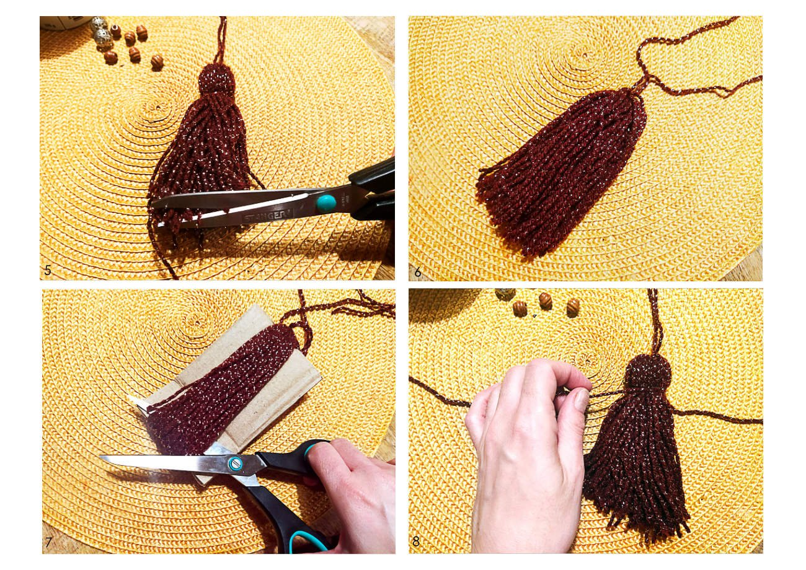
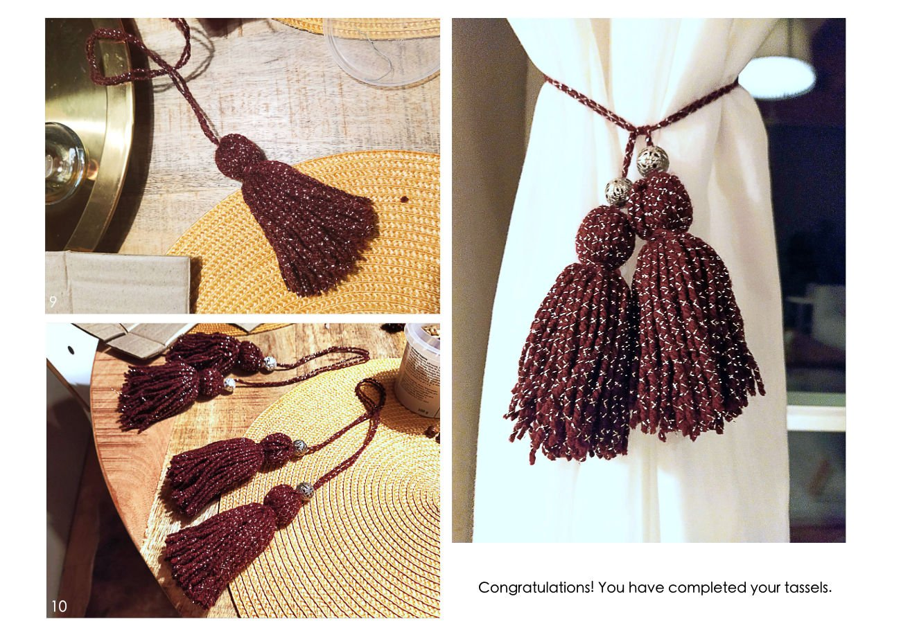

*I am a sucker for pom-poms, fringes, tassels, and all things fun. They instantly give off a boho vibe, and when combined with more subdued colors, they can create a nice complementary wow factor. DIY tassel tutorial included!*

<Caption>
Image credit: Staying Cosy
</Caption>

Decorating on a budget can have many challenges. I know from personal experience that doing things on my own brings me a great joy for multiple reasons.

The reasons why DIY is cool:

- Upgrades something that would otherwise be replaced — a win for sustainability.
- Simple, inexpensive pieces keep it economical.
- Improves the look — *hopefully!*
- Gives an amazing sense of accomplishment.
- Adds a touch of whimsy — tassels, pom-poms, and a little poetic flair.

And as they say: *a little whimsy goes a long way.* Okay, I just made that up — but in my head, if it rhymes, it’s a rule, right? At the very least, a few tassels and pom-poms can turn a static room into something unexpectedly poetic.

> “I know it’s not everybody’s cup of tea, but for me it adds just that right amount of boho-casual vibe that every cosy home needs.”

## Tasseled Lamp Shades

<Gallery columns={2} images={[{"src": "/src/assets/library/7e1578-beigeshade02.jpg", "alt": "beigeshade02"}, {"src": "/src/assets/library/2d1b9d-beigeshade01.jpg", "alt": "beigeshade01"}]} />

When I decided to improve these simple [Ikea drum shades](https://www.ikea.com/au/en/p/skottorp-lamp-shade-light-grey-60449006/), I'd had them for about two years. I had previously used pom-poms on a shade in my children's bedroom, but I knew I wanted something a little more sophisticated and muted down.

These tassels appeared to be an excellent choice. They came attached to a ribbon, so *I hot glued them* onto the lamp shades' outer edges.

<Gallery columns={2} images={[{"src": "/src/assets/library/c915a4-tassel01.jpg", "alt": "tassel01"}, {"src": "/src/assets/library/ff9269-shade02.jpg", "alt": "shade02"}]} />

Thanks to using small tassels, the outcome isn't too overwhelming. If you prefer a more boho look, choose longer ones for a more dramatic effect.

Since I have both of these lamps in my open plan kitchen-living area, I chose two colours. Beige, to match the shades, and white, to break up the monotony.

## Pom Pom Curtains

I saw a picture of pom pom lined white curtains somewhere, and right aways I knew *I had to put them up* on my girls’ bedroom curtains.

<Gallery columns={2} images={[{"src": "/src/assets/library/c1650c-pink01.jpg", "alt": "pink01"}, {"src": "/src/assets/library/56dee6-pink06.jpg", "alt": "pink06"}]} />

Though I do have a sewing machine and can shorten pants and perform other simple tasks, I somehow felt that hot gluing might work just as well. I intended to say it was to speed up the process, but I have to admit — laziness got the better of me.

*For the more adventurous among you, feel free to get that sewing machine out!*

This time, I attached the ribbon to the back so that only the pom-poms would be visible. It's a subtle, yet effective change that makes the curtains look much more interesting and fun.

# Pom Pom Lamp Shade

<Caption>
Image credit: Staying Cosy
</Caption>

We were doing the kids’ bedroom on a budget, and to match the curtain upgrade, I also decorated the hanging lamp shade. It is the same affordable Ikea drum shade that I have in my open-plan kitchen-living room, except this time in white. I chose two pom-pom sizes to go for a more whimsical and girlie vibe, so the decorating process took a little longer.

> “My idea was to make the lamp look funky and cheerful. After all, it was meant for the bedroom of two cheeky girls. ”

I had to *individually connect each pom pom* to a white cotton ribbon, *spacing them evenly.* I measured the diameter beforehand to know what length of the ribbon to work with. Afterwards, I followed the steps for the tassel lamp shades above, hot gluing the decorated ribbon to the bottom rim of the shade.

# Tasseled Curtain Tie-Backs

I usually have some leftover wool from my kids’ projects, and this time I put it to good use by making these gorgeous curtain tiebacks.

Don’t you think those lovely pom-pom curtains needed an extra level of cool?

<Caption>
Image credit: Staying Cosy
</Caption>

Yes, they did — and so did all my other curtains! I found some wooden beads in my arts and crafts box and thought they’d look adorable on tassels. Turns out I was right! The muted white and grey colours give the finished tassels a soft, versatile look that works with everything. I can easily move them from one room to another, and they still look great.

☘︎ ***DIY Tassel Tutorial:***

*1. Spin wool onto a 10cm/4inch wide piece of cardboard to desired thickness. You can see that one set of my white tie-backs is thicker and bulkier than the other white pair. Use more wool for a thick tassel, or less for a long, sleek one.*

*2. Cut the wool thread after you're finished spinning.*

*3. Then, choose a longer piece of wool, approximately 50cm/20inch, and tie it around the thickness of the wrapped bundle of wool on one edge of the cardboard.*

*4. This will be the tassel's top.*

*5. On the opposite end of the cardboard, cut along the full thickness of the bundle.*

*6. Your tassel should now have a rough shape, and all that's left is to make the little 'head.'*

*7. Cut a shorter piece of wool and knot it around the tassel at about a third of its length.*

*8. Even out the fluffy bottom part using scissors.*

*9. You've completed your basic tassel.*

*10. To make it more original and unique, you can add some wood or metal beads, as well as other decorations.*

A curtain tie back is made by connecting two tassels together. Use single tassels as a keychain, to decorate pillow edges, as napkin holders or to make a tassel garland. Let your creativity take over!

---

**☘︎ Would you like more inspiration?**

[*Mindful Living at Home*](https://bluebird-hawk-as8j.squarespace.com/blog/shaping-a-green-home-with-purpose) *|* [*Effective Window Cleaning Hacks*](https://bluebird-hawk-as8j.squarespace.com/blog/effective-window-cleaning-hacks) *|* [*Sculptural Lamps Guide*](https://bluebird-hawk-as8j.squarespace.com/blog/sculptural-lamps-light-personality)

SEARCH THE BLOG

---

---
