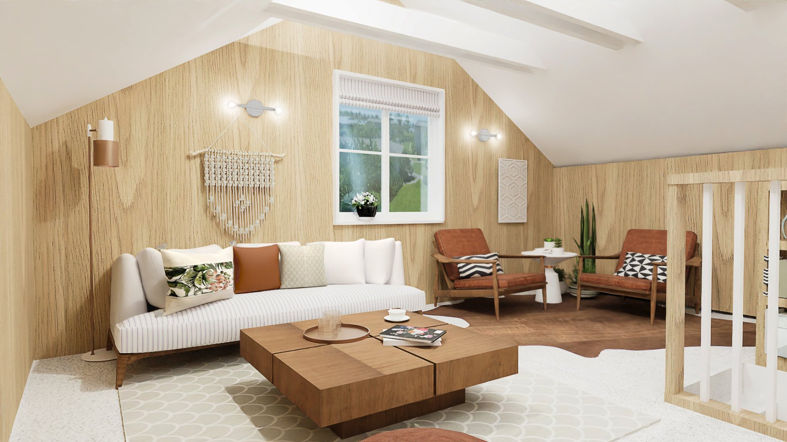
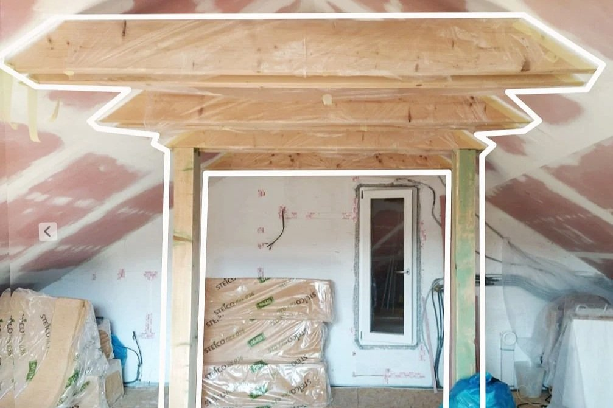
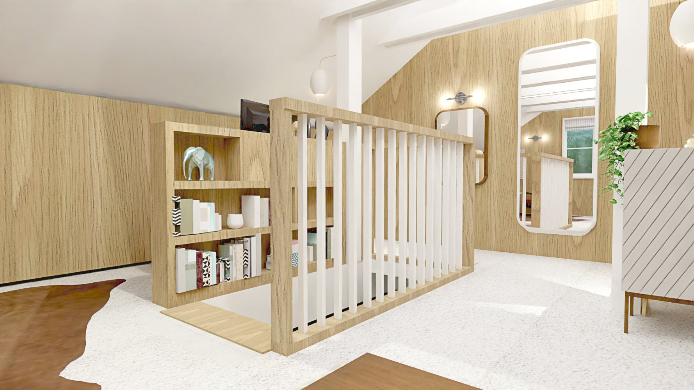
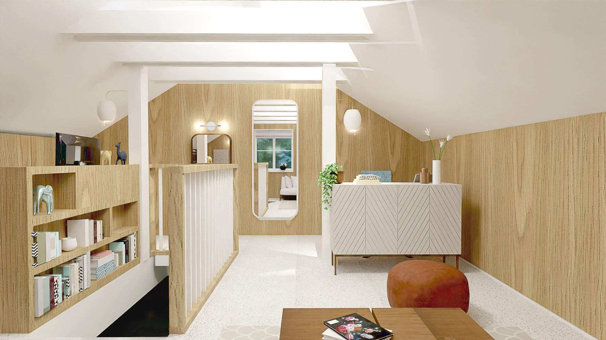
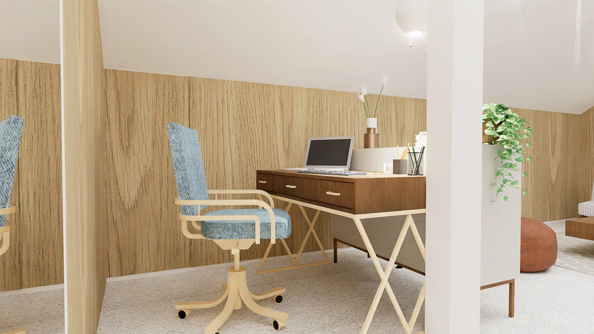

*Let’s be honest. Designing an attic space can be daunting. I’ve been there. I’m taking you behind the scenes of our cosy attic home office. This project was a true test of multifunctional design, as we had to navigate a tricky walkthrough layout and limited floor space. If you’re looking for small loft office ideas or a solution for a challenging floor plan, this journey is for you.*

<Caption>
Image credit: Staying Cosy
</Caption>

We finally got the chance to start working on our attic. It happened after three long years of relocating items and boxes in and out of this area, which seemed to go on forever.

And here we are now. Parts of the room have been completed, and since I started documenting the entire process earlier already, I'm going to split it into a few different posts. This one shows the room's original rough state as well as the proposed final design.

## The General Idea — A Vision for the Space

I’ve always imagined the attic as a warm, wood-cladded home office tucked beneath a sloped ceiling. A snug sofa flooded with morning sunlight, transforming into a cosy home cinema by night.

To make the most of the footprint, we planned built-in storage hidden behind wooden cabinetry that follows the angled walls. While this is a softer take on a *man cave* for my husband, I also needed a dedicated desk space. The room had to gently balance both our needs.

In practical terms, the space needed to accommodate:

- Two workstations for a double home office.
- A TV lounge area.
- Safe stairs railing and integrated storage for printers and files.

Basics of attic interior design start with architecture.

Our primary goal was a cosy home office for two that doubles as a secondary lounge, all while maintaining a clear access route to the storage room beyond.

To lay the foundation of a successful loft conversion, consider:

1. **The main purpose:** Is it a chalet-style *(A-frame)* bathroom with exposed beams, a dry-walled dormer playroom, or a mansard *(barn-style)* guest bedroom?
2. **Multifunctional use:** Will the space transition from day to night?
3. **Lighting:** Does it have a roof window, or skylight?

Now that the fundamentals are in place, it’s time to address the challenges.

## Gables and Dormers — Navigating a Tricky Loft Setup

<Caption>
Exposed beams in our attic | Image credit: Staying Cosy
</Caption>

Sloped ceilings and dormer windows define most attic rooms. They bring a certain charm, but also introduce very specific interior design challenges. In our case, we have just one simple gable window, while the roof’s load-bearing beams shaped many of our design decisions.

The attic stretches across the full width of the house, with a floor area of 5.6 x 5 metres (18’4” x 16’4”). This generous proportion gave the **exposed beams** an unexpected elegance, almost like a Chinese gate, turning what could have been an obstacle into a defining architectural feature.

## Mastering Attic Layout by Solving Structural Hurdles

When working with attic rooms, it’s always best to address structural oddities first—stairs, beams, awkward openings, or any other weird attic features—before turning your attention to aesthetics. Once those fixed elements are thoughtfully resolved, the rest of the design can unfold far more naturally.

**The challenging staircase**

<Caption>
Image credit: Staying Cosy
</Caption>

For us, the biggest hurdle was the staircase cutting through the room. Instead of fighting it, we designed a custom U-shaped stair railing that visually obscures the messy desk area while allowing natural light to flow in. It became a practical solution that didn’t compromise the openness of the space. By adding a bookshelf to the stairwell, we turned a safety requirement into a stylish design feature.

With the major constraints handled, you can start focusing on the key design elements that shape the character of the space:

**The ceiling and uneven shapes**\
Defined by the roof’s angle and height, the ceiling is the dominant feature in any loft room. You can choose to celebrate it as a focal point or let it quietly blend into the background, but it should always be a conscious decision.

Alcoves, dormers, pillars, sharp angles—especially when several appear at once—need careful consideration. Each element benefits from its own approach rather than being treated as a problem to hide.

**Embracing the attic quirks**\
A smaller-than-usual door, a tucked-away storage nook, an unexpected step or level change—these details are golden opportunities to add character. Embrace them. They’re often what make an attic space feel truly one of a kind.

## Light, Mirrors and the Secret Attic Door

<Caption>
Image credit: Staying Cosy
</Caption>

For attic room design, natural light is essential. It makes small spaces feel expansive and boosts productivity.

**In a room with only one window, every ray of light counts.**

We used a two-step approach to brighten the layout: first, painting the ceiling and wooden beams in a crisp, neutral white; and second, installing large mirrors between the desks to bounce light across the room. One of them serves a dual purpose by hiding a secret access door to the uninsulated attic storage behind it.

Because every home deserves a bit of mystery!

Thankfully, our south-east facing window receives plenty of unobstructed daylight. This fact gave me the confidence to brighten the entire space and go for a light and airy design. If you’re dealing with a darker, moodier space, skylights can be a game-changer.

#### 💡\*\* \*\*Lighting Insight

Did you know that skylights and roof windows provide up to **three times more light** than traditional vertical windows? This makes them the ultimate tool for brightening deep attic plans.

Assessing your attic’s lighting potential is essential. To get a clear sense of how your attic handles light, ask yourself:

- Which direction is the light coming from?
- How many natural light sources are there, and how large are they?
- Are they dormers, gable windows, roof windows—or a mix?
- Are there any outside obstructions, like nearby buildings or tall trees?

If your attic is darker and adding roof windows isn’t an option, *embrace the mood.* Rich tones, layered textures, and warm lighting can transform a shadowy space into a cosy, den-like retreat. A perfect cocooned comfort, isn’t it?

## Zoning, Textures & Colour Palette

Once we’ve carefully thought through all the above aspects, it’s time to define key design elements. In our case, they were a handful.

**Smart Storage**\
We’re making the most of every centimetre under the eaves with angled built-in cabinetry. This transforms otherwise *dead* space into generous storage, keeping the main floor uncluttered and preserving the room’s airy, open feel.

**Workspace flow**\
Since the built-in storage stretches the full length of the sloped walls, the workspace needed careful zoning. Instead of pushing the desks against the eaves, we positioned them to face the room, nestled between two vertical beams. This layout creates a focal point that allows for a view of the window while keeping the *messy* office zone tucked neatly away.

<Caption>
Image credit: Staying Cosy
</Caption>

**Hidden tech**\
Oak cladding will ground the space, with all heating pipes smartly concealed within the millwork. This ensures a calm, relaxing atmosphere. We’ve dedicated the area to both work and relaxation, opting to hide the TV behind a large grey cabinet door—out of sight when not in use. I prefer not to have a cold, black screen staring at me.

**Natural textures**\
As always, we’re embracing natural textures. Thick-pile wool carpet will play into the *Hyge* feel and compliment the warm nature of the wood.

**Soft paint colour**\
The neutral white shade for the ceiling and beams ensured that even with one window, this small attic space feels airy, intentional, and full of life.

## Work in Progress

The structural work is done! The drywalling is complete, and the sloped ceiling and beams have been coated with a soft white shade called [Paper](https://tikkurila.com/pro/colors/paper-f497) by Tikkurila. This neutral base is the perfect backdrop for the next phase of our attic study.

Coming up in the future: I’ll be sharing the final floor plan and the stunning wooden cladding details. If you're working on your own loft conversion, I’d love to hear your ideas or suggestions in the comments!

---

**☘︎ You might also find useful:**

[*How Much Space Do We Really Need?*](/blog/how-big-should-your-home-be) *|* [*Air Purifying Plants for Your Home*](/blog/air-purifying-plants)

SEARCH THE BLOG:

---

