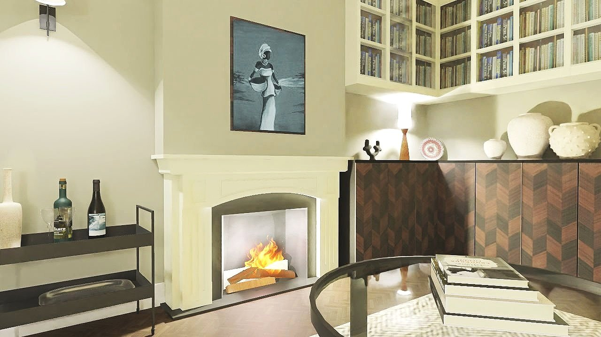
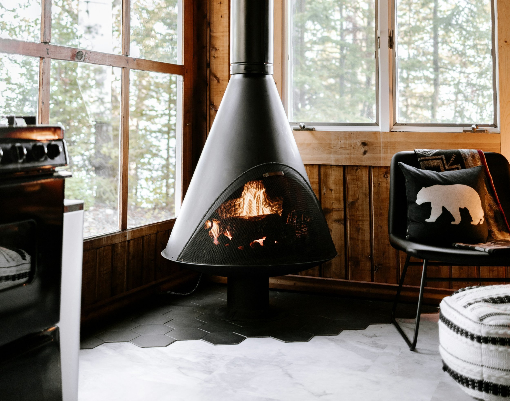
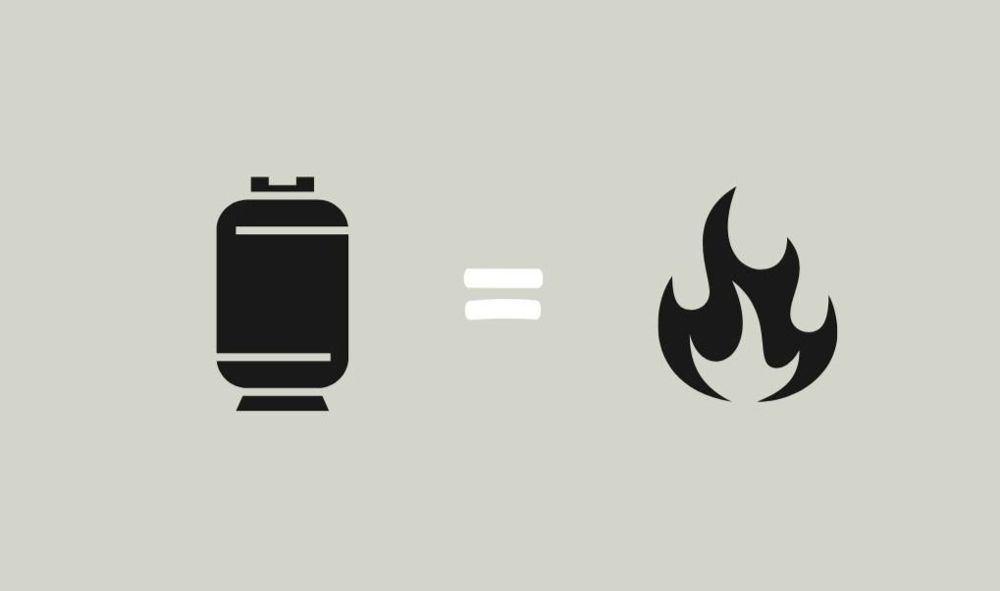
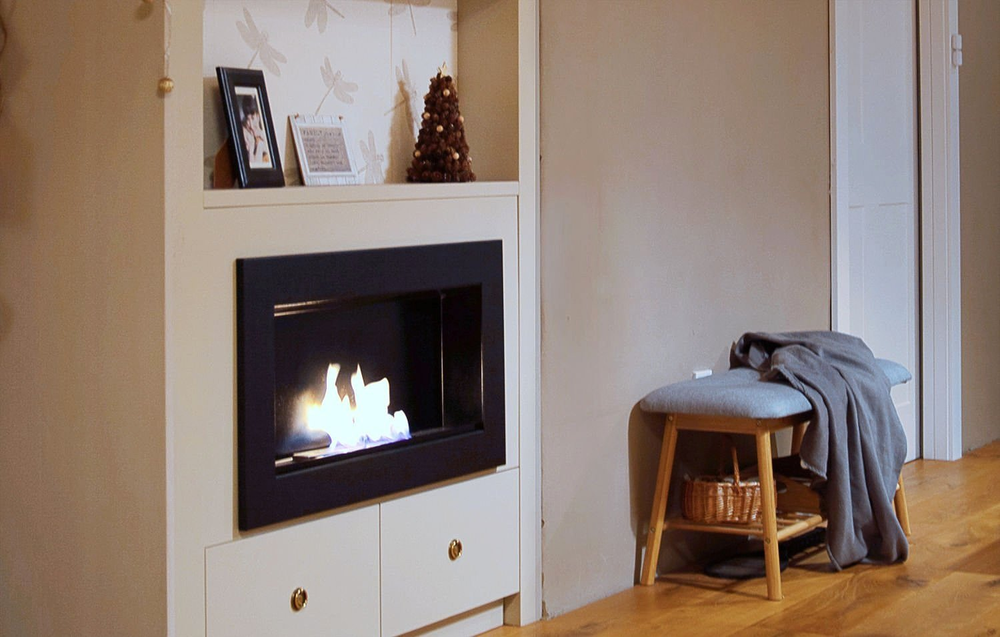
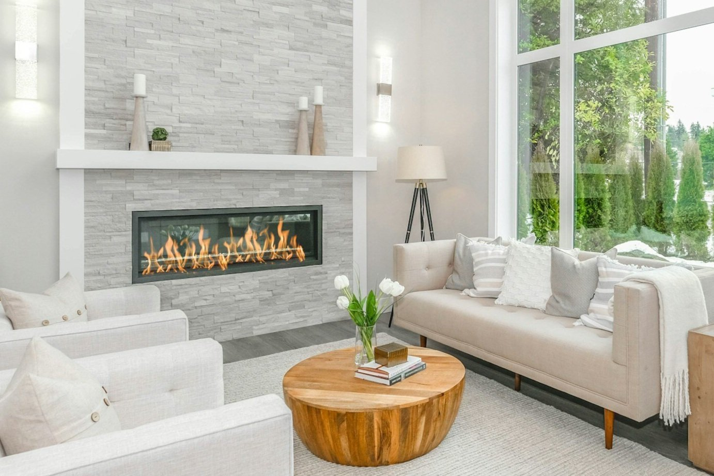
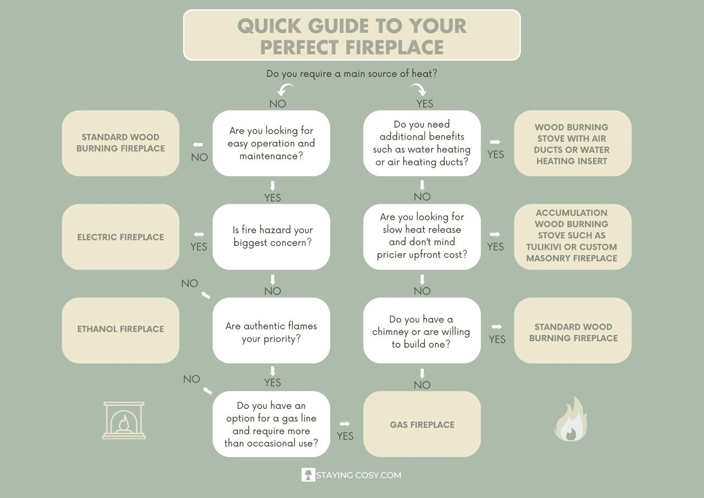

*I’ve always been a huge fan of fireplaces. By fireplace I picture a calm crackling of flames against a serene backdrop while the dancing glow promotes feelings of relaxation. Gathered with your loved ones around cosy fire, who doesn’t love this kind of nostalgia and sense of belonging?*

<Caption>
Image credit: Staying Cosy
</Caption>

Fireplaces are undeniably charming. They bring warmth, atmosphere, and even a touch of romance. But when it comes to their main practical purpose — heating your home, they’ve become almost obsolete. Central heating systems are far more efficient and convenient.

That said, fireplaces can still serve as a great backup heat source. However, there’s a catch—they require chimneys, and chimneys emit pollutants. It’s a tricky balance creating what feels like a vicious loop: Do you choose to go for a fireplace or not at all?

### Fireplace or No Fireplace?

Here’s the good news. You don’t need to struggle with finding an eco-friendly option that also meets your heating requirements. That’s what I’m here for! :-) And let’s be real. There isn’t one perfect eco-friendly fireplace.

But there is one that is perfect for *you*.

So, let’s dig in deeper and figure out which option works best for your needs.

## Wood Burning Fireplace

<Caption>
Image credit: [Hans Isaacson](https://unsplash.com/@hans_isaacson?utm_content=creditCopyText&utm_medium=referral&utm_source=unsplash) on [Unsplash](https://unsplash.com/photos/a-living-room-with-a-wood-burning-stove-33ML-Z9JsLo?utm_content=creditCopyText&utm_medium=referral&utm_source=unsplash)
</Caption>

These traditional and classic fireplaces exude a genuine flame and a rustic ambiance by burning wood logs or wood pellets as fuel. When people think "fireplace," this is usually the mental image that pops up.

A glass screen allows for a closed type, striking the balance between keeping the fire visible and enjoyable, yet eliminating harmful fumes. The interior construction can vary based on the desired benefits. Some may even feature extras like heating water through a water heating insert or channeling hot air to upstairs bedrooms via air ducts.

Not all fireplaces are created equal in retaining heat. Take the Finnish Tulikivi, for instance, renowned for its soapstone construction that excels in heat retention. And if you're after a custom solution, there are masonry fireplaces created to hold the heat within their body mass, slowly releasing it for up to 12 hours. They can even come with integrated cooker or oven.

### Heating

The warmth emanating from a crackling fire makes wood-burning fireplaces an excellent source of natural heating. Their efficiency is influenced by factors like configuration, type of heating element, and of the wood burned. Additionally, the material qualities and insulation of the building being heated play a crucial role; brick houses, for instance, tend to retain heat longer than their timber construction counterparts.

While the heat distribution might not be as uniform as from some other heating methods, these fireplaces can still work wonders for warming up smaller spaces.

### Cost-effectiveness

As much as I would like them to be the perfect choice, wood-burning fireplaces are the least affordable option. While the fuel - wood or pellets, can be relatively inexpensive, there are other considerations to take into account.

Expenses associated with potential installation, routine maintenance, and chimney cleaning can mount up. Local regulations and the availability of wood may also affect prices.

### Ecological Impact

One may argue that burning wood is a sustainable energy source, but this applies only if done responsibly. The key is to use environmentally friendly stoves or inserts certified by agencies like the EPA and stick to burning seasoned wood, the kind that's had its sweet time drying out properly.

Burning anything else is a BAD idea! No cheating on the quality of your firewood – trust me, the not-so-pleasant smoke will spill the beans. I've even heard some wild tales about burning disposable diapers in fireplaces! I mean... seriously? That's plastic – definitely not the kind of cosy fire vibe we're going for!

### Ease of Use

Getting the wood ready for winter is just a typical summer job in our village. So, it comes as no shocker that running a wood-burning fireplace is a bit more hands-on than other heating setups. You gotta have the knack for starting and maintaining the fire, not to mention the whole process of gathering, splitting, and stashing away wood.

Even with certified stoves and fancy tech, making them work smoothly still needs some regular love and care. Let's not get too deep into ash cleaning and glass screen polishing, but one thing's for sure – convenience isn't their top trump card.

And don’t forget to keep that chimney in check to avoid any fire risks – regular servicing is the way to go!

### Is this your choice?

- It's a good idea to take advantage of any existing chimneys on the site and install wood-burning fireplaces.
- This is a great choice if you are looking for a backup source of heat.
- If authenticity is what you're looking for nothing can beat real burning logs.
- Do you need a backup wood fire oven or cooking top? The masonry oven stove can serve both as the primary source of heat and possibly as a kitchen addition.

## Gas Fireplace

<Caption>
Graphic: Staying Cosy - made in Canva
</Caption>

Gas fireplaces add a touch of sophistication to the fireplace scene, especially if low maintenance is your game. Using natural gas or propane, they bring convenience without the fuss of wood preparation. With instant ignition, adjustable flames, and minimal upkeep, it's an attractive option, and hey, no need for a chimney!

What you do need, however, are gas pipes and vents so the initial cost might be a bit steeper. I would personally advise to opt for a model with direct vent technology, ensuring proper external connections for exhaust and oxygen to avoid oxygen depletion in smaller rooms. Also a must is to obtain a carbon monoxide detector.

### Heating

Are you trying to get your log cabin heated up right away? Gas offers quick warmth with adjustable settings. Many fireplaces include flexible options that let you customise the heat output and flame intensity to suit your preferences. They will warm your house just as effectively as any wood-burning fireplace.

### Cost-effectiveness

The gas fires prove to be economical and less expensive than its wood-burning predecessors, yet still competitively priced when compared to other chimney-free options. While the initial installation cost could be higher, eventually savings are likely to result thanks to their convenience and efficiency.

In many areas, gas is often less expensive than electricity, which helps with reducing expenses even more.

### Ecological Impact

I think anyone can visualize that a fireplace without smoke will naturally be more on the Ecological end of the spectrum.

Gas fires produce fewer emissions and particulate matter, contributing to better air quality and, therefore are more environmentally friendly compared to traditional wood-burning fireplaces. Needless to say, it's essential to go for high-efficiency models and ensure proper installation and maintenance to minimise their environmental impact. Otherwise you can end up with [high VOC levels](/blog/chemicals-that-pollute-our-living-rooms) inside of your home, *and you don’t want that.*

Could gas stove be your winner? Keep reading – more options are on the way!

### Ease of Use

Fire with a switch of a button? It is as simple as that. New models will eliminate the need for a lighter entirely. They usually feature remote control options for ignition and extinguishing, and control over heat output and flame intensity.

Gas fireplaces are generally safe, but like with any other gas appliance, there's a teeny-tiny risk of a fire hazard. It's all about proper installation, regular check-ups, and having a keen eye for any oddities to keep things cosy and secure.

Imagine no handling of wood, ash cleanup, or concerns about sparks and embers. For extra convenience, certain designs have functions that can be programmed. Spark up that fire like a true magician! Let those kids' jaws drop by performing your magic trick on them, they will be amazed!

### Is this the one for you?

- If you've got gas pipes on your property, why not make the most of them?
- Choose gas if you're after ample heating without the hassle of chimney installation, maintenance, or added costs.
- If comfort is at the core of your life philosophy, then gas is a definite yes.
- Need to warm up a smaller house with a straightforward appliance? A gas fire is your ticket to tailor-made settings.

## Ethanol Fireplace

<Caption>
Image credit: Staying Cosy
</Caption>

Let’s make it clear, ethanol fireplaces are the real deal when it comes to real fire, without any additional hassle. You get the beauty of a flickering flame, minus the smoke, the mess, or the need for a chimney.

I’ve got one at home, and honestly? It’s perfect for our busy household!

These fireplaces run on bioethanol fuel—yep, that’s where the name comes from—and they burn clean, needing no venting at all. Just fire, warmth, and a whole lot of mood, especially on those slow, quiet weekends.

You've got a ton of choices in sizes and styles, including stand-alone options since they don't need any fancy pipe connections. Feeling traditional? Go for one that looks like a classic wood-burning fireplace. Short on space? Grab a portable, lightweight freestanding version. They're so versatile you can even throw one on a balcony.

I love using ours when I feel the need for some extra warmth during a change of seasons or when I just want some cosy vibes as the days get shorter. It's a quick one-minute job to fill up the fuel burner, light it, and let those growing flames set the mood.

### Heating

Ethanol fireplaces provide a decent amount of heat, often enough to take the chill out of a room. However, they're not the most heat-efficient, making them better for setting the mood and adding a bit of warmth rather than being your main heat source. If you're all about experiencing real flames without the heavy maintenance, an ethanol fireplace might be your top pick.

When selecting one, remember that different models offer different heat outputs, so it's essential to consider your specific heating needs.

### Cost-effectiveness

If upfront cost is your main concern, going for ethanol is a no-brainer. They can be reasonably priced, and depending on the model, you might save a good chunk of money. They're virtually maintenance-free and way less expensive than fireplaces with chimneys or gas lines.

*Here's the catch* – while the initial purchase cost is usually reasonable, the ongoing expense of ethanol fuel can add up. Their practicality and aesthetic appeal might however make the investment worthwhile for those seeking a stylish heating option, that can be placed anywhere where gas or chimney aren’t an option.

They're the perfect alternative for enjoying the occasional glow of a real fire in well-insulated homes.

### Ecological Impact

This is the green champion in the fireplace world. When it comes to fireplaces, ethanol stoves are considered the most environmentally friendly choice out there. The fuel they use, denatured ethanol, is a renewable energy source derived from plants.

Essentially, the burning of ethanol doesn't produce any hazardous fumes, ash, or smells within your home, nor does it release any harmful gases. It's combustion simply releases heat, steam, and a trace quantity of CO2. Since the levels are incredibly low, ventilation is recommended but usually not required.

Say yes to no smoke and enjoy clean burning flame inside of your home with an ethanol fireplace.

### Ease of Use

One of the standout features of ethanol fireplaces is their user-friendliness. Have I mentioned this already? Let's recap. No venting, no chimney, no electricity, and no special installation. Lighting them up is as simple as pouring the fuel into designated burners and igniting them. Yay!

Most models also come with adjustable flame settings and extinguishing mechanisms for added convenience. And it wouldn’t be a proper round-up if I didn’t mention that there is no cleaning necessary, except for the occasional dusting. Is that even cleaning, really?

But what about safety? I knew this question was on your mind, so let’s get it answered. Like any real flame ethanol can pose a fire hazard if not used properly. Rule number one is to keep the fuel out of children's reach and properly stored. Safety is paramount, so always follow the manufacturer’s instructions when using your fireplace.

### Is this the one for you?

- If you want a hassle-free option without the need for complex installation, this truly ventless, chimney and pipe-free alternative is made for you.
- Go for it, if preserving the environment is your top priority, but you still crave the charm of real flames.
- If you don't need a primary heating source yet still desire a bit of fire ambiance every now and then, choose ethanol.
- If you are after a vast array of designs and portable options, this is your winner.

## Electric Fireplace

<Caption>
Image credit: Unsplash by [Zac Gudakov](https://unsplash.com/@zacgudakov)
</Caption>

Since most homes have electrical outlets, this list would not be complete without an electric fireplace. These energy-efficient devices are easy to install and rely on electricity to create heat, simulating artificial flame effects. While lacking the luxury of authentic flames, electric fireplaces are a safe option, as they don't pose fire risks.

What makes them stand out is their portability and versatility, making them an excellent option if you are constricted by other means or want to eliminate any fire hazard. Their instant heat on command is alluring and programmable settings offer comfortable heat management.

### Heating

Electric fireplaces are a great way to provide consistent heat. All they require is the connection to an electric outlet, no additional fuel is required. Their adjustable settings allow customisation of heat output and flame effects, providing swift heating to keep an area pleasantly warm. And sometimes that is all we need.

### Cost-effectiveness

Interestingly, electric fireplaces are usually seen as affordable and cost-effective, especially in buildings with excellent insulation. They boast energy efficiency and a lower initial cost compared to most other fireplace types.

Their significant advantage lies in minimal ongoing fuel expenses, as they don't rely on wood or gas. This makes them an economical choice for supplementary heating. However, for those considering them as a primary heating source, there are more budget-friendly and practical solutions.

### Ecological Impact

If the electricity originates from renewable sources, such as solar or wind, an electric fireplace stands out as the most environmentally friendly option among all types. It’s clean as it does not produce any emissions and coupled with relatively low energy consumption, it is the ideal choice for those prioritising a green and sustainable living environment.

### Ease of Use

In terms of ease of use, electric fireplaces excel. Much like the preceding two types, they are remarkably user-friendly and practical. Equipped with remote controls and adjustable settings, they allow easy customization of flame effects and heat output without having to leave your favorite armchair. When it comes to installation ease, electric fireplaces take the lead, requiring nothing more than plugging them in.

### Is this the one for you?

- If comfort and convenience are your priorities, and you don't want to compromise on potential fire hazards, the electric fireplace is the perfect fit.
- While this device doesn't produce real fire, opting for it is an excellent decision if you're comfortable with artificial flame effects.
- Go ahead with this type if you lack a chimney or gas connection and wish to avoid any ongoing additional expenses.
- For those sourcing electricity from renewable resources and aiming for maximum eco-friendliness, an electric fireplace stands out as the best option.

## Have You Found Your Perfect Fireplace Yet?

I completely understand the struggle of choosing the right one — I’ve been there myself! So I’m genuinely happy if my advice has been helpful. And if you’re still unsure and perhaps in a bit of a rush, I’ve put together this quick guide just for you:

<Caption>
Graphic: Staying Cosy - made in Canva
</Caption>

Once you know your desired type of fireplace you need to choose its right heat output.

#### 💡 **Heat Output and Sizing**

Heat output is measured in **kilowatts (kW)**. It’s the standard measurement for produced heat across different devices. When selecting the correct output, the size of your home and its level of insulation are the main factors to consider.

This is important for you to avoid under, or overheating your home. Let me break down how to figure out the correct amount quickly and easily.

**For a 25m² room** (269 sq.ft) in a moderately insulated home, you might be good with 2-6 kW. But if you've got a larger space, say 50m² (540 sq.ft) with average insulation, you might need 5-10 kW.

Of course, these are ballpark figures which don’t consider main source of heat and they further depend on factors like where you live, your insulation quality, and how energy-efficient your home is.

I also stumbled upon this awesome [heat output calculator](https://www.glowing-embers.co.uk/blog/heat-output-calculator) that helps you figure out the exact values based on your house specs. And remember, always select the correct kW output of the fireplace to meet your demand.

### Find the Balance

Figuring out the right fireplace is about striking the perfect balance between warmth, style, and sustainability. Whether it's for cosy winter evenings or as a functional centrepiece, make sure your choice complements both your home’s needs and your lifestyle.

By considering factors like efficiency, eco-friendliness and design, you can create a space that’s not only warm and inviting but also closely echoes your values.

A fireplace isn’t just a heat source. It becomes the backdrop for family evenings, slow mornings, and everything in between.

---

---

---
