*A little kitchen, a lot of charm. Think of a cosy woodland cottage with a tiny L-shaped meal prep nook and a wood-fire oven crackling away. Now, the question is: can we create a functional and spacious kitchen even in limited square meters and on a modest budget? You bet you can!*

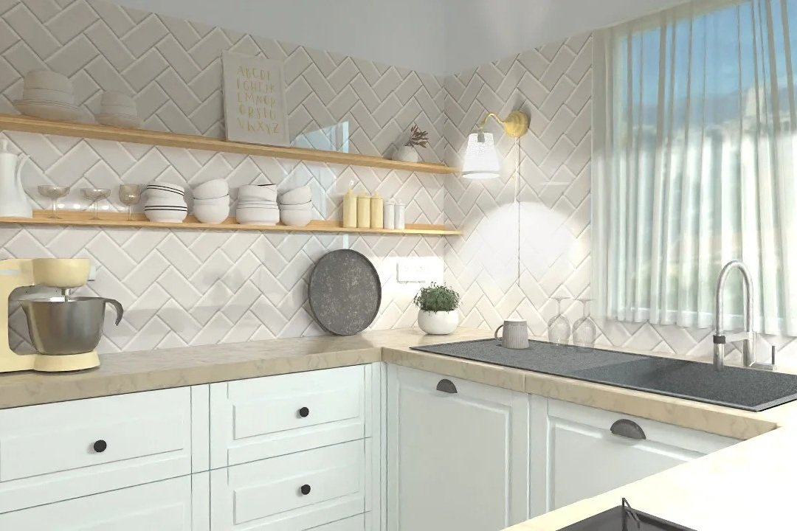

<Caption>
Image credit: Staying Cosy
</Caption>

Inflation may be soaring like a runaway train, while square meterage is shrinking, especially in city apartments. That’s just the reality we live in. And as our homes get tighter, so do our kitchens. Compact corners, open-plan alcoves, and one-wall layouts are becoming the new norm.

If you’re wondering how to make your kitchen work without blowing the budget or cramming it full of regrettable choices, you’re in the right place.

Grab a cup of coffee and read on for real-world, design-savvy tips to help you make the most of your space and your hard-earned cash. *And if you’ve ever wondered how much space we really need to live comfortably,* find out [here](/blog/how-big-should-your-home-be) — but beware, the answer might surprise you!

## Your Cooking Lifestyle

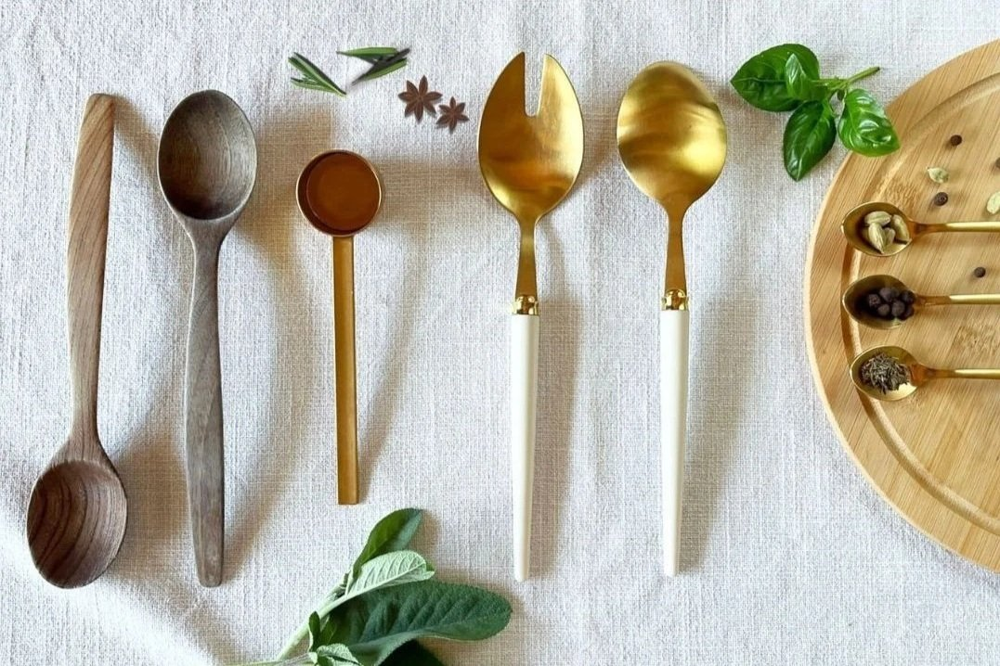

<Caption>
Image credit: Staying Cosy
</Caption>

Are you a gifted home cook, budding chef, or a just-left-mama’s-house beginner?

Whatever your level, your kitchen layout should reflect your *lifestyle and cooking habits.*

Ask yourself:

- Are you an everyday cook?
- How many people do you usually cook for?
- Do you cook from scratch or lean on pre-made meals?
- How much storage do you need?
- How many small appliances do you regularly use?
- Will a dishwasher, even a compact one, be considered?

In a small kitchen, space is limited. Your answers to these questions will help you find the *right balance* between cabinetry, countertop space, and appliances. Small details, like the sink size or its drying zone, can make a big difference.

***Do you entertain?*** Choose [everyday dishes](https://www.amazon.com/dp/B0D96166QF/ref=sspa_dk_detail_6?pd_rd_i=B0D96166QF&pd_rd_w=lsgtH&content-id=amzn1.sym.7446a9d1-25fe-4460-b135-a60336bad2c9&pf_rd_p=7446a9d1-25fe-4460-b135-a60336bad2c9&pf_rd_r=C19T4B6ZK7B8BYBMNYQV&pd_rd_wg=zWxLK&pd_rd_r=db2cb2f2-4be0-43af-ba69-5f7897c26a27&sp_csd=d2lkZ2V0TmFtZT1zcF9kZXRhaWw&th=1) pretty enough to double as Michelin-star-worthy serve-ware.

***Cook mostly from scratch?*** You’ll likely need *a larger fridge* and *plenty of counter space.*

***Can’t live without your daily Italian coffee?*** Invest in a compact [coffee machine](https://www.amazon.com/Keurig-K-Mini-Single-Serve-Coffee/dp/B07GV2S1GS/ref=sr_1_5?crid=1XO60MA2GMXX5&dib=eyJ2IjoiMSJ9.V8XarB37Ej5w81yJWCjnqXIsXGgsRkc6x08PWs_n7__LkBjv9-3ZVM-BJ5ZO0Xnp28cx1A9y-TgO5yzDTYAcWJA2ee8VyKpKEVRZNc1ytTGN72f1BuIBooE4KrvykpXI_2ILtp_YAuGziNLndkdbcAGseGjzx7kk_MYYvQ5qLN3mnniXdnkQrW7AZ1fmaONnm8f2hUG4gaQknG2pCJJr5hzFooOiGUpmAOsjAjf2UXMvzRbiMIOlYb4nm-5djHMl8uy9dL6RVYnMy2fN1w1MupgiZtjBmbBZ0RSHD-wCeug.PZFRJ8OfQ8KV7vyVWF-NQKFGtJmGJpgUvFLvOC0Z2FM&dib_tag=se&keywords=compact%2Bcoffee%2Bmachine&qid=1750762295&sprefix=compact%2Bcoffee%2Bmachi%2Caps%2C277&sr=8-5&th=1) and tuck it into a waist-height appliance cabinet, ready to use. *(Just don’t forget the electrical connection!)*

## Enough Food Prep Area

I’ve been an avid cook since I was a teenager. Plus, I was fortunate enough to live in many different places. One thing I’ve learned?

> “No matter how stunning a kitchen is, if it lacks enough food prep space, it’s just a pretty room pretending to be a kitchen.”

Especially in small-footprint layouts, a strategically placed, generously sized prep zone *is a must.* Ideally, this area should sit between the fridge/sink and the cooktop, forming part of an efficient workflow.

Aim for at least 90cm (36") of uninterrupted countertop space, if really limited — 70cm (27") at an absolute minimum.

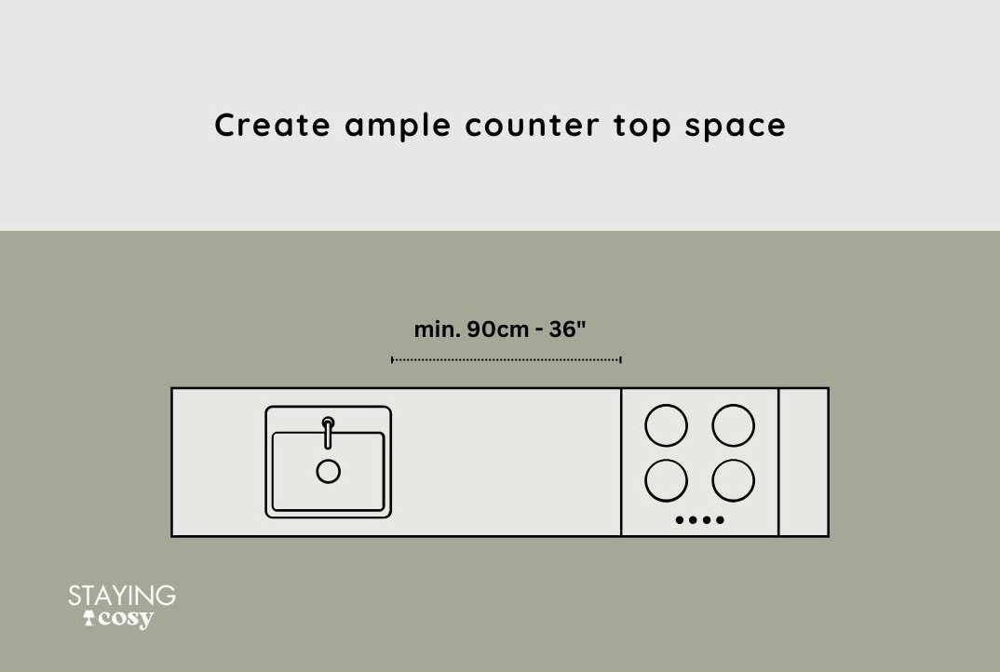

<Caption>
Graphic: Staying Cosy - made in Canva
</Caption>

Anything less, and cooking becomes a juggling act. If you’re short on space, skip the built-in dish drying zone and opt for a *portable or collapsible* [dish drying rack](https://www.amazon.com/OXO-Aluminum-Drainboard-Kitchen-Collapsible/dp/B09BVYVFZQ/ref=sr_1_15?crid=1AE0CE31M2UQJ&dib=eyJ2IjoiMSJ9.H0pIpe22hlKDIUMP6BoKOMmWWC0anisJHDHwOm_457rCTdMQMB3KzRvtblkZXKMKTDBEBGOsqe2DSe9yt1x81OmRFrQFAXFa_aIr-dNEZaNgRGwwn215_azp3CPqGhHE_TESt_al3cThQZ-fqpzBY8I7zS-2mNfE0uksYFY_tTM7mnDtSYSYWvbyha3Evl5GexzTQyqKta-ZlLRImhmWAZ1rCnLuvi17WtKNrsYQ2V3MXHb62SXFgEg4QKB2XuUxf-lp7HYX1JzOIMxO8I76b0EjGa2kggwB0XlmXewrhYQ.7h-VHT3VMzJRr49ut81HgnCHiwiIDQWgKjnJEGv3b6A&dib_tag=se&keywords=portable+foldable+dish+drying+rack&qid=1750847477&sprefix=portable+foldable+dishdrying+rack%2Caps%2C176&sr=8-15) that you can stash away when not in use.

Even occasional cooks need at least that 70cm. And to stretch your prep area even further, consider a *seamlessly integrated flat-panel electric or induction hob.* That way, when it’s not in use, it can double as extra workspace—*two birds, one stone.*

## The Kitchen Triangle

Yes, yes… we’ve all heard it before. The famous kitchen triangle.

But how to make it work in a restricted space?

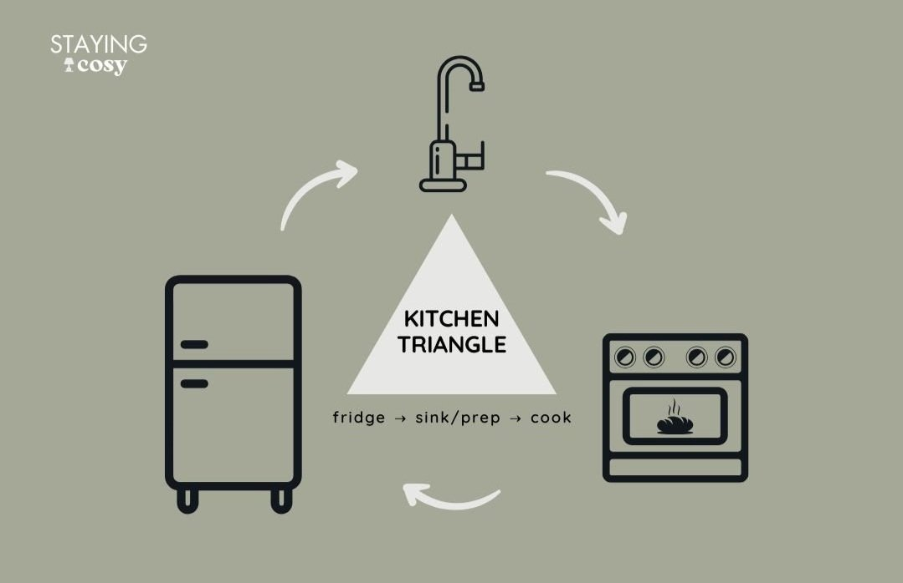

<Caption>
Graphic: Staying Cosy - made in Canva
</Caption>

Well, the *triangle* is not always a perfect geometric shape. Many times it ends up being rather stretched or squashed. The principle, however, stays the same — you need a step or two to reach your fridge, sink and cooktop from each other. In a small kitchen, it is literally *a step away.*

And, as someone who cooks daily, I place huge importance on a practical layout. Because smooth workflow has to come first, design and aesthetics can *(and should!)* follow.

### Single-wall Linear Kitchen

A classic triangle isn’t possible here. That doesn’t mean you can’t apply the logic. If space allows, place the freestanding fridge across from the main wall and — voilà, you’ve got a version of the triangle.

> “Remember the order: 1. you fetch food from the fridge, 2. wash & prep, 3. move onto cooking.”

### L-shaped Corner

Be careful not to create dead zones that trap grease or dirt, as well as clashing cabinet and appliance doors. *The oven vs. corner cabinet door battle is real!* Use spacers to allow doors to open freely.\
Also, avoid placing the cooktop too close to the corner. That little nook is better suited for a drying rack or prep items.

### Galley Kitchen

Even if it’s narrow, a galley layout actually gives you more opportunity for a well-balanced triangle. One key rule? Don’t block incoming light. Avoid placing tall cabinets or appliances directly in the path of a window. *Let natural light flood the space — it always pays off.*

### Tiny Island

If your space is truly limited, skip the island. It’s likely to feel *bulky and awkward,* no matter how cute it looks on Pinterest. Instead, consider placing a small dining table nearby. It can double as an *extra prep space* when needed and won’t visually choke the room.

## Avoid Corners, Multiple Levelling & Visual Breaks

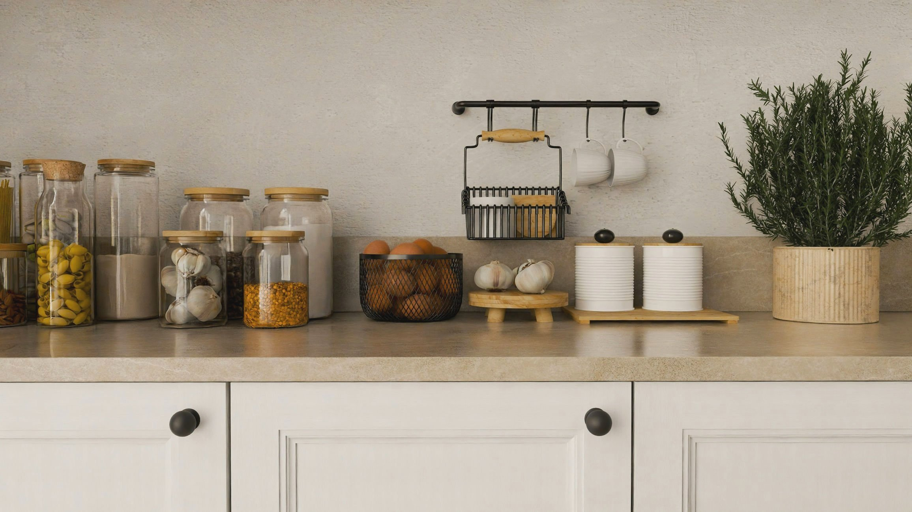

<Caption>
Image credit: [Jivitharsan Suresh](https://unsplash.com/@jivitharsan?utm_content=creditCopyText&utm_medium=referral&utm_source=unsplash) on [Unsplash](https://unsplash.com/photos/a-kitchen-counter-topped-with-lots-of-jars-and-containers-Nm4NP4s78Hg?utm_content=creditCopyText&utm_medium=referral&utm_source=unsplash)
</Caption>

When your kitchen is short on square metres, every millimetre of height and every visual line counts.

To make it cohesive, and more spacious than it really is, avoid carving it up with corners, stepped surfaces, or over-defined zones. These only break the space into even smaller fragments and create unnecessary visual clutter.

Instead, focus on *smooth, uninterrupted lines* that work with the existing architectural features. There is simply not enough space to forcefully create separate work areas. If you do want to distinguish certain zones, consider doing it gently—with a subtle shift in texture, tone, or lighting.

**Keep the floor on one plane:**

- **Same finish, wall to wall.** Skip the *easy-clean* tile rectangle in front of the hob and run the timber, micro-cement or large-format tile seamlessly under every cabinet.
- **Flush thresholds.** If the kitchen opens onto a terrace or living area, use a slimline drainage track or built-in mat well instead of a raised step.

**One continuous work-surface:**

- **Match heights.** Standardise all base-unit carcasses at 72 cm (28 3/8"), or the height that suits you ergonomically, and run one single worktop across. Avoid dropped baking stations or raised breakfast bars, which only chop up the view.
- **Waterfall ends.** Where an island or peninsula stops mid-room, let the worktop “waterfall” to the floor; the vertical line neatly contains the kitchen without adding an extra material.

**Use cabinetry, not walls, to define function:**

- **Pocket or bi-fold doors** can cleverly hide a coffee nook or breakfast pantry within the same run of cabinets. No need to box off another little “room.”
- **Open shelves** in perfect alignment with cabinet lines give a hint of zoning for spices or mugs, yet everything still reads as one clean grid.

**Unify the colour and material palette:**

- **Cabinet fronts,** wallsand even the ceiling in one tone—soft grey, warm white, pale oak— help erase boundaries.
- **Handle strategy.** Choose either all integrated pulls or all discreet knobs—mixing handle types unnecessarily fragments a short run of units.

**Let lighting do the zoning:**

- **LED strips** at the underside of wall cabinets highlight the prep area; a slim pendant over the dining perch marks the social corner—all at the flick of a switch, no sectioning required.
- **Toe-kick lighting** gives evening ambience and visually floats the run, enhancing the sense of a single plane. In small footprint kitchens it tends to be very effective.

**Keep vertical lines clean:**

- **One backsplash material**, full height. Running quartz or tempered glass right up to the wall units avoids extra horizontal breaks.
- **Group tall units together.** Stack the fridge, oven and broom cupboard in one column so they read as a single vertical block, rather than dotted elements.

## Maximise Clever Cabinet Storage

No matter how compact your kitchen is, smart cabinetry can make it feel twice as efficient. The more you can tuck away into well-organised, easy-to-access storage, the more calm and tidy your kitchen will feel.

Plan for cabinetry that reflects your height and your daily needs. It will make your day-to-day use more comfortable, while squeezing out every last bit of usable space.

### Go All the Way To the Ceiling

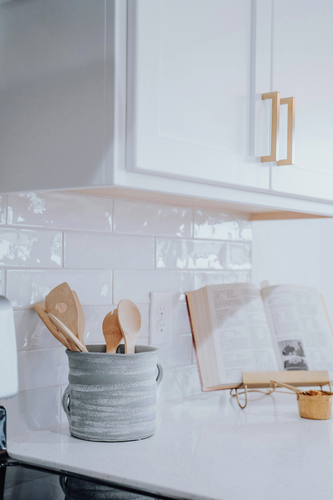

<Caption>
Image credit: [Bailey Alexander](https://unsplash.com/@baileyal3xander?utm_content=creditCopyText&utm_medium=referral&utm_source=unsplash) on [Unsplash](https://unsplash.com/photos/a-kitchen-counter-with-a-book-and-wooden-utensils-A77cXb4kBqQ?utm_content=creditCopyText&utm_medium=referral&utm_source=unsplash)
</Caption>

Upper cabinets that reach the ceiling might not be part of your daily use, but they’re perfect for occasional items like holiday platters, tablecloths or rarely-used appliances. Out of the way, but not out of mind.

To keep tall units from feeling heavy, go for soft colours that reflect light and choose slim cabinet doors that visually lighten the upper section.

### Think Slim, Sliding, Pocketing

Pocket-sliding doors save precious swing space and a pull-out larder or tray cabinet makes clever use of narrow gaps. Even just 15 cm (6") wide will do beautifully. It may cost a little extra, *and not every carpenter is willing to make them,* but believe me — it will be well worth it.

In galley layouts, bi-fold panels on corner cabinets are perfect in preventing doors from blocking movement or clashing with each other.

### Drawers Are Everything

Full-extension drawers are a total game changer. They let you access even the very back of cabinets and see everything at a glance—no more forgotten tins or hidden gadgets. I love mine! In fact, every kitchen should have them.

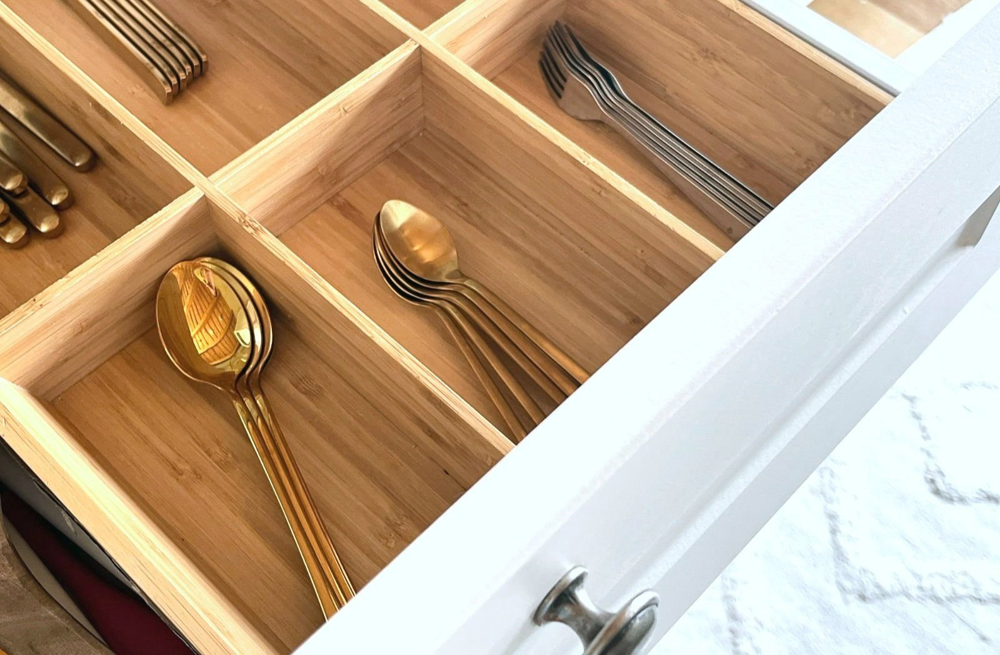

<Caption>
Image credit: Staying Cosy
</Caption>

And how about going even further?

**Inner drawers tucked inside outer drawers!**

Yes, they exist! Even IKEAhas [them](https://www.ikea.com/gb/en/cat/inner-drawers-700671/). They help you maximise every square inch of usable drawer space. And while mentioning Ikea, I have a little secret to tell. In Europe, their higher-grade drawer slides are produced by a very reputable manufacturer, meaning *you’re getting top quality at a surprisingly reasonable price.* I’m not sure about the U.S. range, but it’s definitely worth checking out.

## Choose Furniture That Disappears

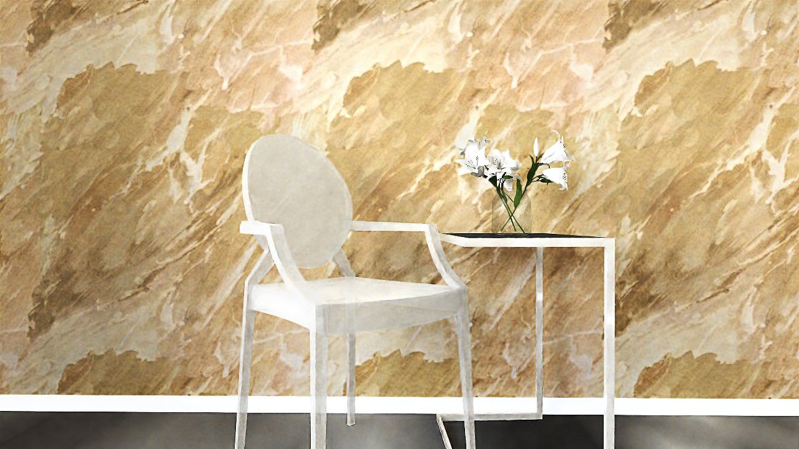

<Caption>
Image credit: Staying Cosy
</Caption>

Ever seen the iconic post-modern acrylic [Ghost Chairs](https://www.kartell.com/mt/en/ktcm/shop/product/louis-ghost-2-sedie/66-530) by Kartell? Even if they’re not quite your style, the idea behind them is brilliant: choose furnishings that blend in rather than stand out.

In a tiny kitchen, this approach can make a world of difference. Think tone-on-tone décor, fold-down tables, and even a bold glass pendant that feels airy instead of heavy.

**Hidden in plain sight:**

- **Backless stools** tuck neatly under an island overhang.
- **Glass, acrylic, or slim metal table bases** let the flooring flow uninterrupted, visually expanding the space.
- **Retractable surfaces**—like pull-out counters or sideboard drawers—stay out of the way until needed.

**Multifunctional pieces:**

- **A table that can double** as food prep zone or home office adds instant flexibility.
- **A deep window sill** can become a tea station or bar with the right setup.
- **A bench or stool with hidden storage** is a small-space hero—perfect for stashing bulkier kitchen items.

**Light-legged & levitating:**

- **Chairs with slim chrome or acrylic legs** reflect light and take up less visual space than their heavy wood counterparts.
- **Floating cabinetry** or raised cabinetry on legs gives the illusion of more floor, which adds to the feeling of spaciousness.

## Work *With* the Light, Not Against It

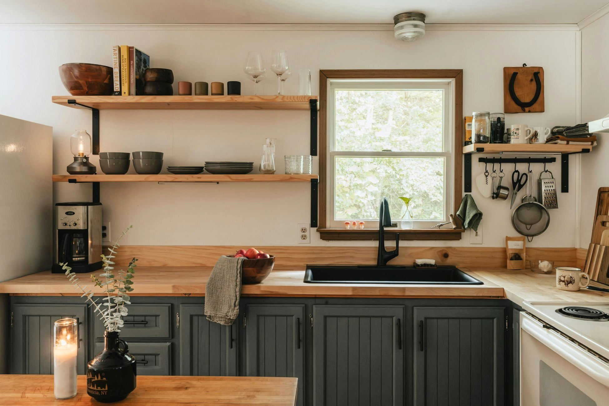

<Caption>
Image credit: [Clay Banks](https://unsplash.com/@claybanks?utm_content=creditCopyText&utm_medium=referral&utm_source=unsplash) on [Unsplash](https://unsplash.com/photos/a-kitchen-filled-with-lots-of-counter-top-space-haJdK-oucKg?utm_content=creditCopyText&utm_medium=referral&utm_source=unsplash)
</Caption>

I love how tiny kitchens flourish when bathed in natural light. Sipping a hot tea in the soft morning sunrise can be really beautiful. Natural light can make even the smallest space feel expansive, so *treat it like a key design feature*, not just a happy accident.

### Let It Flood In

Avoid placing a fridge, tall pantry, or stacked cabinets right next to a window. Instead, make the most of that light-filled wall with low-profile cabinetry, open shelving, or even a cosy seating nook.

Choose materials that reflect or diffuse light gently: matte quartz, pale timber, brushed metal, or even soft-sheen painted cabinets. These surfaces help daylight reach deeper into the space.

### Short on Windows?

- **Fake the focus.** A textured wall, a striking art piece, or a tiled feature lit by a warm sconce can act like a “visual window,” drawing the eye and adding character.
- **Mood over mimicry.** Don’t try to imitate daylight—instead, layer your lighting. Use a mix of ambient and task lighting to create a cosy, inviting atmosphere from dawn to dusk.

### On the Flip Side

If your kitchen faces south or west, be prepared for overheating—small spaces warm up quickly! A full blackout roller, a roman blind, or sheer curtains layered with heavier fabric can help control both light and temperature throughout the day, without compromising on style.

## Avoid Too Much Shelving

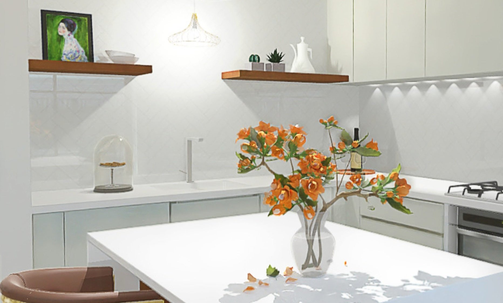

<Caption>
Image credit: Staying Cosy
</Caption>

Open shelving *can* be lovely. It brings personality and a lived-in feel—think eclectic gallery wall or a charming vintage farmhouse kitchen. But in small spaces, it must be used with intention, or it quickly adds more visual clutter than character.

### Simple and Aligned

A single long shelf, perfectly in line with your upper cabinets, creates a subtle sense of structure. It provides just enough room for stacked bowls, daily-use mugs, or a neat row of jars—without shouting for attention. Stick to matching or harmonising pieces in your chosen colour palette to keep the overall look cohesive and calm.

*Farmhouse or rustic kitchens* might allow for a little more layering. Thicker timber shelves with heritage ceramics, some greenery, or vintage glassware can feel inviting—but even here, less is more.

### Beware the Trap

Multiple narrow shelves, squeezed into odd corners just to use the space, often do the opposite. They create visual noise and a sense of chaos, making your kitchen feel cluttered and cobbled together. What starts as a clever storage idea quickly turns into a styling burden.

If in doubt, go for closed cabinetry below and one well-placed shelf above. Let the walls breathe. Negative space is a design tool, too—use it. Your kitchen will feel lighter, calmer, and more intentional.

## Opt for Seamless if Part of Open Plan

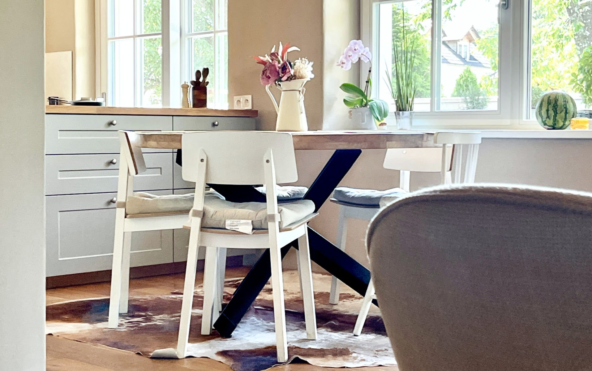

<Caption>
Image credit: Staying Cosy
</Caption>

If your kitchen is part of an open-plan layout, let it blend with the surrounding living or dining space rather than stand out as a separate room. Fluidity is key. You want the kitchen to feel like a natural extension of the whole space.

As much as I love colour, *and I truly do*, in my own open-plan home I chose a soft grey and white cabinetry. Some might call it “boring,” but I didn’t want it shouting across the room. Instead, it sits quietly in the background, allowing the artwork, furniture, and lighting to take centre stage.

### Texture Brings Life

Even the most neutral palette can come alive with a thoughtful mix of materials: soft-matte cabinets, subtle veining in the worktop, a tactile timber stool, or brushed metal tap. These small shifts in texture add richness and warmth without disrupting the understated design.

### Small Details for Personality

A vase of herbs, your favourite jug on display, or a row of linen tea towels — they all add souls and identity. And if you’re itching for colour, try it on a decor, cushion, or artwork that can be changed with the seasons, rather than locking it into your cabinetry.

A seamless kitchen doesn’t mean lifeless. It just knows its role: to support the space, not compete with it.

## Go Bold & Creative if On It’s Own

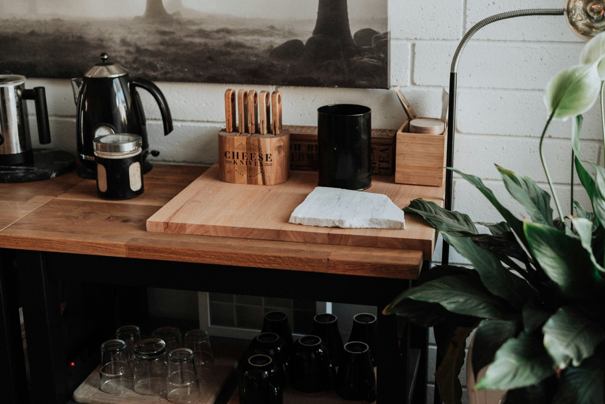

<Caption>
Image credit: [kevin laminto](https://unsplash.com/@kxvn_lx?utm_content=creditCopyText&utm_medium=referral&utm_source=unsplash) on [Unsplash](https://unsplash.com/photos/brown-wooden-organizer-on-table-AxuS6CFO1eM?utm_content=creditCopyText&utm_medium=referral&utm_source=unsplash)
</Caption>

When your kitchen lives in its own room, tucked away from the main living space, you have more freedom to *go bold, playful, and truly expressive.* This is your chance to turn a purely functional area into a space with real personality—without worrying about how it flows with the sofa or dining chairs next door.

> “A statement kitchen doesn’t need a dance floor’s worth of space.”

Even the tiniest alcove can become the *jewel box* of the home. Think rich cabinet colours, like deep olive, punchy coral, or smoky plum, paired with patterned Moroccan tiles, copper fittings, or a vintage rug underfoot. These touches bring life and warmth with that satisfying feeling of: *yes, this is me.*

Want to experiment with dramatic [lighting](/blog/interior-lighting-guide), bold wallpaper, or open shelving bursting with colour? Go for it. A separate kitchen is the perfect place to play—it’s where the chaos of everyday life turns into your very own live cooking show.

### Beauty of Tiny Kitchen

It creates a natural threshold. The moment you step in, you enter a completely different mood. A vibrant morning coffee zone, which turns into an atmospheric little cocktail corner in the evening — all within a few square metres. From my experience of moving eighteen times, I’ve noticed the smallest kitchens have always been the liveliest.

So, don’t be hesitant. Give your stand-alone kitchen character. Make it memorable and let it wear its quirks with confidence, like Cinderella slipping into her ballgown.

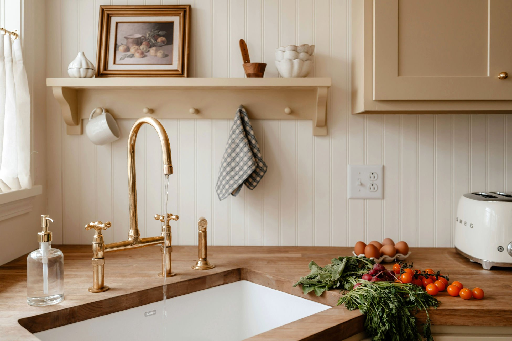

<Caption>
Image credit: [Clay Banks](https://unsplash.com/@claybanks?utm_content=creditCopyText&utm_medium=referral&utm_source=unsplash) on [Unsplash](https://unsplash.com/photos/cozy-kitchen-scene-with-sink-shelf-and-groceries-rLQwcbZjrcU?utm_content=creditCopyText&utm_medium=referral&utm_source=unsplash)
</Caption>

If your dream kitchen had a soul, what would it be? A quiet, whispery essence or a spicy, intriguing presence? And what small steps can you take to bring it closer to that vision?

Start small. Shape it slowly. And let the ideas from this post be your gentle compass.

---

---

---
