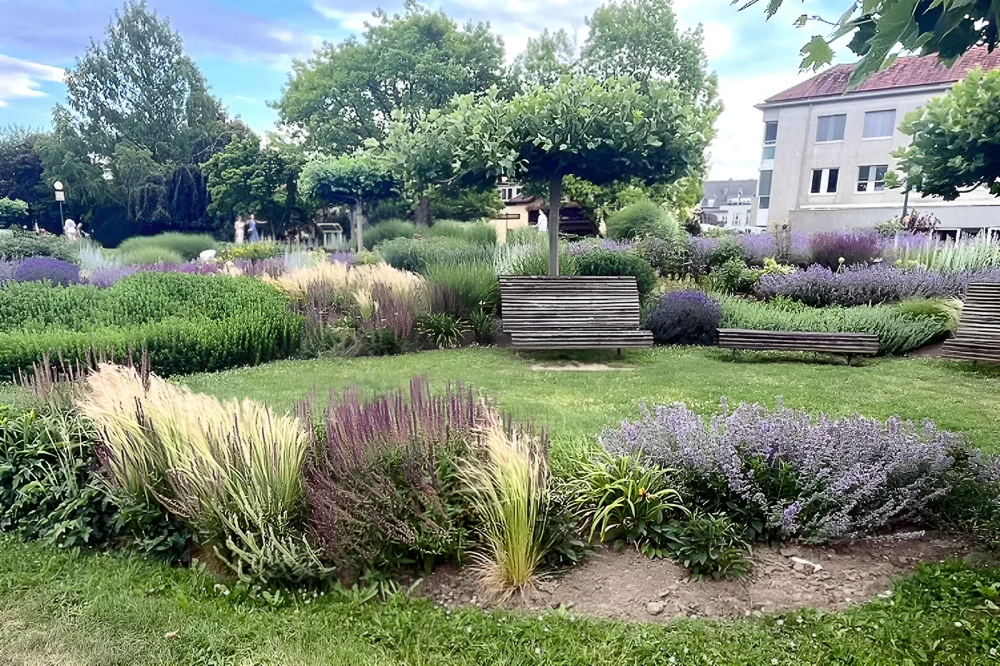
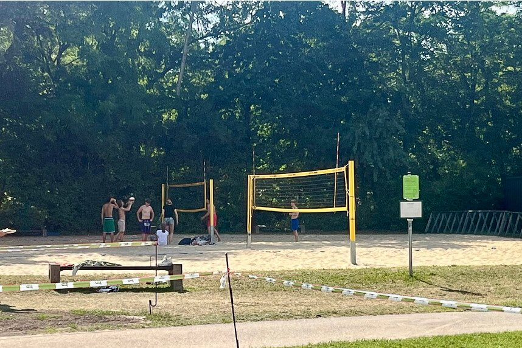
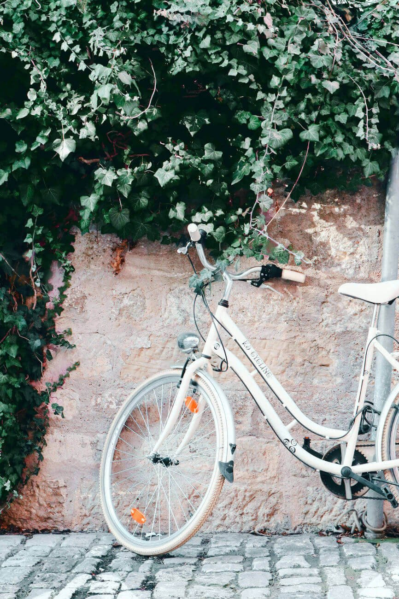
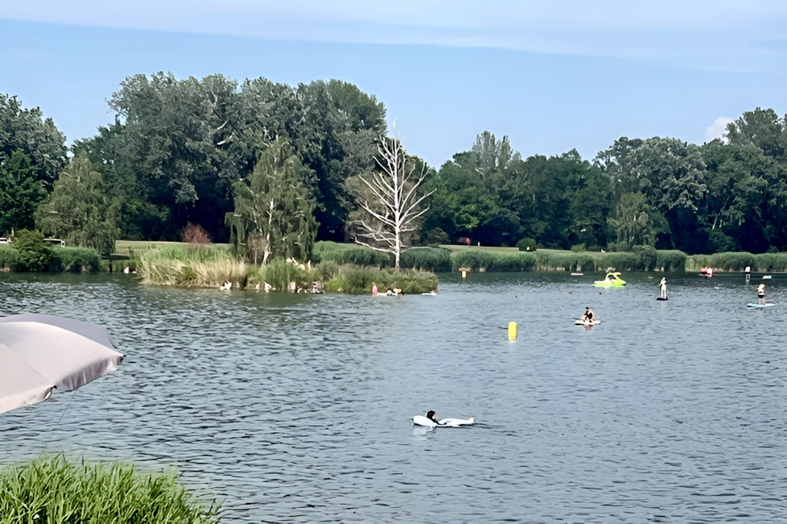
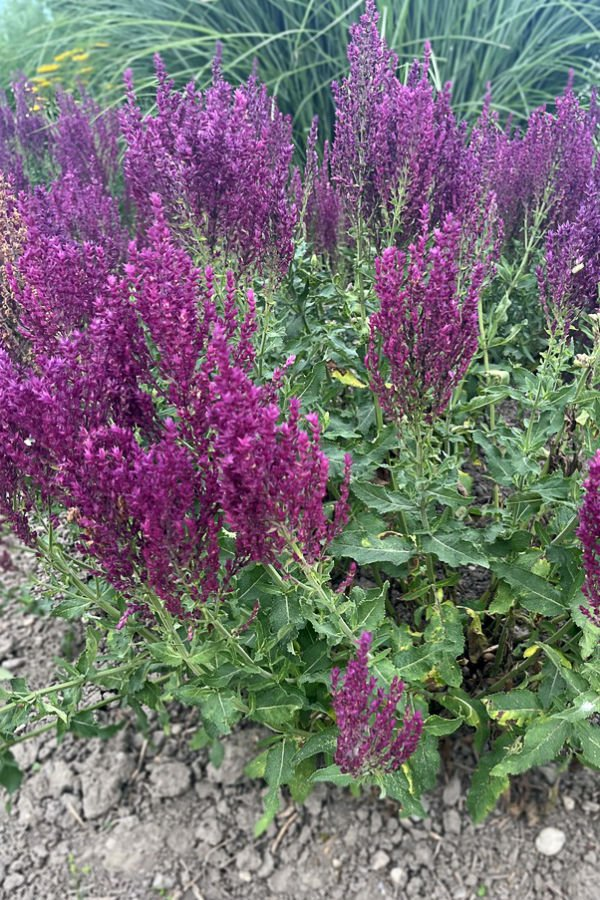
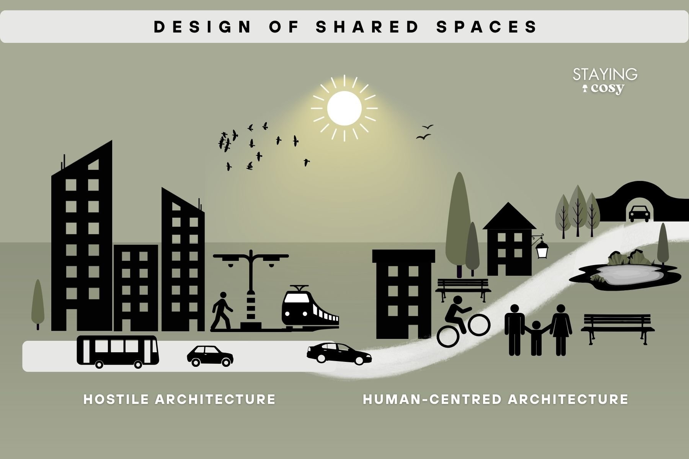

*My friend invited us to spend a weekend camping. Instead of returning to our usual countryside escapes, she suggested a small town by a river she had recently discovered. I expected a relaxing weekend of cycling, swimming and escaping the summer heat. What I didn’t expect was to come home wondering about the power of well-designed public spaces.*

<Caption>
Image credit: Staying Cosy
</Caption>

It doesn’t happen often that I visit a place and immediately feel at ease. A place where moving, resting and spending time outdoors all seem to happen effortlessly.

People cycle because the network of paths makes it feel like their natural choice. They linger beneath mature trees because there are benches waiting in the shade. Children are happily occupied with water, smooth stones and sand instead of flashing plastic attractions. The whole town seems to follow a more relaxed rhythm, encouraging you to do the same.

We arrived on a hot summer day with no particular expectations. Yet from the very beginning, there was a sense of comfort about the place. People were leisurely cycling instead of rushing, flower beds softened the streets, and movement and calm seemed to exist side by side. Life was everywhere.

We had arrived in Tulln an der Donau, a small Austrian town on the banks of the Danube.

## A Town That Encourages You To Move

The first thing I noticed was that cycling wasn’t separate from daily life — it *was* daily life. Almost like Amsterdam’s quieter little sister. The network of paths connected neighbourhoods, parks and the river in a way that made movement feel entirely intuitive. You didn’t need to decide to cycle; it was simply the easiest way to get around. Before long, we found ourselves doing exactly the same.

Walking felt just as natural. Distances felt human. Routes felt direct, yet full of little discoveries, often curving just enough to reveal another view. You’d choose the longer way to the bakery just because it passed beneath a tree-lined avenue.

Movement never felt rushed or interrupted. It casually carried you through little nooks and secluded shortcuts, making the journey as enjoyable as the destination. At the end of the main path, a natural swimming lake opened up, complete with a beach volleyball court and simple exercise stations that made an ordinary walk more engaging. Physical activity was seamlessly woven into everyday life.

<Caption>
Image credit: Staying Cosy
</Caption>

And then there was the Danube.

Not hidden behind fences or reserved for the occasional photograph. It became part of the journey, accompanying cyclists and walkers as intimately as an old friend who doesn’t mind walking in silence. We met rafters on canoes, stopping at the campsite for a night before heading back onto the water before sunrise.

By the end of the weekend we had cycled in the cool of the morning, wandered into town for a quick shop, swam in the lake and somehow spent most of the day on our feet without it ever feeling like a workout.

## A Town That Invites You To Slow Down

There is a lovely generosity to public spaces that are designed with people in mind.

Seating appears exactly where you might want to rest, often placed just as the shade begins. Tall trees provide relief from the scorching midday sun, while perennial flower beds line paths and squares, adding bursts of colour. You never feel hurried from one place to another. Quite the opposite – the town seems perfectly content for you to linger a little.

The buildings echo the same attitude.

<Caption>
Image credit: [Lea](https://unsplash.com/@leakatharinafr?utm_source=unsplash&utm_medium=referral&utm_content=creditCopyText) on [Unsplash](https://unsplash.com/photos/a-white-bicycle-parked-next-to-a-wall-covered-in-vines-ngyuYyugw84?utm_source=unsplash&utm_medium=referral&utm_content=creditCopyText)
</Caption>

Rarely towering above three storeys, they never overwhelm the streets or the people walking through them. Historic facades sit comfortably beside modern additions. What I especially loved is that contemporary details appear here and there, but they never compete with the town’s heritage. They delicately complement it.

To me, this feels like restoration done right.

Nothing is trying to become the star of the show. Instead, your eye wanders from a cobbled street to a climbing rose, from a bicycle resting against a wall to a wooden bench just around the corner. And perhaps this is my favourite part:

> “You don’t have to buy a coffee to deserve a place to sit. ”

That feels surprisingly rare these days.

## A Place for Everyone

The lake feels like its own small world.

Children move between water, stones and sand, completely absorbed in their own small imaginative play. There is a rock-scape too, shaped for climbing and balancing with little streams of water running between stones ready to be discovered and experimented with. The slides and shallow edges gently help younger children get used to the water.

A little further along, teenagers gather in the grill area, slightly set back from the main beach. Music, laughter, dance — but contained so, that it allows the rest of the recreation grounds to stay undisturbed. The way it is placed there, certainly feels thoughtful. Present, but not dominant.

Across the wider area, there is a mix of activity — beach volleyball, paddle tennis, football on the grass, and a small food stall where people stop for a quick bite before heading back to the water.

Families drift between swimming and lounging in the sun. Some stand in the shallows, teaching younger children how to swim, holding them for a moment before letting go again. Others float, or sit at the edge with their feet in the water, watching the day pass slowly.

<Caption>
Image credit: Staying Cosy
</Caption>

And then, almost unexpectedly, there is an island in the middle of the lake. Two birch trees stand there — one alive, one long past its prime, left in place because its white trunk still holds a strong presence. Around the edges, tall reeds move gently with the wind, softening the boundary between water and land.

Further back, older visitors tend to quieter, more secluded spots, where things slow down again. They watch the movement rather than being part of it.

Nothing feels separated into strict categories. Instead, life overlaps. Everything is there, ready to be used and enjoyed by anyone.

And I can’t forget to mention the campsite, bordering the lake.

We had our tent pitched by the very front, in a small woodland clearing. It felt pleasantly unintrusive, with a clear sense of distance from the more village-like part of the camping grounds.

That one caters mostly for retirees who stay there for longer stretches of time. They occupy seasonal mobile homes, a few plastered and slightly more permanent than others, but most feel lived-in. There is a sense of continuity there — not visitors passing through, but people returning to a familiar place for well-deserved rest and social connection.

The whole area seems to accommodate every stage of life, without one needing to push the other aside.

## When Care is Almost Invisible

<Caption>
Image credit: Staying Cosy
</Caption>

The more we looked around, the more we noticed the care behind it all. Early in the morning, gardeners were already tending the flower beds, carefully removing weeds before the day became too hot. The grass was neatly cut, the paths spotless, and the public spaces beautifully maintained.

The most welcoming places rarely feel overly manicured or controlled. Quite the opposite.

Every decision seems to respect what is already there: the historic streets, the broad river, the full-grown trees, and, most importantly, the people moving through them. Maintenance isn’t trying to dominate nature or impress visitors. It simply allows the town to stay welcoming and healthy.

Care here is almost invisible.

And that is because it’s not abstract. It is entirely human. People looking after spaces for other people to use. Gardeners, planners, cleaners, builders — all part of the same exchange that allows a place to function and thrive.

## What Well-Made Public Spaces Do To Us

<Caption>
Graphic: Staying Cosy — made in Canva
</Caption>

Not every town has a lake or a river. Many have neither. That does not mean they cannot feel open, generous and carefully tended. Very little is needed for things to change.

> “Places designed with care invite care in return.”

They make ecological behaviour feel natural. They encourage preservation over consumption. They reduce friction, stress, and unnecessary competition. They allow beauty, movement, and everyday connection to coexist.

This is what well-made public spaces do to us.

And then I think about my own garden. How easily it changes when I place a simple bench under a tree. Or two benches. Or even one more than necessary. Suddenly there is a reason to stop and observe, to notice the sunlight moving across the grass, the lavenders in full bloom, or the amelanchier berries coming to fruition\*\*.\*\*

A place to sit doesn’t need justification. It just needs to be there.

---

**☘︎ Expand your horizon.**

If you enjoyed exploring how intentional public spaces alter our daily rhythm, see how these philosophies translate into human behaviour and home design:

*•* [*Beauty of Desire Paths — Walking the Way We Feel*](</blog/what our natural shortcuts reveal about the spaces we truly crave.>)

*•* [*Why Decluttering Matters More Than You Think*](/blog/stuff-taking-over-why-decluttering-matters)

*•* [*Biophilic Interiors — The Soul of a Living Home*](/blog/biophilic-interiors-living-home)

SEARCH THE BLOG

