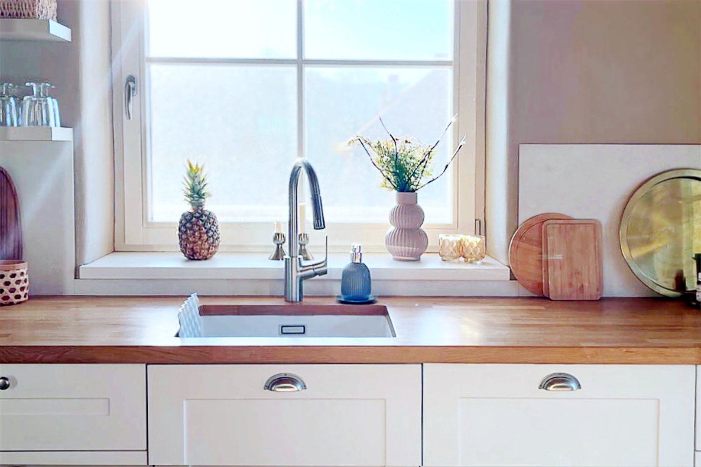
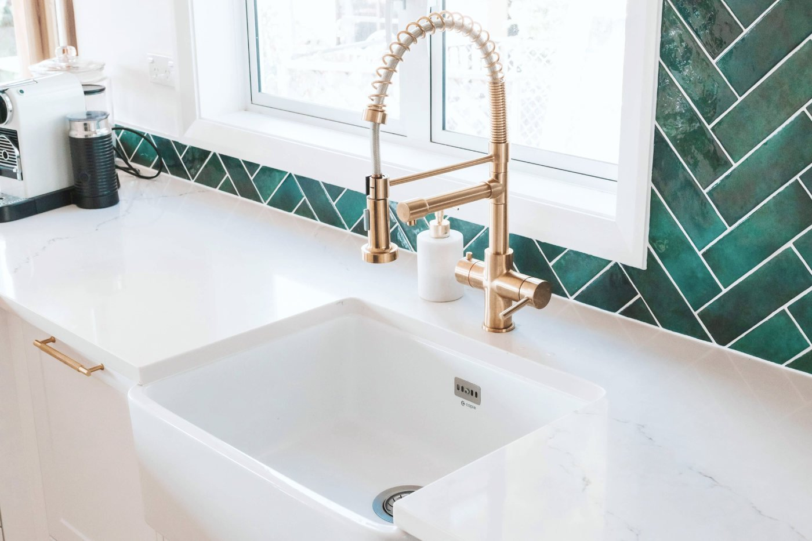
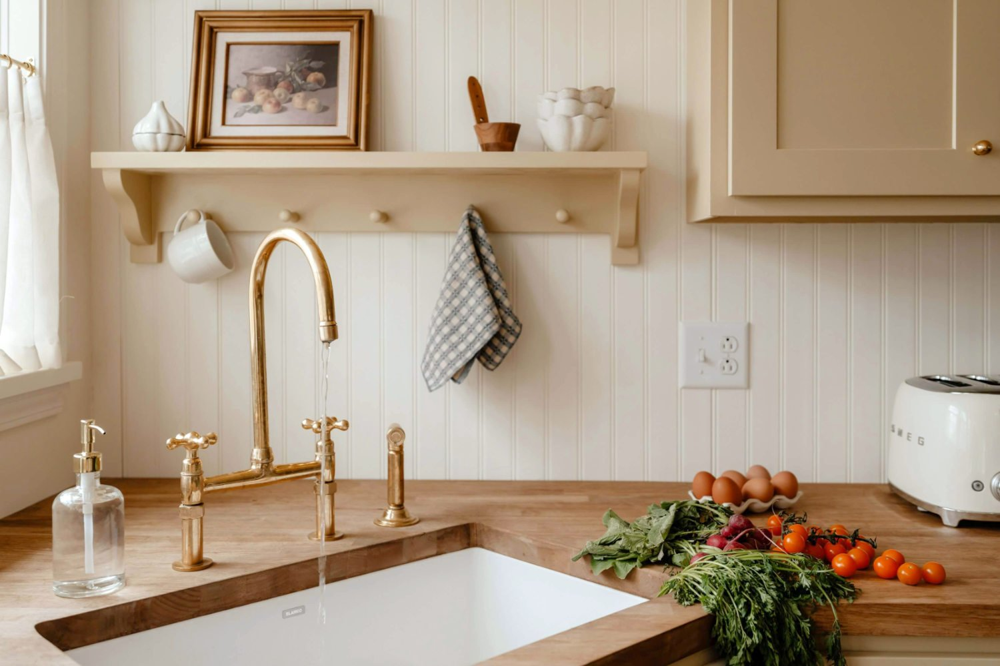
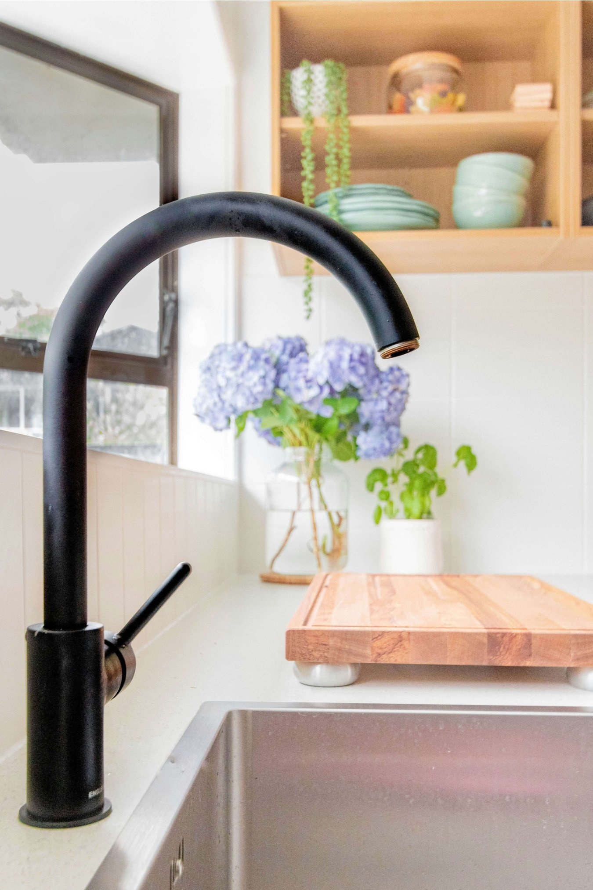

*If there is one design decision that sparks a ‘love it or hate it’ debate in kitchen planning, it’s the sink's placement. While modern islands often try to steal the spotlight, I’ve found myself returning to the romance of the window-side sink. Living with a good double-digit number of kitchens throughout my life, my secret winner has always been the under-window kitchen sink.*

<Caption>
Image credit: Staying Cosy
</Caption>

There is a meditative joy in watching the garden transition through the seasons while you tackle the morning’s coffee cups. It turns a mundane task into a moment of connection with the outdoors.

**Sink under window or an island?**

In my own kitchen, I actually have both. My small island sink serves the prep area, while my primary sink is a dedicated wet zone placed under an East-facing window. Having lived with them for almost a decade, I can tell you exactly why an under-window kitchen sink has my full thumbs-up for a slow-living, [holistic interior.](/blog/holistic-interior-design-guide-101)

## Pros of a Window Kitchen Sink

There is a reason this layout remains a timeless favourite, appearing in everything from rustic cottages to high-end modern builds. Beyond the immediate charm, the benefits of placing your sink area against an exterior wall range from psychological wellness to clever architectural efficiency.

If you are on the fence, I recommend *test-driving* the experience at a friend’s home or a kitchen studio. Stand there, feel the light, and imagine your own daily routine in that space.

<Caption>
Image credit: [Callum Hill](https://unsplash.com/@inkyhills?utm_source=unsplash&utm_medium=referral&utm_content=creditCopyText) on [Unsplash](https://unsplash.com/photos/a-kitchen-with-a-sink-and-a-window-_IX9O9Uuizc?utm_source=unsplash&utm_medium=referral&utm_content=creditCopyText)‍ ‍
</Caption>

### 1. Natural Light for Circadian Syncing

If your window offers a view of the street or the garden, you have a prime candidate for a perfect sink placement. Flooding your primary workspace with natural light reduces the need for artificial task lighting and helps keep your internal clock in check. Our circadian rhythms are deeply connected to sunlight; by syncing our morning routines with the sun, we feel naturally more alert and mentally fresh for the day ahead.

The ideal setup is an East or West-facing window. It catches the low winter sun to illuminate your workspace exactly when you need it most. However, if your kitchen is North-facing, proceed with caution. Gloomy northern shadows are rarely mood-enhancing; if the sun never touches that glass, you might find the space feels a bit too stagnant for a primary work zone.

### 2. Space Saving & Architectural Footprint

In most kitchen layouts, the wall with the window is a *restricted zone* because you cannot hang upper cabinets there. By placing the sink in this specific spot, you are utilising an architectural footprint that might otherwise be underused.

- **Reclaiming wall space:** Because a sink doesn't require upper cabinets directly above it, you can save your solid wall space for full-height pantry storage or tall appliance housing. A major ergonomic bonus? You’ll never hit your head on a cabinet door while leaning over the suds again. Plus, seeing better means you can spot those *unwashed forks* that kids, with their terrifyingly sharp eyesight, always seem to point out.
- **Protecting the island for connection:** By moving the primary sink area to the perimeter, you keep your kitchen island clear for food prep, homework, and social gatherings. It transforms the island from a utility station into a clean, hospitable social hub — the true heart of the home.
- **The raised sill advantage:** While it's tempting to extend the countertop into the window sill for a *floating look*, I find it much more practical to raise the sill instead. High-end invisible transitions are fragile and difficult to achieve well. Instead, treat the sill as a standalone pedestal for herb pots; it keeps them away from water spray and acts as a recessed shelf that visually clears the workspace. It’s about creating layers rather than one flat, vulnerable surface.
- **Sink under window plumbing:** Placing your sink on an exterior wall is usually the most cost-effective and efficient path for pipework. Unless you are dealing with a complex renovation where existing pipes are locked elsewhere, pulling drainage directly through the exterior wall simplifies the build and minimizes the risk of leaks inside your cabinetry.

### 3. Natural Ventilation & Air Quality

<Caption>
Image credit: [Clay Banks](https://unsplash.com/@claybanks?utm_source=unsplash&utm_medium=referral&utm_content=creditCopyText) on [Unsplash](https://unsplash.com/photos/cozy-kitchen-scene-with-sink-shelf-and-groceries-rLQwcbZjrcU?utm_source=unsplash&utm_medium=referral&utm_content=creditCopyText)‍ ‍
</Caption>

I have often spoken about the importance of fresh air circulation, especially in high-use wet zones like bathrooms and kitchens. The scent of a baking cake is lovely; the lingering smell of cauliflower patties or fried fish? Not so much.

Opening a window ajar while cooking is a traditional, effective way to manage moisture and odours. While a high-tech ventilation system, like MVHR, takes over during the colder months, there is no substitute for the immediate, natural airflow of an operable window. For those moments when the sourdough toasts a little too long, a quick flip of the latch provides a level of ventilation that no extractor fan can reliably replicate. It’s the simplest way to ensure your kitchen remains a fresh, healthy environment for the whole family.

### 4. Biophilic Connection

The shift toward biophilic design, intertwining nature with our daily indoor lives, was inevitable. The kitchen is the heart of our home’s ecosystem; it’s where we nourish ourselves, host friends, and bump into family members scavenging for a midnight snack.

A window sink is the ultimate way to anchor this living connection. An apple rinse invites a quick glance at the blooming tulips in a neighbour’s yard; a post-dinner cleanup becomes a moment to catch the sunset. By framing the outdoors, you turn a chore into a cinematographic experience. This is the power of a well-placed sink and [window](/blog/architectural-window-design-trends) — where the latter isn't just a hole in the wall, but a tool that dictates the energy and pulse of the entire kitchen.

> “A window sink turns a mundane chore into a moment of connection with the outdoors.”

<Caption>
Image credit: [Callum Hill](https://unsplash.com/@inkyhills?utm_source=unsplash&utm_medium=referral&utm_content=creditCopyText) on [Unsplash](https://unsplash.com/photos/black-metal-faucet-near-brown-wooden-chopping-board-yq32iG6F36w?utm_source=unsplash&utm_medium=referral&utm_content=creditCopyText)‍ ‍
</Caption>

### Faucet vs Frame

When exploring different under window sink ideas, consider how the faucet interacts with your frame\*.\* The rise of tall, gooseneck faucets has created a common oversight: tap height. You must ensure the apex of the tap doesn't cut across your view or, crucially, prevent a tilt-and-turn window from opening. Aligning the faucet base so it doesn't interfere with the window's swing is vital. If space is tight, look for fold-down or low-profile taps designed specifically for this placement to keep the composition clean.

### Splashback and Window Sill

To protect your window frame from moisture, consider the height of your sill. While many like a flush transition, raising the sill to about 100–120 cm (40–44”) from the floor creates a *safer splash zone.* Using a stone or solid surface backsplash that runs directly into the window reveal creates a seamless, watertight transition that is as functional as it is beautiful.

When planning your kitchen layout, keep these three principles in mind for a more intentional workspace.

**☘︎ *Kitchen Layout Tips***

- **Align the plumbing early.** Placing sinks on exterior walls is usually the most cost-effective path for drainage and minimises internal pipework.
- **Embrace asymmetrical framing.** Don't feel the sink must be perfectly centred; sometimes an offset placement captures a better garden ‘portrait.’
- **Prioritise the sill over the float.** Avoid the temptation to run the countertop directly into the window opening. A slightly raised, independent sill is much more practical for moisture control and offers a dedicated pedestal for herbs.

Opting for an under-window sink is a rewarding choice for the daily rhythm of your household. While you must remain mindful of the architectural details, the trade-off is a workspace that feels emotionally alive.

By framing your view, you turn a repetitive chore into a moment of quiet connection — transforming a functional utility zone into the soulful cornerstone of a holistic home.

---

**☘︎ Want more design ideas for your home?**

*•* [*Clever Tips for T*](https://bluebird-hawk-as8j.squarespace.com/blog/tiny-kitchen-clever-design-tips)[*i*](/blog/tiny-kitchen-clever-design-tips)[*ny Kitchens*](https://bluebird-hawk-as8j.squarespace.com/blog/tiny-kitchen-clever-design-tips)

*•* [*Ultimate Colour Manual For any Interior*](/blog/your-guide-to-beautifully-layered-home)

*•* [*Lighting Made Simple*](/blog/interior-lighting-guide)

SEARCH THE BLOG

