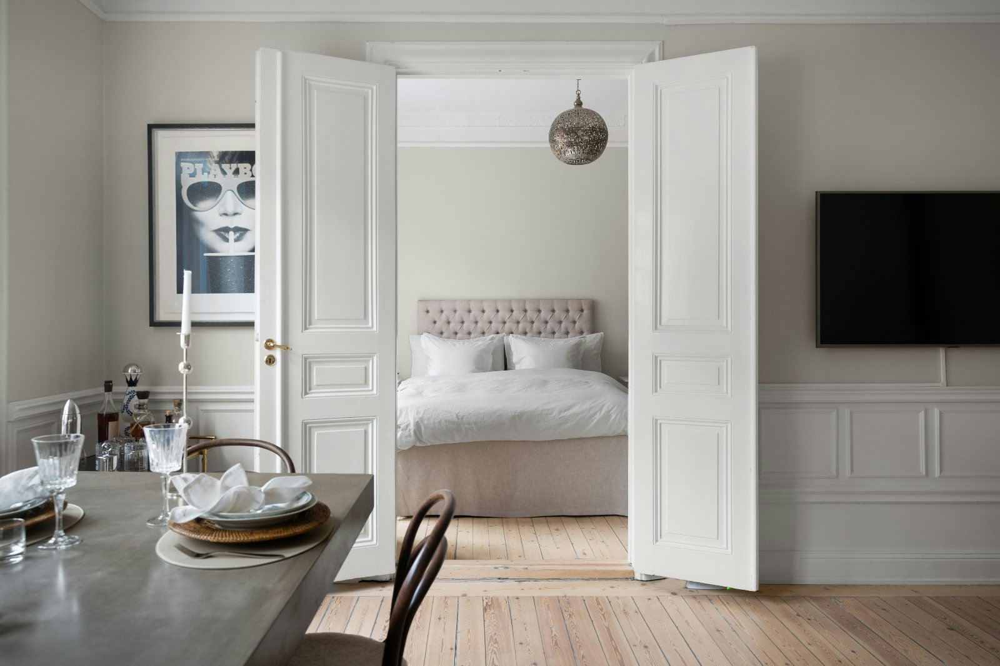
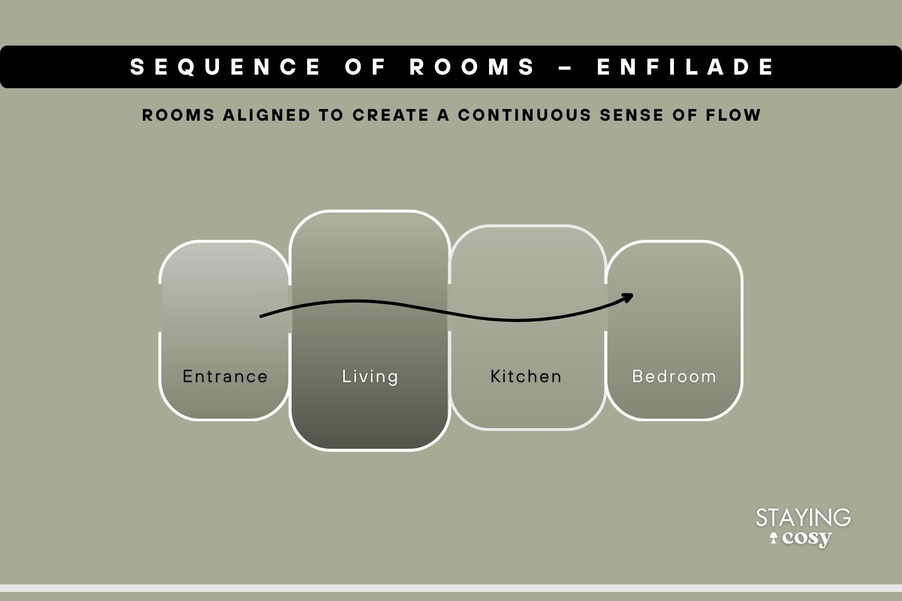
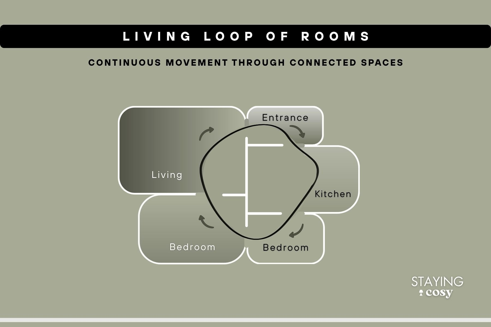
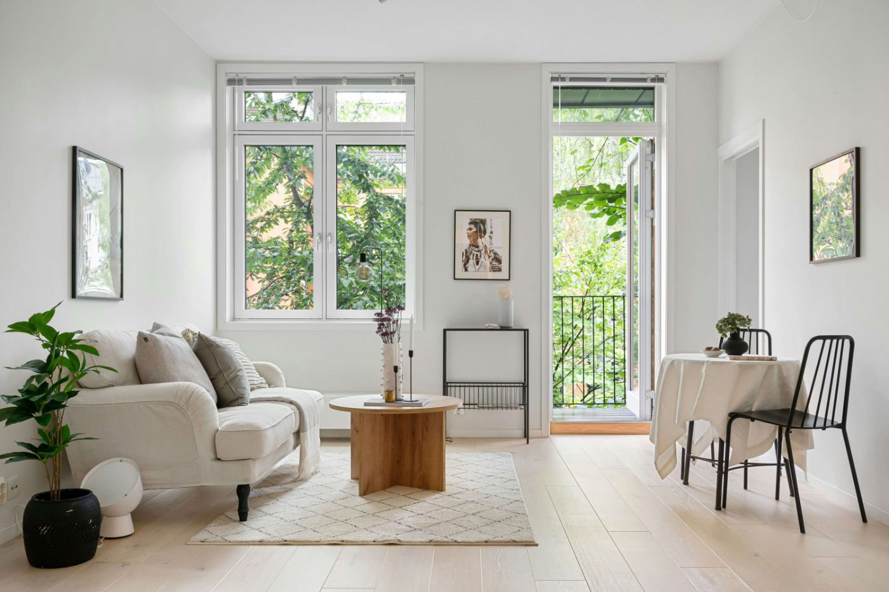
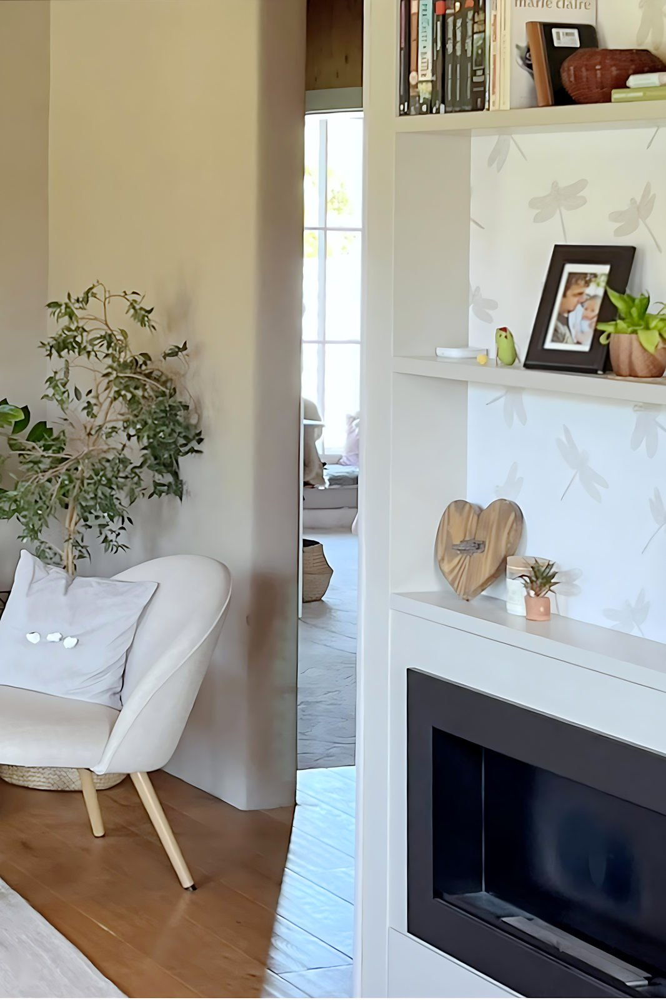
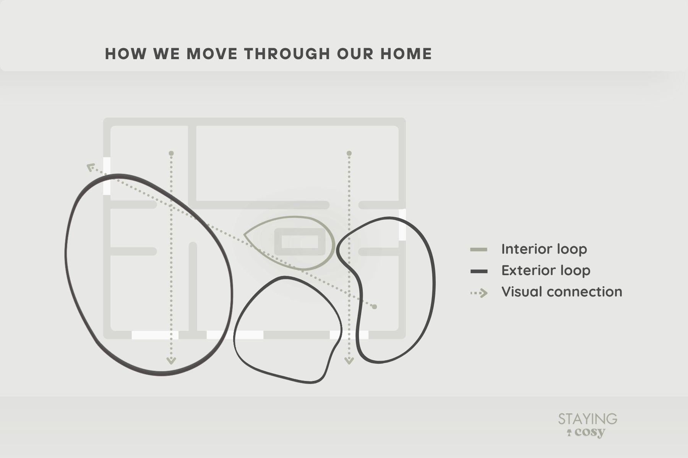
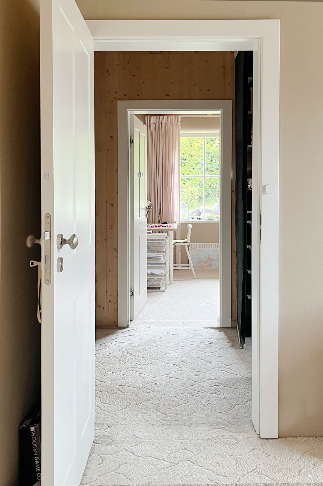
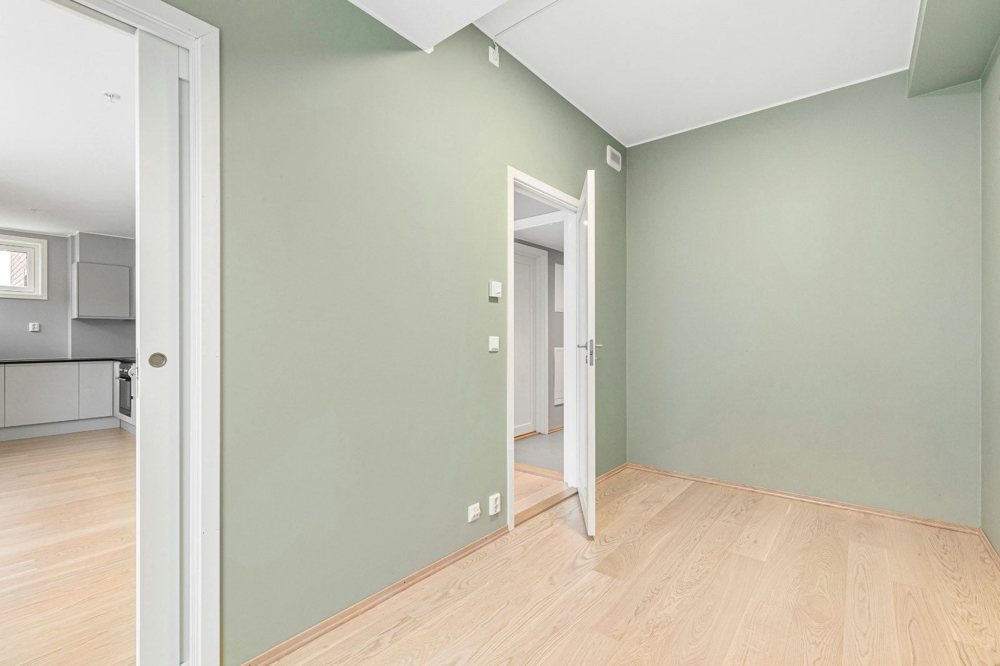

*When I was a child, every year we used to visit my aunt. I always got excited because there was something magical about her small flat. They had an extra pocket door separating the master bedroom from their daughter’s room. Even though that master bedroom ended up being technically windowless, I found the walk-through rooms fascinating. Guess what? Forty years later, I still do.*

<Caption>
Image credit: [Alex Tyson](https://unsplash.com/@alextyson195?utm_source=unsplash&utm_medium=referral&utm_content=creditCopyText) on [Unsplash](https://unsplash.com/photos/a-room-with-a-table-chairs-and-a-television-1RmcKEVuoQM?utm_source=unsplash&utm_medium=referral&utm_content=creditCopyText)‍ ‍
</Caption>

I know. We’ve shunned walk-through rooms lately in the name of privacy. And that’s a fair argument. Most modern family houses aren't vast castles where secret doorways and long walk-throughs were the standard. Yet, I find something enchanting about them because, believe it or not, they hold exceptional psychological qualitites.

And really, can there be such a thing as *too much* privacy?

## Are We Building Ourselves into Corners?

We’ve become experts at compartmentalising our lives, ensuring most proper rooms are closed-off. But are these dead ends really our natural choice, or just a modern habit?

> “By building rooms with only one way in and out, we might be gaining privacy — but sacrificing our natural sense of connection.”

### The Psychology of the Second Exit

As part of the animal kingdom, *yes, we still are*, having more than one way to go is an instinct. In the wild, a second exit is a survival strategy. In a home, it’s a psychological relief. A space with two exits feels safer and more expansive. Without dead ends, room circulation becomes fluid, and the mind feels more at ease. It all comes down to **having a choice**.

In home design psychology, spatial flow and rooms that lead into each other play a key role in creating a balanced, [holistic sense of wellbeing](/blog/holistic-interior-design-guide-101) — where the home is understood as a connected system rather than separate spaces. Home layout flow sits at the core of this experience.

## Geometry of Freedom in a House Layout

To bring a sense of movement into a home, we generally look at two classic layouts:

- Sequence
- Living loop

While these sound like technical architectural terms, they are the secret to making a house feel interconnected rather than a collection of boxes.

<Caption>
Graphic: Staying Cosy — made in Canva
</Caption>

**The Sequence —** enfilade is a grand term for a simple, beautiful idea: rooms aligned in a row so that the eye, and the body, can move straight through them. Imagine those castles I mentioned earlier. In a small home, this is a total game-changer. By omitting a dedicated corridor, which is often just dead square footage, and letting the rooms themselves act as the path, you create a sense of generosity. It makes a modest footprint feel like a manor.

But beyond space; it’s about human connection. Flow-through rooms invite us to join in on life as it happens. They allow for a brief conversation or a shared glance as you move from point A to point B. Enfilade layout works *for* social interaction, not against it.

<Caption>
Graphic: Staying Cosy — made in Canva
</Caption>

**The Living Loop** is the circular path, where the major rooms are interconnected so you always have at least two directions to move. This loop ensures you are never truly trapped in a dead-end. It’s a layout that encourages a home to function like a small neighbourhood as opposed to a series of private islands.

This brings up a practical question: Have we sacrificed too much in the name of privacy? By building tall concrete fences outside and walled-off rooms inside, we sometimes undermine the natural paths of living together. I’ve noticed this especially with children; until the teen years hit, they seem to thrive on that subtle sense of being tucked into the flow of the family, rather than being isolated at the end of a dark hallway.

## Holistic Flow and the Great Outdoors

The geometry acts as the bones of a home, while the flow is its breath. According to Feng Shui and holistic well-being, rooms that open to each other allow energy, or Chi, to circulate instead of getting trapped in stagnant corners. But you don’t need to be a philosopher to feel the difference; you just need to look at the light.

<Caption>
mage credit: [Lisa Anna](https://unsplash.com/@lisaanna195?utm_source=unsplash&utm_medium=referral&utm_content=creditCopyText) on [Unsplash](https://unsplash.com/photos/a-living-room-filled-with-furniture-and-lots-of-windows-pXK2OuaqOQs?utm_source=unsplash&utm_medium=referral&utm_content=creditCopyText)
</Caption>

### Double Sunlight Moment

This interconnectedness creates opportunities for light to travel in unexpected ways. Our master bedroom door is aligned with one of our kids’ rooms. When the days are shorter, there is a point in the afternoon when the sunlight from my daughter’s [window](/blog/architectural-window-design-trends) travels through the corridor and right into our bedroom. I love those days because it feels like I’m catching the sun twice — a small, holistic gift from a thoughtful layout.

### The Vista Effect

<Caption>
Soft vista effect | Image credit: Staying Cosy
</Caption>

Aligned openings create vistas that draw the eye forward and expand your horizon. I don’t live in a 15-bedroom manor, but when I’m standing by my kitchen island, I can see right through the house, into our bedroom, and out the French doors. My eyes follow a natural path:

***Kitchen → Dining → Hallway → Bedroom → Outside***

It’s not a strict alignment, but a soft visual opening through the plan — enough to give the mind a sense of breathing room, and that expansive feeling of a pathway that doesn’t end at a wall.

### The Ultimate Loop — Bringing the Outside In

To take things a step further, the perfect loop shouldn't stop at your front door. The most natural way to apply this flow is to connect the interior directly with the exterior. When a walk-through room leads to a garden or balcony, the outdoor space becomes just another room in the sequence.

It’s no longer a destination you have to go to — it’s a part of the path you walk. By bridging the inside and outside, you remove that boxed-in feeling and let the entire property act as one.

☘︎ ***Having the option to choose***

*Multiple entries and exists are not only beneficial psychologically, they make a home feel like an exploration as opposed to a cornered box.*

## From Theory to Floor Plan — My Living Case Study

It’s one thing to talk about energy flow, it’s another to see it in action. When designing our home, I wanted a layout that felt functional and flooded with light, while partially incorporating walk-through principles to see how they work in a modern context. Here is the result:

<Caption>
Graphic: Staying Cosy — made in Canva
</Caption>

### Staircase Block — A Multi-functional Anchor

The heart of our home’s circulation is a simple, off-centre block that houses the staircase. Small enough not to feel obstructive, large enough to be a high-performance multitasker. From the living area, it features a built-in ethanol fireplace with shelving; on the other side, it provides storage and opens to the stairs.

The magic of this block is how it directs movement. It acts as a pivot point, creating a natural walk-around path that separates the social zones from the utility areas. All that is achieved without using traditional, long and narrow closed-off hallway. Instead, a short, open corridor runs alongside it, connecting the front entry to the living zone. This central path is so fluid and fun that I even use it for my speed-walking exercises in the winter.

### Door Alignment Strategy

<Caption>
Bedroom door alignment | Image credit: Staying Cosy
</Caption>

Moving out from that central anchor, we used aligned doorways to pull light through the entire footprint. I was not brave enough to go for a full on walk-through layout, so this was my compromise. All three bedrooms are at least door aligned; two connect visually, creating that vista effect I mentioned earlier, while the third aligns with a kitchen pocket door.

This creates a light corridor that draws brightness from the kitchen and my daughter’s bedroom deeper into the house. Most importantly, it offers us **flexibility of privacy**.

We keep the doors open for connection and flow, but when we need quiet, a room can be closed off simply by closing one or both doors.

### The Indoor-Outdoor Loop

Finally, the flow expands to our land. Apart from the bright main entry, we have a sequence of exits that turn the entire property into a seamless living space:

- **Kitchen** sliding door
- **Living Room** to terrace sliding door
- **Master Bedroom** private french door

These exits lead to a raised walkway that wraps around the house, creating a variety of paths where the transition between inside and outside is effortless. I love that I can walk out of the kitchen with a cup of tea, enjoy the garden view from the terrace, and re-enter through the bedroom without ever retracing my steps.

Once the warm months hit, these open loops turn our compact home into a series of never-ending pathways, making every movement feel like a **scenic journey** rather than a walk between rooms.

## Limits & Balance of Room Circulation Layouts

<Caption>
Image credit: [Lisa Anna](https://unsplash.com/@lisaanna195?utm_source=unsplash&utm_medium=referral&utm_content=creditCopyText) on [Unsplash](https://unsplash.com/photos/an-empty-room-with-green-walls-and-wood-floors-JCyAuCQRHYY?utm_source=unsplash&utm_medium=referral&utm_content=creditCopyText)‍ ‍
</Caption>

Walk-through rooms work best in **family homes and social spaces**, where movement and connection are essential part of everyday life. They make shared areas feel open, fluid, and naturally linked — like a home that intuitively pulls you from one space into the next. This reflects how movement naturally modifies space over time, much like [desire paths](/blog/beauty-of-desire-paths) formed through repeated everyday use.

Room-to-room connection is less ideal in more private zones, such as bedrooms and bathrooms, where separation, quiet, and a sense of enclosure become priority. In these spaces, constant passage can feel disruptive rather than freeing.

It often comes down to simple, physical factors: where doors sit, how sight-lines run through the space, and how well sound is contained. Small decisions can change a home from feeling open to feeling over-exposed or unsettled.

With a few thoughtful adjustments, this idea can be successfully achieved. If you’re worried about losing privacy while gaining flow, here is how to balance the two:

☘︎ **Making Walk-through Rooms Work for You**

⬩**The Power of the Pocket Door:** Just like in my aunt’s flat, pocket doors are the ultimate hack. You can have the loop when you want it, and a solid wall when you don’t.

⬩**Visual Sight-lines:** You don't need every room to be a thoroughfare. Sometimes just aligning the doorways, and preferably windows, is enough to get the holistic benefit.

⬩**The Furniture Path:** Ensure your natural line of movement is clear. You want to be able to see the exit across the room, not trip over a sofa on your way to it.

I don't think we need a manor house to live with a sense of grandeur. By opening up multiple pathways, we can create homes that protect us, but just enough not to restrict our natural need for free movement. Before you build that next wall, remember to ask yourself: *Is there another way around?*

---

**☘︎ If this idea resonates, here are related ways of thinking about home:**

*•* [*Important Lessons from Building our Eco-House*](/blog/eco-friendly-building-guide-materials-principles)

*•* [*How Much Space Do We Really Need for Comfortable Living?*](/blog/how-big-should-your-home-be)

*•* [*Clever Design Ideas for Small, Efficient Kitchens*](/blog/tiny-kitchen-clever-design-tips)

SEARCH THE BLOG

