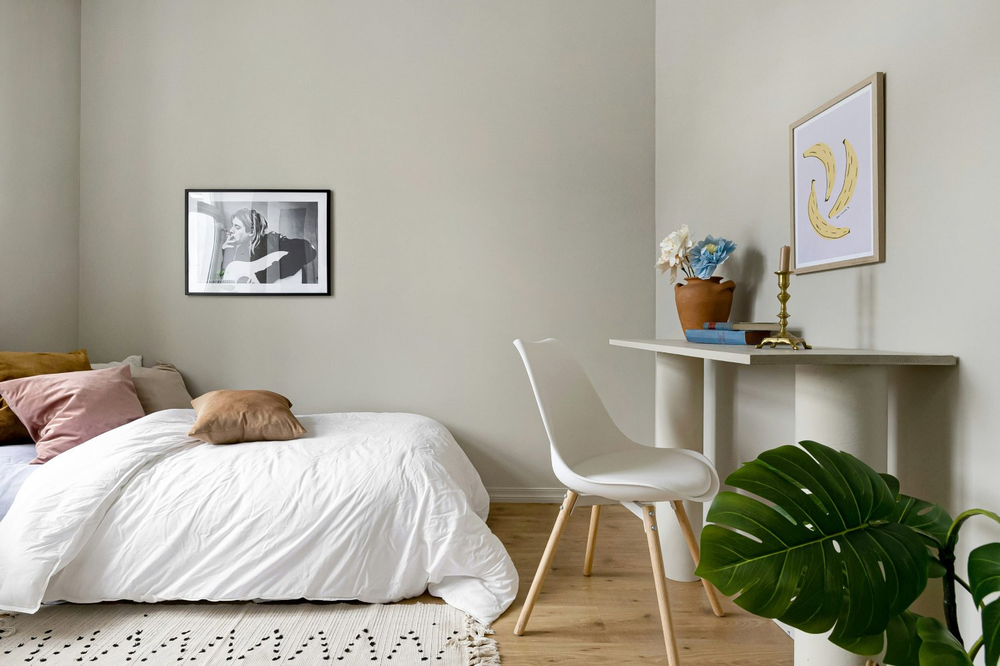
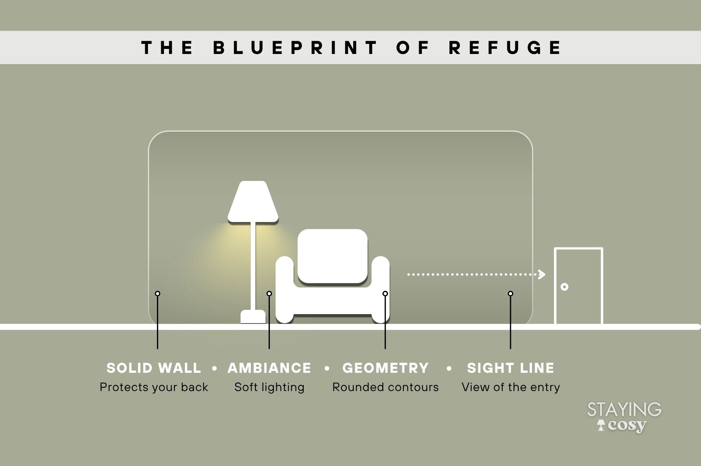
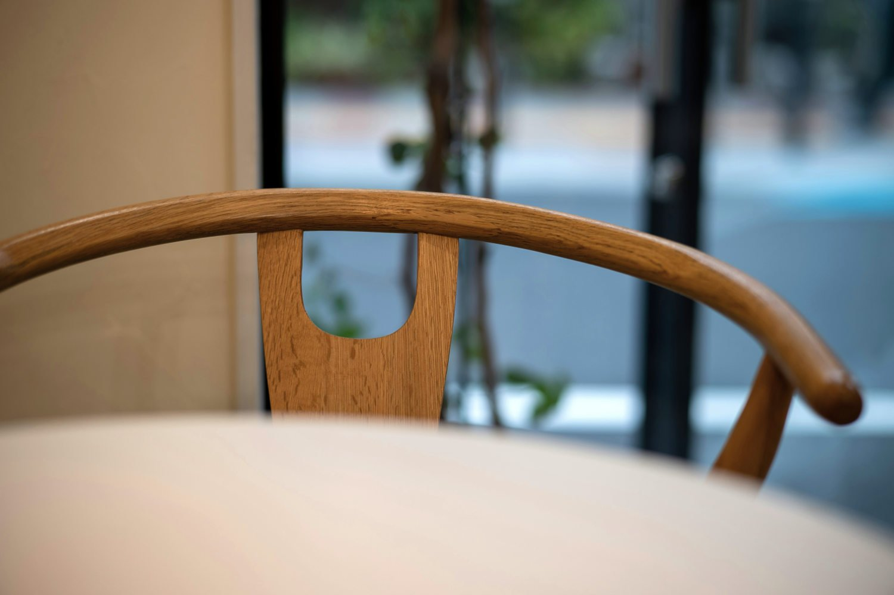
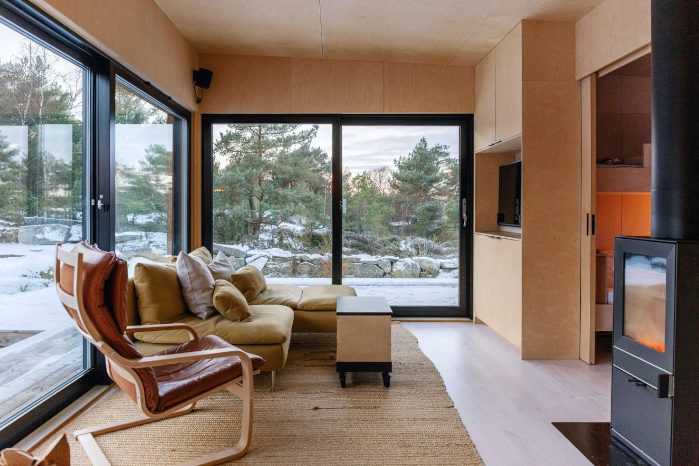
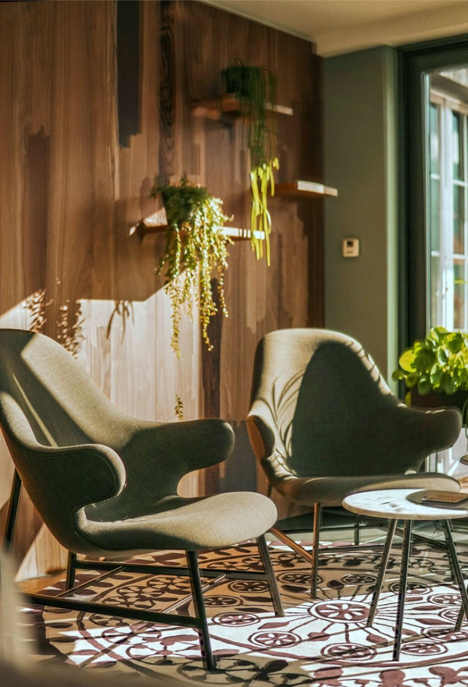

*Walk into a bustling pub. Scan the floor. Where do you want to sit? Almost nobody picks the table stranded right in the dead centre of the room like a lonely island. Instead, we instinctively drift toward the perimeter. We hunt for the corner booth. The deep alcove, or the dark timber bench. We basically want our backs protected. We want to see the whole room without being the centre of it.*

<Caption>
Image credit: [Lisa Anna](https://unsplash.com/@lisaanna195?utm_source=unsplash&utm_medium=referral&utm_content=creditCopyText) on [Unsplash](https://unsplash.com/photos/a-bedroom-with-a-bed-and-a-desk-xMX8EOYLOG0?utm_source=unsplash&utm_medium=referral&utm_content=creditCopyText)
</Caption>

This isn't some modern human characteristic. It’s pure, subconscious survival.

Open-plan layouts, towering ceilings, massive glass walls — we are enveloped by these images. They portray it as modern luxury. But really, when you strip away the walls, you often strip away your own comfort too. A home shouldn’t just look striking on an Instagram feed. It needs to satisfy a primitive, hardwired human need for shelter.

## The Primal Cave and the Blind Spot

In environmental psychology, there’s a concept called [Prospect-Refuge Theory](https://www.archpsych.co.uk/post/prospect-refuge-theory). It was coined by a geographer named Jay Appleton, but the core idea is dead simple. We feel safest when we can see our surroundings — prospect, while remaining entirely protected from behind — refuge. Think of our ancestors scanning the savannah from the mouth of a sturdy cave. Simple as that.

When you get this wrong, your nervous system knows it. Immediately. Your shoulders tense up and you don't even know why. Throw in a little twinkle of light and non-threatening corners and you get this:

<Caption>
Graphic: Staying Cosy — made in Canva
</Caption>

Take my childhood bedroom. I slept in the bottom part of a bunk bed shoved in a tight corner right behind the door. Cosy little nook, right? In reality? Rather terrifying for a small child. Because of the awkward angle, I couldn't see the doorway from my pillow. Every single little creak of the floorboards at night had me convinced an intruder was coming through the door.

Feng shui experts call this the **command position** — placing your bed or desk so you face the entrance without being directly aligned with it. They call that direct alignment the dead person’s position. Sounds dramatic, but it’s pure evolutionary biology.

## How to Implement the Side-Glance Rule

I didn’t just read about this and forget it. When my husband and I designed our own place, this principle basically dictated how we laid out the rooms.

In our home office, as well as in our daughters’ bedrooms, the desks are set up so that if you're working, you can just glance to the side and instantly see the door. That’s it. You don't have your back turned to the open room. No vulnerable blind spots while you're deep in a spreadsheet, typing an email, or writing down your deepest thoughts.

It gives the brain this background reassurance that absolutely nothing is sneaking up on you. Because honestly? Jump scares are a favourite hobby of my family. Believe me, we need that side-glance safety net.

> “We deliberately chose a tiny master bedroom for our home. It’s compact, snug, and fits exactly what it needs to. Nothing more. Why? Because small rooms feel safer by default.”

It is that simple. Your brain takes in the whole space in a single, lazy glance. There are no vast, creepy shadows for your subconscious to stress about in the midnight hours.

Placing your sofa directly under a massive window, or pointing your favourite armchair away from the doorway does the exact same thing. It triggers a low-level, background alarm in your head. You can't just fully relax when your blind spot is wide open to the elements. Or, you know, the hallway.

## Why Your Brain Hates Sharp Corners in Interior

<Caption>
Image credit: [Kouji Tsuru](https://unsplash.com/@pafuxu?utm_source=unsplash&utm_medium=referral&utm_content=creditCopyText) on [Unsplash](https://unsplash.com/photos/a-wooden-chair-sitting-in-front-of-a-window-Nrb3Yjc0LxE?utm_source=unsplash&utm_medium=referral&utm_content=creditCopyText)
</Caption>

It turns out your brain isn't just judging a room by where you put the furniture. It’s judging the shapes, too.

People who study this for a living, [neuroarchitecture](https://anfarch.org/), if you want the fancy term, found that sharp, jagged edges and blocky, angular furniture subtly freak us out. Specifically, they kick off a tiny panic response in the amygdala. That's the brain's primitive fear centre.

It happens because nature uses sharp angles to warn us. Think thorns, jagged cliffs, or teeth.

When you crowd a room with sharp, boxy coffee tables and harsh, rigid lines, your brain treats the space like a low-level threat. Subconsciously, at least. And honestly, it's exhausting. To fix it, you need to soften the geometry. Choose soft curves, rounded table edges, and arched doorways. It tricks the brain into dropping its guard. An armchair that gently curves around your body isn't just a design choice. It’s a literal security blanket for your nerves.

## Open-Plan Layouts and Vast Windows Cause Stress

Ever noticed how those trendy, floor-to-ceiling glass walls feel absolutely magnificent at ten in the morning, but deeply unsettling by eight at night? There’s a reason for that.

> “Once dusk falls, an uncovered sheet of glass completely reverses. It turns your sanctuary into a brightly lit fishbowl. ”

Anyone outside can see you dragging the bins out or eating cereal in your pants. You can see absolutely nothing out there. Just pitch black. It’s an instant psychological red flag.

This doesn't mean floor-to-ceiling glazing is a design flaw. The daytime architectural benefits to our circadian rhythms are unmatched. But a truly high-end refurbishment requires an intentional evening strategy. Curtains aren't just for blocking out the morning sun; they are literal psychological armour.

<Caption>
Large windows bring unsettling feeling of exposure | Image credit: [Jack Prew](https://unsplash.com/@jack_prew?utm_source=unsplash&utm_medium=referral&utm_content=creditCopyText) on [Unsplash](https://unsplash.com/photos/a-living-room-filled-with-furniture-and-a-flat-screen-tv-wqTCg8wn04w?utm_source=unsplash&utm_medium=referral&utm_content=creditCopyText)
</Caption>

The same rule applies to massive open-plan spaces. They cause genuine cognitive fatigue. Without physical boundaries or walls, your brain is forced to constantly scan a massive perimeter for potential disruption.

True safety requires a sense of enclosure. Plain and simple.

☘︎ **The Power of Thick Walls**

The architect Christopher Alexander wrote a lot about why a room feels safe. In [The Pattern Language](https://www.patternlanguageindex.com/patterns/thick-walls) his take was that boundaries need to feel substantial. Thick. Heavy. Like old stone cottages or log cabins, for example.

They have an instant cosy factor because the materials are solid, the colours are muddy and grounded, and the whole space embraces a slightly darker, restful vibe. It mimics the calm of twilight.

## Does the Stagnant Air Ruin Your Calm?

You cannot build a true retreat out of aesthetics alone. True refuge offers chemical balance.

What am I talking about? Air. If the air in your cosy nook is stagnant and heavy with carbon dioxide, your brain will simply refuse to relax. High CO₂ levels mimic the feeling of suffocation. Instinctively, at least. It spikes your heart rate and keeps your nervous system on high alert.

True psychological safety requires a clean, invisible baseline. If the air feels stuffy, your body stays tense. Protect your indoor climate with a [regular ventilation routine](/blog/fresh-air-in-home).

## Laying Out a Safe Space

<Caption>
Image credit: [Marvin Meyer](https://unsplash.com/@marvelous?utm_source=unsplash&utm_medium=referral&utm_content=creditCopyText) on [Unsplash](https://unsplash.com/photos/black-metal-framed-white-padded-armchair-beside-white-round-table-gRbrzRPf_Xk?utm_source=unsplash&utm_medium=referral&utm_content=creditCopyText)
</Caption>

Fixing this doesn’t mean boarding up your windows and living in a concrete bunker. Far from it. It means choosing a human, comfortable scale over cold grandeur.

So, next time you are moving furniture around, think about anchoring the space. Shove a solid timber bench or a deep-set reading chair right against a proper, windowless wall. If you are stuck with a massive open-plan layout, [break it up with walkways](/blog/how-to-zone-a-large-room) and interlocking zones, or lowered ceiling for an ultimate snuggly feel.

Knowing you have [more than one way out](/blog/walk-through-rooms-and-room-circulation) of a space instantly takes the pressure off your brain. And lastly, swap those brutal, sharp-edged coffee tables for something with soft, rounded contours.

You don't need to commit to a massive, messy renovation project to drop the physical height of a room, either. If you have towering ceilings, you can trick the brain into feeling that protective canopy effect simply by lowering your lighting scale. Drop a low-slung pendant light over your dining table, or bring in an oversized, arched floor lamp that bends right over your favourite armchair. It creates an invisible, intimate ceiling of light exactly where you sit.

Dim the lamps. Pull the curtains closed the second it gets dark. Just trust your gut on this. Your body knows when a room feels safe.

---

**☘︎ Want to dive deeper into how interior affects our well-being?**

*•* [*Biophilic Interior: The Soul of a Living Home*](/blog/biophilic-interiors-living-home)

*•* [*Can Wool Carpeting Fix the Thirsty, Dehydrated Air?*](/blog/biophilic-interiors-living-home)

*•* [*How Much Space Do We Really Need for Comfortable Living?*](/blog/how-big-should-your-home-be)

SEARCH THE BLOG

