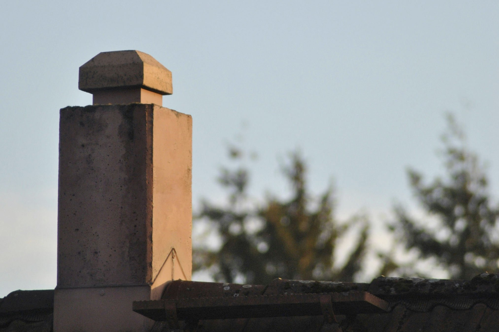
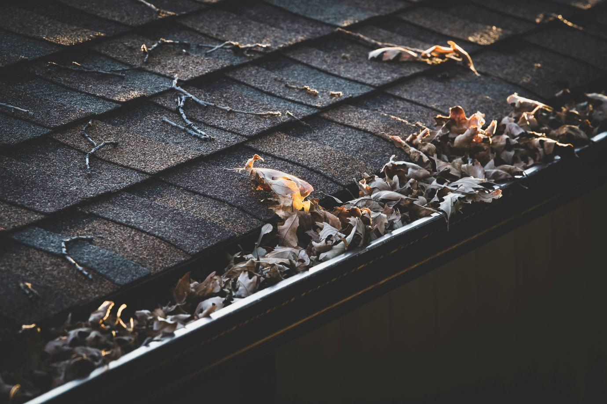

*Mid autumn, a strange phenomenon hits the high street. Shops flood their shelves with synthetic pine-scented aerosol sprays and artificial cinnamon plug-ins. Harsh cleaning kits become our trusted anti-bacterial go-tos. We intend to scrub and spray our homes in toxic synthetic perfumes to get holiday ready.*

<Caption>
Image credit: Staying Cosy — made in Canva
</Caption>

On top of it, we are doing this at the exact moment we seal our window tracks, shut our doors, and trap our indoor air for the next six months. Not exactly common sense, is it?

But if we want our homes to be genuinely clean and healthy, we’d better ditch the [chemical mask](/blog/chemicals-that-pollute-our-living-rooms). Before the winter air breaches our insulated walls, we should get the house ready for a structural revision. Then later, approach a more organic, mindful way to transition into the cold season.

This is a simple, practical, hands-on prep for the physical shell of your home and the health of your lungs. Let’s get our hands dirty before the frost sets in.

## Step 1 —Warm Air in, Cold Air Out

<Caption>
Image credit: [Annina Maria](https://unsplash.com/@anny191?utm_source=unsplash&utm_medium=referral&utm_content=creditCopyText) on [Unsplash](https://unsplash.com/photos/a-chimney-on-top-of-a-roof-with-trees-in-the-background-U-azyBuJcN4?utm_source=unsplash&utm_medium=referral&utm_content=creditCopyText)
</Caption>

Let’s start with the invisible setups that keep us warm. October is your absolute final hour to lock these down before emergency call-out fees skyrocket closer to Christmas.

**The MVHR filter swap**\
If you have [mechanical ventilation](/blog/clean-air-home-ventilation-mvhr-guide), go slide the filters out today. Winter brings all that heavy, soot-laden smoke from neighbouring wood burners straight toward your house. You want clean lungs before that happens. Also, do yourself a favour and walk outside to check the intake grille on your external wall. If autumn leaves are plastered across it, your system is practically choking for air.

**The flue and chimney sweep**\
Please don't light that first ceremonial winter fire without getting a professional in. Creosote buildup is a nasty, silent fire hazard. While they are there, check the flue damper. If it doesn't seal tightly when you shut it, it acts like a giant open straw, sucking your expensive heated room air straight out into the sky.

> “Home has an active skin. When we lock it down for the cold months without checking its breathing pathways, we are trapping in our own pollution.”

**The candle draft test**\
Take a beeswax candle, light it, and trace it slowly around your window frames and door seals. If the flame starts dancing or flickering, your rubber seals are failing. It’s an easy fix, so swap them out before the true frost hits.

**The radiator bleed and fan flip**\
Fire up the central heating and bleed the radiators to get rid of those annoying cold spots at the top of the panels. It makes a massive difference to your energy bills. And if you have ceiling fans, flip the switch to clockwise on low. It sounds counterintuitive, I know. But it works. It gently coaxes all that trapped, rising heat back down to the floor, without creating draft.

## Step 2 — Hard Prevention & Internal Checks

<Caption>
Image credit: [Jon Sailer](https://unsplash.com/@jonmsailer?utm_source=unsplash&utm_medium=referral&utm_content=creditCopyText) on [Unsplash](https://unsplash.com/photos/a-group-of-leaves-on-a-tree-fYwPrfAQcMo?utm_source=unsplash&utm_medium=referral&utm_content=creditCopyText)
</Caption>

Let’s deal with the heavy stuff outside before your fingers freeze off, then look at the bits indoors that have to survive the Christmas chaos.

**The garden tap**\
Go pull the garden hose off the tap today. Don't leave it until November. Drain the outside line completely, because if water stays trapped in those pipes during a proper frost, it expands. Splits the copper wide open. And you won't even notice the leak until it thaws out behind your nice internal plasterboard in January. A total, soggy disaster.

**The gutter outlets**\
With freezing weather coming, blocked leaves turn into ice dams. Water backs up under the roof tiles and wrecks plasterboard ceilings right before Christmas. Prevent this from happening by a swift check on your next Saturday morning.

**The material check**\
Flip the [mattress](/blog/eco-friendly-mattress-materials-guide). It’s a chore, but just get it done. While you’re at it, check any exposed timber or raw stone around the house. Winter heating absolutely parches the indoor air, and natural materials suffer. If the finishes look starved, [rub in some wax or oil](/blog/how-to-oil-wooden-counter-tops) now before they start cracking.

**The fuse box**\
With everybody home over the holidays, running three appliances at once will test your electrics. Go find the consumer unit today and make sure you can actually read your handwriting on the labels. You do not want to be squinting at an encrypted panel with your phone torch while holding a half-cooked roast because a faulty festive gadget tripped the power.

**The oven light**\
Check the bulb, please. I’m telling you. Once you’re mid-bake on a Christmas cake, it’s too late. If you have to keep cracking the door open just to see if the top is burning, you lose all your heat. The temperature drops, the cake sinks, and you've wasted your afternoon. Just scrape the grease off the glass, change the bulb now, and save yourself the headache.

<Caption>
Try my Winter-proofing toxin-free home detox | Graphic: Staying Cosy
</Caption>

## Step 3 — Festive Clean & Authentic Scent

Forget chemical bleach. A simple white vinegar mix sorts out ninety percent of the kitchen counter dirt. And no, your house won't smell like a chip shop. The vinegar smell disappears within twenty minutes, leaving nothing but the clean surface underneath.

It is a straight swap. We are dumping the synthetic aerosol cans completely, and using basic plant chemistry to clear the air. Try these two simple recipes:

☘︎ **The Everything Surface Spray**

- 200ml distilled water
- 200ml white vinegar
- 1 tablespoon liquid Castile soap
- 10 drops eucalyptus oil

Pour it all into a glass spray bottle. Shake it. It cuts straight through grease on steel, tiles, and glass. Just keep it away from marble or natural stone — the acid will etch the surface permanently.

**Quick tip:** For nasty, burnt-on baking trays, don't mix baking soda into the liquid. It just neutralises. Instead, scatter the bicarb dry over the grease, spray the vinegar mix on top until it fizzes, and leave it alone for ten minutes.

☘︎ **The Highland Room Mist**

- 50ml rubbing alcohol or unflavoured vodka
- 150ml distilled water
- 12 drops pine essential oil
- 8 drops cedar wood oil
- 5 drops clove bud oil

Mix the alcohol and oils first so they emulsify, then top up with the water. Pine and clove aren't just for show; they have genuine antimicrobial properties. It leaves the hallway smelling like a wet forest cabin. No synthetic fragrance headaches.

Ditch the paraffin candles entirely. They are just soot-machines for your lungs. If you want something to go alongside the room mist, try the natural scent of baked apples. Because, why not to feed the crowd?

<Caption>
Image credit: [Liia](https://unsplash.com/@liia8?utm_source=unsplash&utm_medium=referral&utm_content=creditCopyText) on [Unsplash](https://unsplash.com/photos/a-close-up-of-some-food-in-a-pan-pImp9uVuMrc?utm_source=unsplash&utm_medium=referral&utm_content=creditCopyText)
</Caption>

Core four or five apples, scatter a handful of walnuts on top, and finish it off with ground cinnamon and cloves. Bake them on a low heat for an hour until they caramelise. Their smell is sweet, and completely fills the house. Best part? You get a warm snack out of it. Zero waste. Job done.

## Clean Slate for The Season

Now that the house is winter-checked, detoxed, and full of that raw holiday scent, it’s time to prep your mindset for the coming months. Don’t rush into shopping just yet. Take your time. Most of all, focus on keeping the festive anxiety out.

From here, the seasonal planning gets easy. My [Mindful Guide to a Stress-Free Christmas](https://example.com/mindful-xmas) will do half the work for you. You’re officially ready to slow down and enjoy the colder months.

---

**☘︎ Interested in learning more about holistic home?**

*•* [*Effective Window Cleaning Hacks Everyone Needs to Know About*](/blog/effective-window-cleaning-hacks)

*•* [*How to Frame Your Kids’ Art & Why You Should Do It Too*](/blog/how-to-frame-your-kids-art)

*•* [*Mocha Christmas Inspiration for Your Cosy Festive Living Room*](/blog/mocha-christmas-inspiration-natural-cosy)

SEARCH THE BLOG

