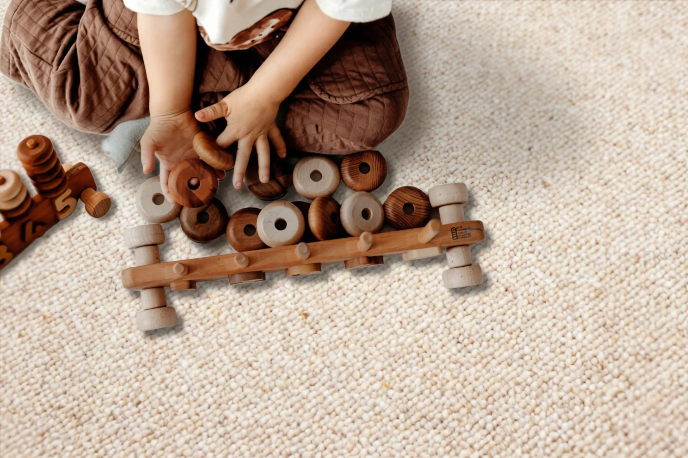
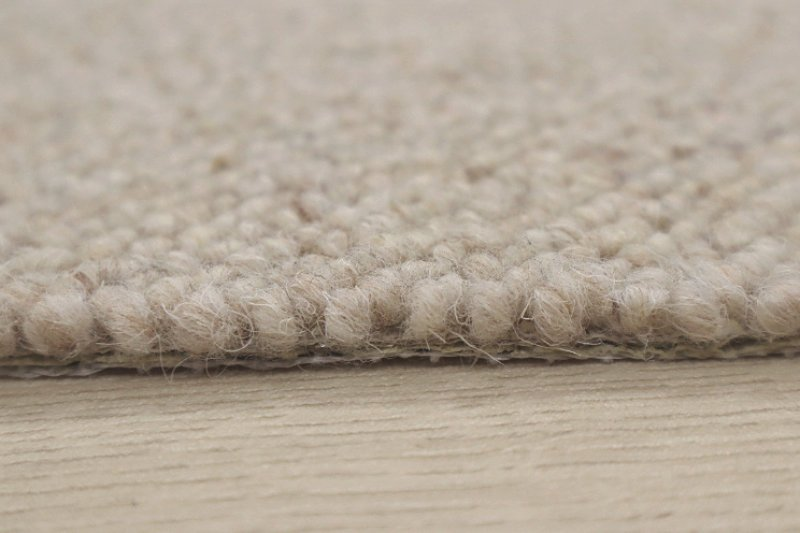
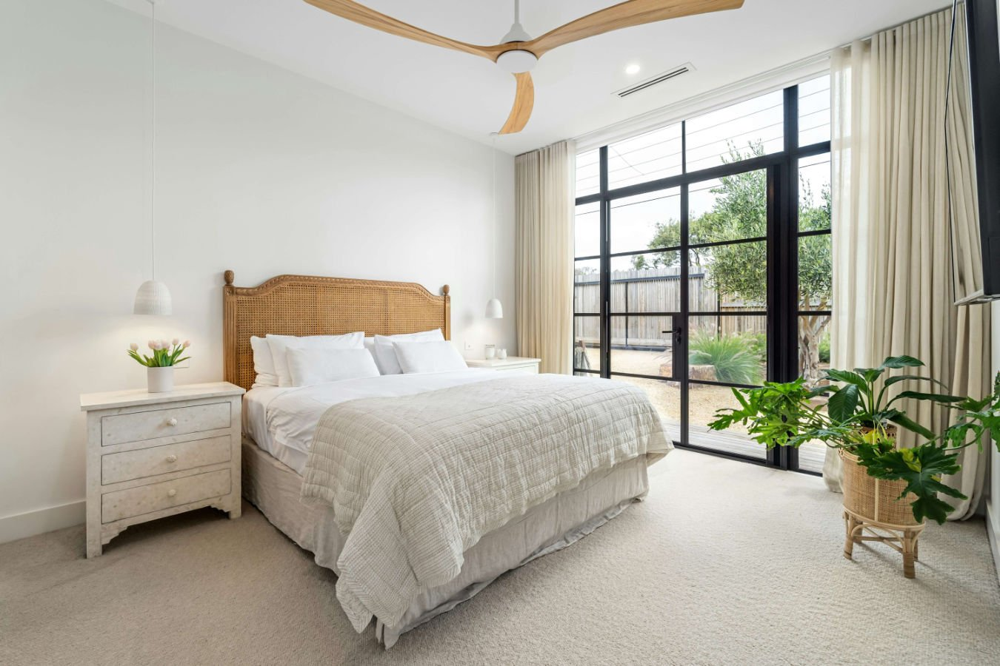
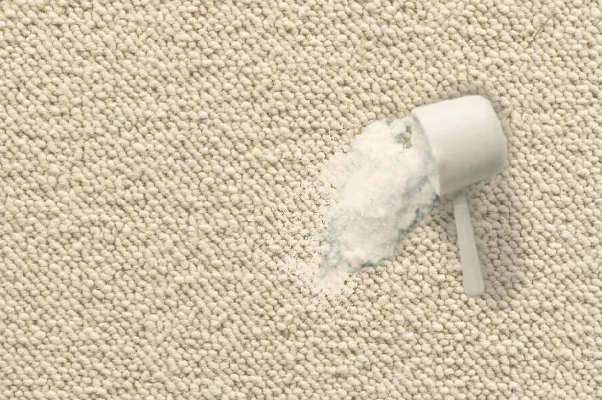

*Visiting an old friend recently made me think a little deeper about how wool performs when it’s more than just a rug, but an expansive wall-to-wall design choice. It led me to wonder: could this natural fibre be the missing lung in our increasingly non-porous, modern homes?*

<Caption>
Image credit: Staying Cosy & Canva - edited
</Caption>

As my friends approach their second-floor renovation, a lovely attic space currently filled with the skeleton of dry-walling, we got talking about the common *new-build feeling* of thin, dehydrated indoor air. Standing amidst the dust, it became clear how mindful they are of the materials that dictate a home’s soul. To counteract those layers of plasterboard, they are considering eco friendly wall to wall carpet options paired with untreated wood cladding.

In a space wrapped in modern seamless dry-walling, can the synergy of wool and wood fix the dehydrated climate? Is wall-to-wall carpeting a left-over 1970s relic, or a sophisticated wellness tool?

Since a similar scenario has been unfolding in [our](</blog/Since a similar scenario has been unfolding in our own attic,>) [own attic](/blog/the-attic-study-design-part-1), I had to investigate.

With four kids ready to reclaim their attic space, softness is a necessity, but the architectural reality goes much deeper than just being kind to little knees. If you are currently brainstorming attic renovation flooring ideas, the choice of material carries a hidden weight.

## Natural Lung of the Home

<Caption>
Loop level wool carpet | Image credit: Staying Cosy
</Caption>

Modern building materials are often static. They fail to interact with the air around them. Flawless plasterboard and synthetic flooring simply sit there, contributing to the parched, thin feeling. Wool, however, serves as a functional asset, acting as a natural lung that actively balances the room’s climate.

Ideally, the wool flooring needs to be a breathable system from the subfloor up. This means a natural underlay should precede the carpeting to ensure the porous nature isn't blocked by a synthetic layer.

When you pair it with the untreated wood cladding my friends are planning, you create a **powerhouse of humidity regulation**. The substantial surface areas of wood and wool work in tandem to buffer the air, making a room feel healthier rather than plastic-wrapped. In an attic space, which is prone to temperature swings, a large-format wool carpet works to stabilise the thin atmosphere. Metaphorically, it wicks your houses *‘sweat’* away.

#### 💡 **Hygroscopic Properties of Wool**

Wool fibres have a unique ability to **absorb moisture** from the air when humidity is high, and release it back when the air becomes too dry. This natural buffering helps maintain indoor relative humidity between 40% and 60%, the gold standard for human health.

## Invisible Filter

I’ll admit, the first time I took an old sheepskin outside for a proper beating, I was a little horrified. Seeing that cloud of dust emerge into the sunlight felt somewhat scary — certainly not an epitome of *cosy.* But as I stood there, it clicked. From a [holistic perspective](/blog/holistic-interior-design-guide-101), that dust was exactly where it should be: trapped in the wool, rather than swirling around my living room.

It is a **common misconception** that carpets are a nightmare for allergies, but the reality is quite the opposite. On a hard floor, every time a child runs past or a door opens, dust and pollen dance back up into the air we breathe. Wool, however, acts like a magnet. It catches those particles and holds them tight within its fibres until you decide to hoover them away, making wool carpet for allergy sufferers an incredibly effective holistic choice.

When we look at natural wool carpeting benefits, its ability to act as an air purifier is perhaps the most overlooked.

For my friends with four kids constantly on the move, this is a massive win for the air quality of their new attic. But the magic goes even deeper than dust. Wool doesn't just grab physical bits; it absorbs [VOCs](/blog/chemicals-that-pollute-our-living-rooms) — Volatile Organic Compounds, like formaldehyde, which can linger in modern furniture and adhesives. It effectively scrubs the air, locking those chemicals away so they aren't part of the family’s daily breath.

## Thermal Mass & Acoustic Softening

<Caption>
Image credit: [Lisa Anna](https://unsplash.com/@lisaanna195?utm_source=unsplash&utm_medium=referral&utm_content=creditCopyText) on [Unsplash](https://unsplash.com/photos/a-bedroom-with-a-large-bed-and-a-ceiling-fan-cty6Z4-hzVk?utm_source=unsplash&utm_medium=referral&utm_content=creditCopyText)
</Caption>

The thing that fascinates me most about natural hygroscopic materials is their ability to curate a micro-climate indoors. Wool, being no exception, feels as snug and warm underfoot as moss or fallen leaves on a woodland floor.

### Unbeatable Warmth of Wool

Choosing a dense-pile wool carpet is like throwing a heavy-knit sweater over your home’s footprint. If you have ever compared a polyester jumper to a pure wool or cashmere one, the difference is clear; [natural fibres](/blog/natural-textiles-wool-cotton-linen) are simply superior at preserving warmth. A wool carpet works in the same way, insulating the floor and raising the perceivable temperature by up to **2°C (3.6°F)**. In a home where slippers are often forgotten, that difference is everything.

Since this attic is to become a vibrant kids’ hub, the floor is essentially a giant playground. Wool provides a natural warmth that synthetic fibres cannot mimic; it is an insulator that keeps the heat in the room and the chill away from little toes. But thermal comfort is just the beginning. Wool excels at keeping the noise down, too.

### Sound of Silence

In a busy family home, quiet is a luxury. Attic bedrooms can easily become echo-chambers, especially when wrapped in monotone smooth materials like dry-wall and hard flooring. This is where a large-format wool carpet transitions from a holistic choice to an architectural necessity.

Wool doesn't just look dense; it acts as a high-performance **acoustic dampener**. It absorbs the high-frequency sounds of play and the thud of footsteps that would otherwise bounce off floorboards. It creates a sensory quiet that is foundational to a cosy home.

## Reality of Spills

<Caption>
Berber style wool carpet | Image credit: Staying Cosy & Canva - edited
</Caption>

Praising wool without a critical look at maintenance wouldn't be fair. If pondering, is wool carpet worth it, we can’t exclude the reality of daily life. I can vouch that spills are 100% likely to occur — usually within the first month already. Choosing a multi-tonal yarn or a slightly darker heathered shade is a smart move; it is much more forgiving than a flat, pale cream.

The irony of wool's acclaimed hygroscopic nature is that it can soak up liquid spills like a sponge if left too long.

**First aid for accidents**

Speed is the only rule that really matters. When my daughter spilled cocoa on her wool rug, we learned that a quick reaction is a miracle worker. Because wool is naturally resilient, a spill will often sit on the surface for a few golden moments before slowly soaking in.

The best approach? Blot, never scrub. Scrubbing damages the scales of the wool fibre and creates an unfortunate fuzzy patch that will catch the light forever. We used cold water and a clean cloth to lift the bulk of the cocoa, followed by a gentle spot cleaner. It came out beautifully because we **didn't give the pigment time to bond with the fibre.**

Ultimately, a lot depends on the colour and the integrity of the weave. A high-quality wool carpet is an eco-friendly investment. Like all good things, it simply requires a little mindful stewardship.

To help you make an informed decision, I have summed up a few practical essentials in this list:

#### ☘︎‍ ‍ **Mindful Basics to Wool Carpeting**

- **Natural Underlay:** Skip synthetic foam. Choose jute or recycled hair felt to keep the floor *breathing*.
- **Stretch-Fit:** Avoid toxic glues. Have the carpet stretched and gripped to maintain structural integrity.
- **Strategic Weave:** Pick a berber or level loop for durability. Avoid shag piles that trap debris.
- **HEPA Filter:** Use a HEPA filter when hoovering to permanently lift allergens out of the wool fibres.
- **Spills:** Speed over chemistry. No-scrub blotting with cold water is more effective than harsh cleaners.

I can imagine the cleaning side might feel like a deal-breaker for many. Let's be honest, mopping a hard floor is so much easier. There is no argument there. However, it is all about finding that personal equilibrium. Before you commit, I always suggest weighing the ease of tiles, laminate or wood against the cushioned atmosphere of a natural fibre.

As my friends continue their renovation, I look forward to seeing their attic transform from a dusty skeleton of cables and dry-wall into a healthy nurturing space. For them, the choice was as much about architecture as it was about creating extra room where their kids can flourish, rest, and play.

Wall-to-wall softness underfoot is the ultimate comfort. Wool’s health properties are **real and measurable**. While the extent to which they offset unfavourable air is unique to every home, those benefits are always there, ready at work.

Wool carpeting is far from a relic of the past century. It is a high-performance choice for sustainable flooring in a conscious modern home, one that allows us to breathe a little deeper.

---

**☘︎ Continue the Journey:**

*•* [*7 Best Air Purifying Plants for Your Home*](/blog/air-purifying-plants)

*•* [*Framing Kids’ Art as Part of Enriching Home Decor*](/blog/how-to-frame-your-kids-art)

*•* [*Best Eco Mattresses for Deep Uninterrupted Sleep*](/blog/eco-friendly-mattress-materials-guide)

SEARCH THE BLOG

