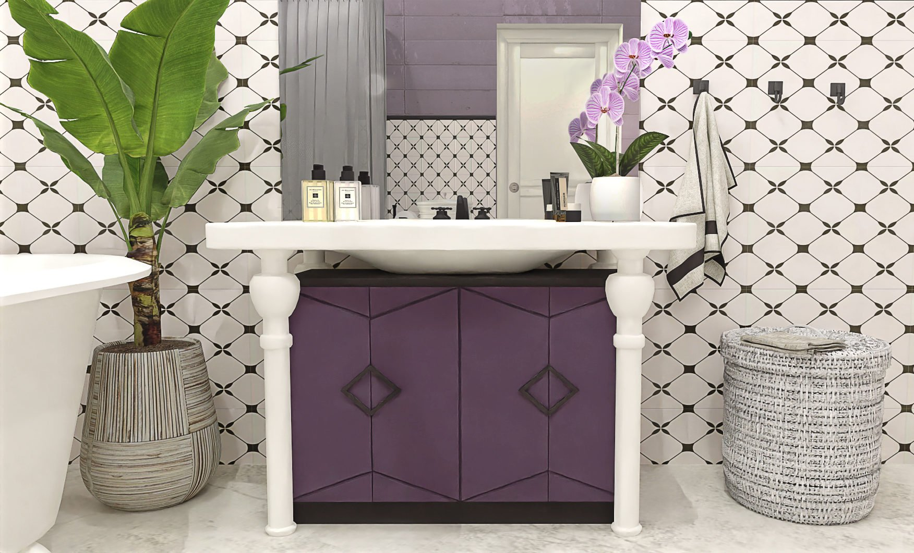
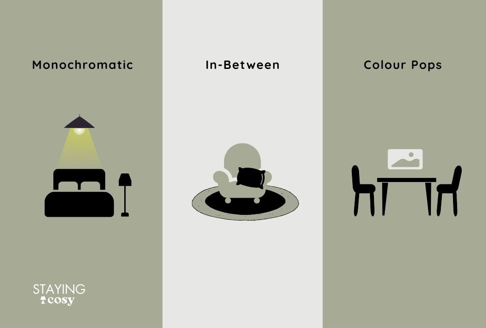
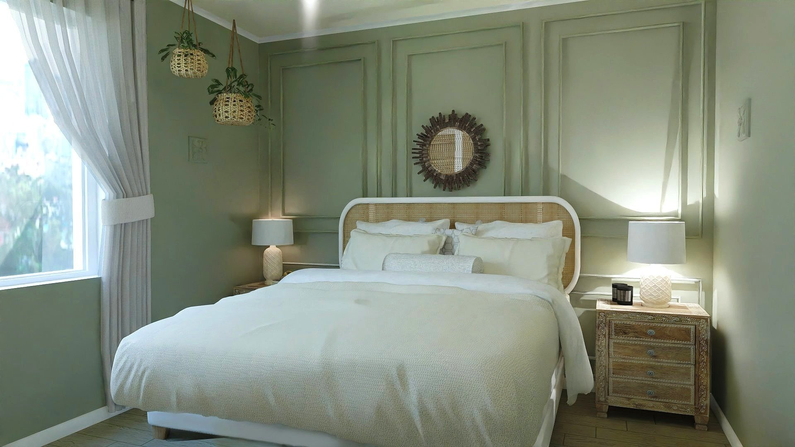
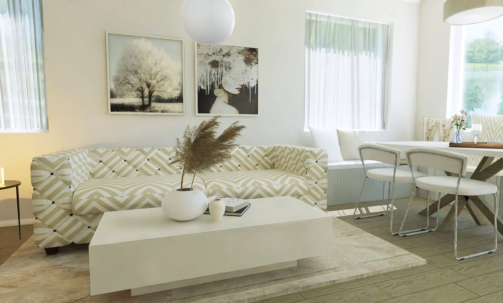
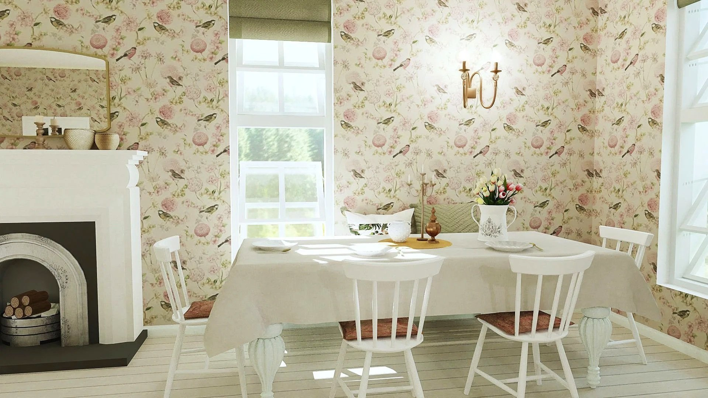
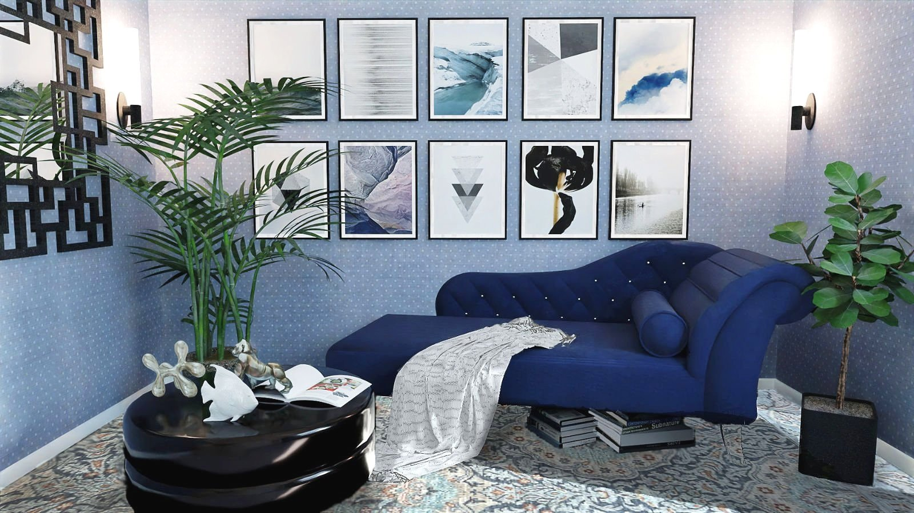
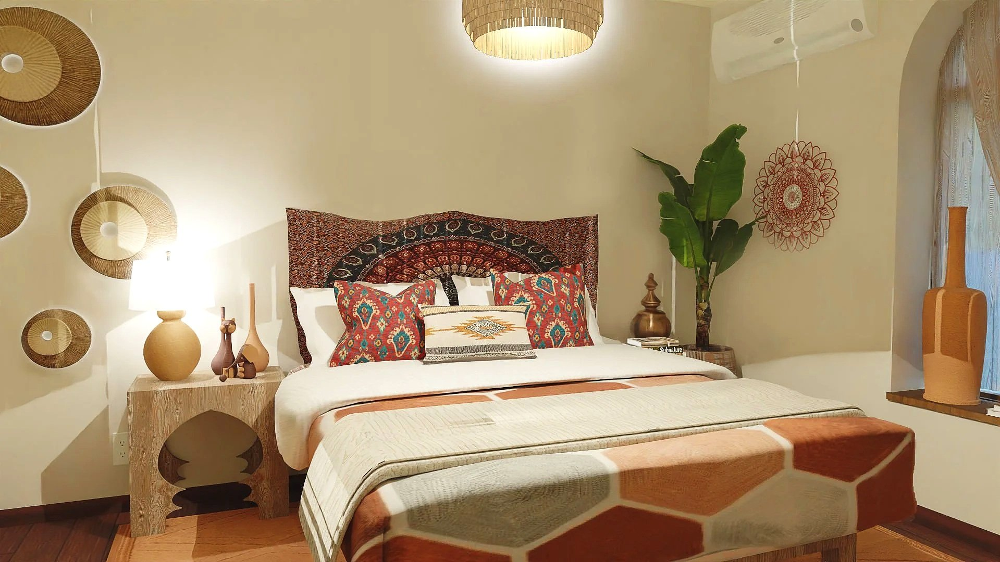
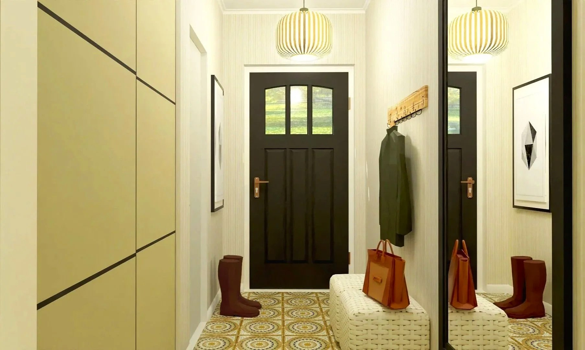
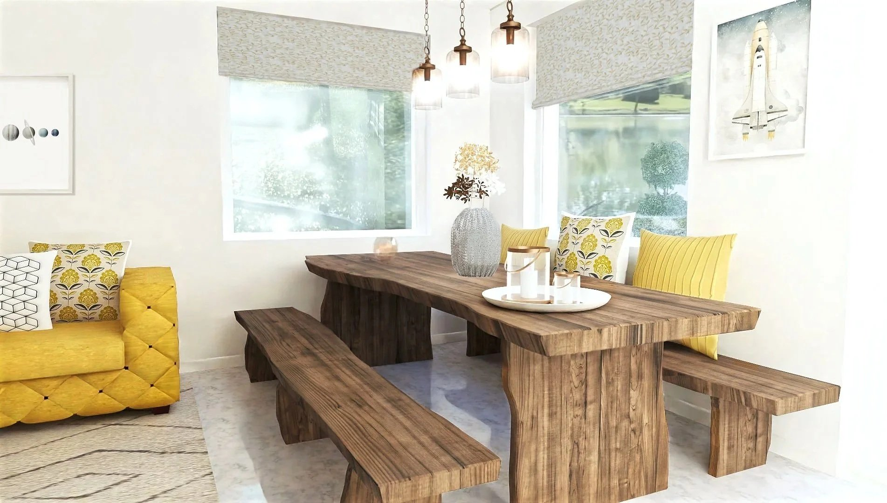
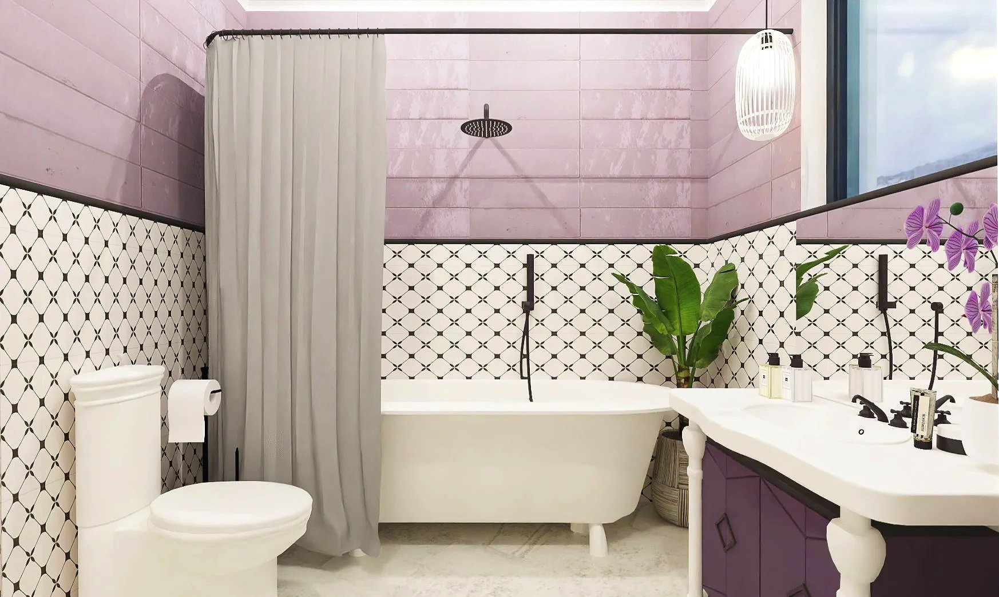

*Have you got a favourite colour you totally love and can’t live without? Maybe it’s a rusty yellow that lifts your spirits, calming shades of blue, or a rich, decadent purple. Do you dream of surrounding yourself with this pretty hue in your home, but lack the know-how?*

<Caption>
Image credit: Staying Cosy
</Caption>

Let me show you how you can pair colours like a pro and breathe new life into even the plainest room. And if you’re working around an already existing hue—finding the right mix of shades, materials, and styles can make all the difference.

## Pick Your Preferred Ratio

Do you like being fully wrapped in one colour, or just adding little pops here and there? There is a solution for every option.

**All in one colour – Monochromatic magic**

When I think of bold, vivid interiors, I always picture the old castles I’ve visited. Each with its own dedicated parlour: a blue one, a green one, even sunny yellow. And when I say blue, I mean *blue*. The wallpaper, the curtains, the upholstery, the carpets, the cushions… *ALL* in one colour tone.

It’s one of the most daring approaches to interior design, completely colour heavy—yet, strangely, it feels incredibly comforting. Like being cocooned in a single mood. Maybe it’s because our brains can relax when there’s only one hue to focus on. Either way, it works; but it’s truly for the brave ones.

**Somewhere in between**

If you’ve fallen for a colour and want to soak your walls in it—go for it! A deep, rich tone on all the trims? A statement burgundy sofa in your living room? Or maybe yellow kitchen cabinets? They all speak: *confidence!*

Just one tip: go easy on the vibrancy. If you’re going bold, either go deeper and moodier, or soften things with off-tones and dusty shades. Super bright colours can overwhelm fast—especially in big doses.

**Colour pops here and there**

Now, this is where vibrant colours really get to shine. In neutral backdrops, small colour moments, like cushions, vases or art, can completely shift the mood. And the best part? You can change it up anytime.

Feeling floral in spring? Blush pink and lilac it is. Want warmth in summer? Hello ochre and coral. Prefer fresh greens for the Christmas season? No problem. A colour-pop approach makes it easy to stay flexible and seasonal without committing to a full makeover.

## Let’s Go Colour!

Now, once you’ve carefully picked your ratio, you may want to dust off some basics of colour matching from school art class; or perhaps, if you’re feeling extra nerdy—consider using a [colour wheel](https://www.amazon.com/Color-Wheel-Company-Interior-interior/dp/B0038N41ZQ/ref=sr_1_2?crid=39AGHF6QQASZG&dib=eyJ2IjoiMSJ9.keBshk6Lq6rcAP-hYR3ikmtfOovfN1hXrJKoJ0bEIupTpI7zEWgMBt2MfC1AS4ZDlI8SW0d94n7tMsuNY0qDttlKcNF0vtiwzaEdYHIQ_PSwVPQHw8mW_nzGYJUzfCOJsjjL-U7l2dTsjJZG_PyjiEWMra4j2fLrjbf1g2c8r9oJ97Glr3FCe_1MBIQf5jq5zH4gNSI8WmtVujjMdbemyUB2vUAcG5X2NsbtumxJaqaBAhCf5JBI4dqZ_700o3u1pnT-6d04zjCWf_x9Ze5QosMcN7cZ0xdK7r90onz3gsg.LnVVcuT3G8l7830_VFGG_MEvk1gNgVP8NFp7xbkI0-A&dib_tag=se&keywords=colour+wheel+interior+design&qid=1754391454&sprefix=color+wheel+interior+desi%2Caps%2C206&sr=8-2).

And what better colour to start with than my personal epitome of staying cosy, right?

### 1. Sage Green – Calm Sophistication

<Caption>
Image credit: Staying Cosy
</Caption>

Among olive green this leafy shade is becoming ever so popular due to its calming and versatile qualities. Sage green is more organic, brings a breath of nature indoors and easily adapts to almost any room. In bright daylight, it looks fresh and gentle. In the evening, under warm lighting, it takes on a soft, cosy elegance. Perfect for bedrooms and bathrooms.

- **Pairs beautifully with:** Warm whites, oatmeal beige, dusty rose, muted terracotta, walnut wood, soft greys, aged brass, brushed nickel, matte leather, marble, cream boucle, rattan.
- **Style it suits best:** Modern Farmhouse, Japandi, Soft Minimalism, English Country, Scandi Vintage.
- **Try it on:** Cabinetry, walls, cotton cushions, [linen curtains](https://www.amazon.com/Jowels-Curtains-Bedroom-Filtering-Elegant/dp/B0DHN7BCDW/ref=sr_1_5?crid=2CH4CGHFZN4VG&dib=eyJ2IjoiMSJ9.cukAR6k3hfEaBhZY5ImKMhC35EYeR83Fu4yuoD3preNwN4pjF_-LQxc-sK7gu_r8PYIopsP5TSmAvp8aPt03zRbWt2oinFRKyzAAtFIJMhWFjwEduDgX0stvQ44BfaEt1DlBeyWDDr5z6o2GYgEsuRAUGIPPxILF52ZwJp4-zKbBcGTkCIEZwVTBGj_WvduNCWH5CI4UqPRVsD1H0TATUAvqhNooDPTo5qtH6M74RE1W9AY-5Cl-EJmJK-uZ9TL1PcPUeESk56mgAeZL45u85VcGf_hl-15jgl_CnkEha9g.Xgw7y_k5MNzzg3gTMUAwyhS4X_fncPqe0KJKqB-rGuI&dib_tag=se&keywords=100%2Blinen%2Bcurtain%2Bgreen%2Bsage&qid=1754391658&sprefix=100%2Blinen%2Bcurtain%2Bgreen%2Bsag%2Caps%2C222&sr=8-5&th=1), bedding, bathroom tiles, lampshades, painted furniture pieces.
- **Avoid:** Overloading with dark or ultra-saturated tones—sage shines best in light, tonal environments with just a touch of contrast.

☘︎ ***A Style Note:***

Sage can fade under cool artificial lighting—choose warm bulbs and layer with natural textures like rattan, wool, or timber to keep it from feeling sterile. Avoid icy blues or stark greys, which can make it appear washed out.

### 2. Warm Neutrals – Soothing & Grounded

<Caption>
Image credit: Staying Cosy
</Caption>

Warm neutrals like stone, sand, mushroom and taupe create a harmonious, lived-in feeling. They work beautifully in layered tones and feel much warmer and more natural than the cold greys of the past decade. These hues offer quiet elegance and adapt effortlessly to different styles and lighting. They’re timeless for a reason—always in style, but never overpowering.

- **Pairs beautifully with:** Olive green, warm whites, dusty pinks, terracotta, brushed bronze, antique gold, rattan, natural linen, light jute, stone, soft blacks, suede.
- **Style it suits best:** Minimalist, Scandinavian, Japandi, Soft Modern, Mediterranean, Transitional.
- **Try it on:** Walls—especially in soft matte finishes, sofas, boucle or linen armchairs, [natural rugs,](https://www.amazon.com/FRELISH-DECOR-Premium-Handwoven-Stripes/dp/B0DTF341T2/ref=sr_1_6?crid=29PZGKTP6XJQ7&dib=eyJ2IjoiMSJ9.RsJKzh4047dozLhIgRtRod0tcSU4pPomhIRId52uRSW3s2-RQMBfjNMfcr8FRvHNzPBXrPSm53E-Z2VMzgWXW2AutXqiy6SsuLaCzgHfAtwPovvt8ow62hDMlysRGXjxD7L7bfJ5OCHjrmTubHKDevEa7rNPSd6sqIDX-C_aPh8rU1z6HZ57ftLG8mmj7XZyB_SZJ22DOe1cA5a0scfz0Up04zOjO_HBq-TgNxvNOJWbj-_9TkHJgl3GA59AqwjWntDtvwiBFv3TilCNNQJvfJkYxFR3GIIopYVfOzVmzBU._Y9ZvCZuKwOLaphIUPxk0M1Z2CEqEOXk_kNE3K3q_k4&dib_tag=se&keywords=natural%2Brug&qid=1754391785&sprefix=natural%2B%2Caps%2C241&sr=8-6&th=1) bedding, curtains, plaster finishes, tiled bathrooms, trim.
- **Avoid:** Pairing with overly cool greys or stark whites, which can make it feel bland or outdated.

☘︎ ***Useful Tip:***

Mix several warm neutral tones together for a layered look. Add interest through texture — raw woods, clay, and soft textiles will keep the space from feeling flat.

### 3. Dusty Pink – Soft Romance with Grown-Up Charm

<Caption>
Image credit: Staying Cosy
</Caption>

Dusty pink conveys a gentle warmth that flatters both cool and warm interiors without tipping into sweetness. It’s romantic yet incredibly versatile—less “*pretty princess*” and more modern luxury. Think sun-faded linen, rose clay walls, or a softened vintage blush. Depending on how it’s styled, dusty pink can feel whimsical, contemporary, or even quietly bold.

- **Pairs beautifully with:** Warm whites, ochre, rust, sage green, soft greys, walnut wood, brass, copper, rose gold, smoky glass, soft cotton, velvet, blush-toned linen, cane, limed wood.
- **Style it suits best:** Boho, Romantic Minimalism, Artful Eclectic, Modern Vintage, French Country.
- **Try it on:** Feature walls, upholstery of velvet or linen, ceramic vases, bedding, curtains, [accent chairs,](https://www.ikea.com/gb/en/p/vedbo-armchair-gunnared-light-brown-pink-00423580/#content) bathroom towels.
- **Avoid:** Extremely glossy finishes, synthetic textures and bright whites, which can make it feel dated or saccharine rather than chic.

☘︎ ***A Style Note:***

To keep it feeling grown-up, pair with earthy tones and tactile textures like boucle or raw wood. Add structure with black or dark metal details to ground the softness.

### 4. Navy Blue – Classic Contrast & Depth

<Caption>
Image credit: Staying Cosy
</Caption>

Navy brings instant structure and elegance to any room. It’s bold yet everlasting, delicate yet pliable. Use it to anchor lighter elements or to create moodier spaces full of depth and contrast. Though dark, it never overwhelms when styled with balance. Works well as a dramatic neutral.

- **Pairs beautifully with:** Crisp white, warm ivory, soft blush, camel, powder blue, deep emerald, shiny brass, polished chrome, natural oak, dark walnut, smoky glass, tan leather, white marble, lacquered finishes, wool, velvet.
- **Style it suits best:** Classic Contemporary, Modern Coastal, Urban Elegance, Luxe Minimalism, Art Deco.
- **Try it on:** Built-in cabinetry, [accent walls,](https://www.grahambrown.com/row/product/glenwhan-wildflower-midnight-wallpaper/127927-master/) velvet sofas, hallway panelling, bed linens, lampshades, powder room ceilings.
- **Avoid:** Pairing navy with too many other darks without contras can feel flat and too heavy if not lifted with light or metallic touches.

☘︎ ***Useful Tip:***

Navy works well under all lighting, but especially sings with warm white bulbs. Soften the boldness with curved forms, soft textiles, and contrasting textures like linen or cane.

### 5. Terracotta – Warm Earthiness

<Caption>
Image credit: Staying Cosy
</Caption>

Terracotta brings in grounded warmth like no other. The colour of clay thrives when paired with natural texture like linen, wool and aged timber. It feels sunbaked and soulful, reminding us of earth, handmade pottery, and aged clay walls. Use it generously in sunlit rooms or layered as an accent in smaller urban spaces that need a touch of depth.

- **Pairs beautifully with:** Muted peach, olive green, rich browns, sandy neutrals, blush pink, soft greys, off-black, aged copper, blackened steel, aged wood, raw clay, wool, jute, plaster, distressed leather.
- **Style it suits best:** Mediterranean, Bohemian, Wabi-Sabi, Desert Modern, Rustic Contemporary.
- **Try it on:** Walls *(lime washed or matte)*, ceramics, tiles, [clay pots,](https://www.amazon.com/Terracotta-Farmhouse-Ceramic-Decorative-Centerpieces/dp/B0DCC4FF5L/ref=sr_1_6?crid=246SEJWV82N0I&dib=eyJ2IjoiMSJ9.QJ5qhxkczP3dyndi55pwjRIjNQnoUPRoR2YpS3D6YsDlGxeDfjtbdkMzThWeNC3qH97SWq8U6_RUNLbAcaRApzgk4sMTih6AlJ7MF_V1fZznJ54isLMwMCNbBopw5ZWOZfGjG7ySyb7JerYzakevdvJ5QaT_SDxL7n2G-64epdJBK7FmHR72Fhr3wqT9ohgCZQNZKtLnFcVq5xk82BQWs8SPk2psieImhJrwmdqg_8ZQeNQvaGaVRU2kZ9RaP8P7gO-HWaWHmUnzFNLLVy7tBTYRpjs58RPG9o0SQpxWwhE.qfpXt4VmZ0juAT_Uec-CS3IQqTGl2NANygzFCwpHCek&dib_tag=se&keywords=clay%2Bvase&qid=1754394225&sprefix=clayvase%2Caps%2C464&sr=8-6&th=1) upholstery, textured throws, large floor cushions, artwork backgrounds.
- **Avoid:** Pairing it with glossy surfaces or sharp neons—it’s meant to feel organic, not flashy.

☘︎ ***A Style Note:***

To avoid it feeling too heavy or dated, keep the finishes matte and balance with airy whites or dusty pastels.

### 6. Charcoal – Bold Without Shouting

<Caption>
Image credit: Staying Cosy
</Caption>

Charcoal is a deep, smoky alternative to pure black. It is just as grounding, but with more depth and subtlety. Ideal for creating contrast, it works well for both—a base colour as well as on accents. Popular in modern interiors for its quiet sophistication, especially kitchens, bathrooms, or window frames. Keeps things elegant and architectural.

- **Pairs beautifully with:** Soft whites, warm neutrals, blush, deep navy, muted olive, steel, blackened metal, warm brass, pale wood, natural leather, concrete, heavy cotton.
- **Style it suits best:** Modern Industrial, Scandinavian, Japandi, Luxe Minimalist, Urban Contemporary
- **Try it on:** Kitchen cabinetry, window frames, metal fixtures, accent walls, ceramics, bedding, matte tiles, [framed art pieces](https://www.amazon.com/VIYYIEA-Vintage-Painting-Bathroom-Friends/dp/B0CBFNTLR6/ref=sr_1_8?crid=O6FDNZGUFVT8&dib=eyJ2IjoiMSJ9.vZNekdU7kDxW4FZ0Vlyo4Id5CH6eY9k6r8lFxPvFvhsqSaGcZ3AnyObbtKm6qjdshQE0Rzqv-qk_UL70KbivFTjNAB07fnpbZ-BBql4mo56y7WEzblL13X5U0xxXsAo5dpjioZWZZaYT2iL1HrxBwDw9oYyHh6Ma1tSFmgHnkpyZDYXMdFIq4aSb1ngoykvhwL6-cKZTA59NpOt6hry-JGyPrDxZMkZkMpyK9RaH6aWrbmKPIbaZctt5B6IiD1dxGpPiuQi6qoRPW7AaJASKqNW3GYPSNxU18eP2Zf9zEWw.TUi3pQeltcHVfsglcoiBhZ6cxr18KPSNw_Fj4oyr_qQ&dib_tag=se&keywords=black%2Bframed%2Bart&qid=1754394284&sprefix=black%2Bframed%2Bar%2Caps%2C271&sr=8-8&th=1).
- **Avoid:** pairing with too many other dark shades unless the space is large and well-lit.

☘︎ ***Useful Tip:***

Use charcoal as a counterpoint to lighter tones—it helps anchor a room and makes softer colours feel more intentional.

### 7. Golden Ochre – Touch of The Sun

<Caption>
Image credit: Staying Cosy
</Caption>

Ochre and mustard bring rich, sun-warmed energy into a room. These glowing tones evoke dried grasses, desert landscapes, and vintage textiles. They’re less flashy than bright yellow but still full of life—perfect for adding a confident, mindful punch of colour with a hint of nostalgia.

- **Pairs beautifully with:** Dusty blue, violet, sage green, charcoal, rust, creamy white, polished copper, vintage bronze, dark walnut, ivory, caramel leather, terracotta tiles, suede, velvet, rattan.
- **Style it suits best:** Mid-Century Modern, Bohemian, Desert Modern, Global Eclectic, Scandinavian.
- **Try it on:** [Velvet cushions,](https://www.wayfair.co.uk/home-decor/pdp/furn-jagger-cotton-cushion-with-filling-u003335660.html?piid=1027558481%2C1027474722) accent chairs, woven wall art, painted furniture, lampshades, patterned rugs, ceramics.
- **Avoid:** Combining with too many other saturated tones, as it can start to feel chaotic rather than warm.

☘︎ ***A Style Note:***

Keep the backdrop calm and let ochre be the *glow* in the room. It works best as a highlight rather than the whole palette.

### 8. Dusty Violet – Rich & Moody

<Caption>
Image credit: Staying Cosy
</Caption>

Dusty violet, mauve, or muted lavender—whatever you call this elegant hue, it’s making a surprising comeback in 2025. At least according to [Minwax](https://www.minwax.com/en/wood-stain-color-guide/color-of-the-year/2025-coty) & [PPG](https://www.ppg.com/en-US/industrialcoatings/color/coty) paint companies. Softer than purple, and moodier than pink, this colour walks the line between warmth and coolness, romance and restraint. It’s beautifully complex, with grey undertones that keep it down to earth and sophisticated. In the right setting, it feels calm, modern, and also a tad sentimental.

- **Pairs beautifully with:** Warm greys, soft taupes, deep aubergine, blush, ivory, powder blue, pale terracotta, aged gold, warm nickel, matte black finish, walnut wood, grey-toned wood, natural linen, antique lace, velvet.
- **Style it suits best:** Parisian Chic, Minimal Glam, Art Deco, Soft Scandinavian, Modern Romantic, Vintage.
- **Try it on:** Velvet or linen upholstery, bedroom walls *(especially in low light),* [bathroom tiles,](https://tile.expert/en-sk/tile/sant-agostino/tetris/a/csatetol05-tetrisorchidluc520?gad_source=1&gad_campaignid=21197310699&gbraid=0AAAAADehUiv7DaIdpzEMA1UnEDtHiyxpM&gclid=EAIaIQobChMItYDuvs7zjgMVCgqiAx0v1ydyEAQYASABEgKcCvD_BwE) ceramic vases, abstract art, bedding layers, powder room wallpaper, painted trim.
- **Avoid:** Pairing it with overly saturated purples or stark whites. It works best in layered, toned-down palettes that highlight its subtlety.

☘︎ ***Useful Tip:***

To stop it from feeling too sweet or old-fashioned, ground it with raw textures, like limewash, matte stone, or blackened steel. And don’t be afraid to treat it like a neutral — it plays well with more materials than you'd think.

**There you have it — the most-loved and trendiest colours, all in one place.**

*So let’s furnish, layer, and play.* Your home is your canvas, and this guide gives you a grounded place to start from. Use colour wisely — it’s one of the most powerful and affordable tools in your design toolkit.

---

---

---
